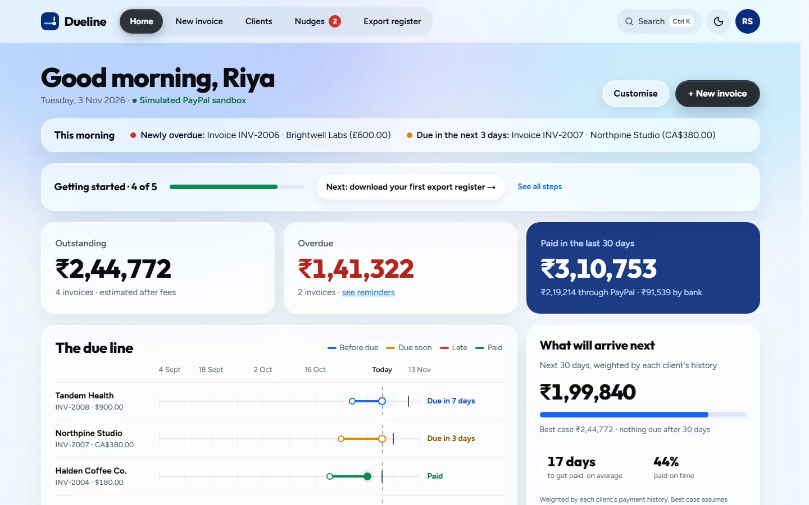
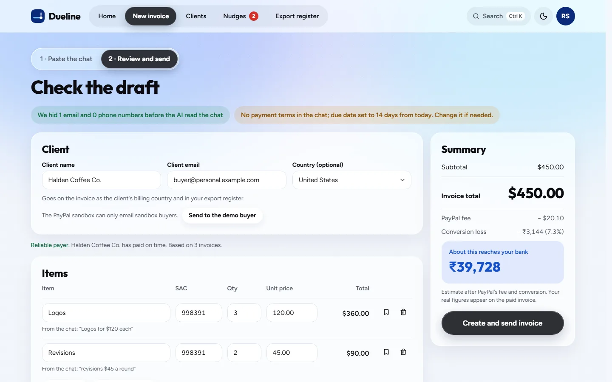
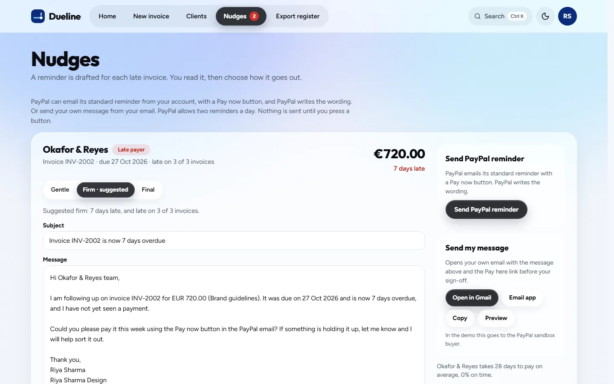
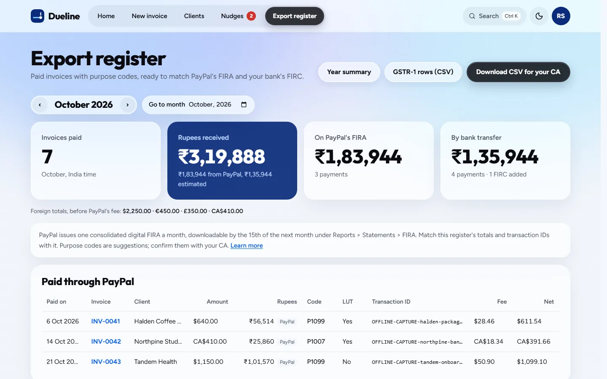

<div align="center">


# Dueline

### Get paid from abroad. Without chasing.

PayPal invoicing, AI drafting and export paperwork for freelancers in India
who are paid by clients abroad.

[](https://dueline-azure.vercel.app)
[](https://www.youtube.com/watch?v=VIDEO_ID)

[](https://github.com/rishibhaskar777/dueline/actions/workflows/ci.yml)
[](LICENSE)


**[Try the demo](#for-judges)** · **[Watch the video](https://www.youtube.com/watch?v=VIDEO_ID)** · **[How it works](#how-it-works)** · **[Architecture](#architecture)** · **[Run it locally](#run-it-yourself)**

</div>

<br>

<p align="center">
  
</p>

<p align="center"><sub>The 30-second story above loops. If your browser hides animation, it shows the finished Dueline screen.</sub></p>

## For Judges

|                          |                                                                              |
| ------------------------ | ---------------------------------------------------------------------------- |
| **Live demo**            | [dueline-azure.vercel.app](https://dueline-azure.vercel.app)                 |
| **Password**             | In the testing instructions of the Devpost submission                        |
| **No accounts or keys?** | Run the offline mode locally, password `offline` ([steps](#run-it-yourself)) |
| **Video**                | [3-minute walkthrough on YouTube](https://www.youtube.com/watch?v=VIDEO_ID)  |
| **PayPal**               | Runs on the PayPal sandbox, so you can send and pay invoices safely          |
| **Built**                | Entirely during the hackathon, from 29 Oct 2026 ([changelog](CHANGELOG.md))  |

**A two-minute path through every feature**

1. **Home.** Each invoice is a line from the day it was sent to the day it was paid. Late ones turn red.
2. **Clients behind.** Open a late client to see how often they paid late and the tone Dueline suggests.
3. **New invoice → Use a sample chat → Draft invoice.** Every line quotes the chat, and the summary shows the rupees that reach the bank.
4. **Nudges.** Switch Gentle, Firm and Final, then Preview. Nothing is sent until you press a button.
5. **Export register.** Go to the previous month and download the CSV for a CA.
6. **Account menu → Fees and rates.** What a $1,000 invoice really pays after PayPal's fee and conversion.
7. **Account menu → Demo tools → Reset the demo.** Rebuilds the story with dates counted back from today.

**Where to find each judging criterion**

| Criterion                    | Where it shows                                                                                                                                                  |
| ---------------------------- | --------------------------------------------------------------------------------------------------------------------------------------------------------------- |
| Technological implementation | [PayPal](#paypal) (thirteen API calls and verified webhooks), [AI](#ai) (masked input, checks in code, a measured evaluation), [quality](#quality-and-security) |
| Design                       | [Screens](#what-dueline-does), [design and accessibility](#design-and-accessibility)                                                                            |
| Potential impact             | [The problem](#the-problem) and what reaches the bank on a real $1,000 invoice                                                                                  |
| Innovation                   | The due line, rupees before sending, quote-checked AI drafts, a two-channel reminder                                                                            |
| Presentation                 | [The 3-minute video](https://www.youtube.com/watch?v=VIDEO_ID) and the animations in this README                                                                |

## The Problem

Many freelancers in India are paid by clients abroad through PayPal. Three things go wrong every
month.

- **The rupees are a surprise.** PayPal India charges 4.40% plus a fixed fee on international
  commercial payments and adds a 3.0% markup when it converts to rupees
  ([PayPal India fees](https://www.paypal.com/in/webapps/mpp/merchant-fees), see
  [decision 0007](docs/decisions/0007-fees-and-rates.md)). On a $1,000 invoice that is about
  7.3%, and the freelancer only learns the rupee figure after the money lands.
- **Chasing feels awkward.** Late clients are rarely chased on time, so the same clients stay late.
- **The paperwork is manual.** Export of services needs a purpose code per payment, a LUT line on
  the invoice, and PayPal's monthly FIRA or a bank FIRC matched to every payment for the CA.

## What Dueline Does

| Feature              | What it does                                                                                                           | Where                           |
| -------------------- | ---------------------------------------------------------------------------------------------------------------------- | ------------------------------- |
| **Rupee truth**      | Shows what reaches the bank after PayPal's fee and conversion before you send, then PayPal's own figures after payment | New invoice, Home, invoice page |
| **Chat to invoice**  | Paste a client chat; Gemini drafts the PayPal invoice and every line quotes the words it came from                     | New invoice                     |
| **The due line**     | Every invoice as a line from sent to paid, so late payments stand out at a glance                                      | Home                            |
| **Late-payer radar** | Scores each client from their history, in plain words: "Late on 3 of 3 invoices, 12 days on average"                   | Home, Clients, New invoice      |
| **Nudges**           | Drafts the reminder in the right tone and language; send PayPal's reminder, your own email, or both                    | Nudges                          |
| **Morning run**      | A daily job prepares reminder drafts, monthly repeats and rate alerts; you approve each one                            | Nudges, Home                    |
| **Export register**  | Monthly CSV with purpose codes, LUT, transaction IDs and FIRC numbers, matched to PayPal's FIRA                        | Export register                 |
| **GST and tax**      | GSTIN, LUT ARN and SAC on every invoice, GSTR-1 rows, and a year summary for presumptive tax (44ADA)                   | Profile, Export register        |
| **Cash forecast**    | Rupees expected in 30, 60 and 90 days, weighted by each client's history                                               | Home                            |

<table>
  <tr>
    <td width="50%"><br><sub><b>Home.</b> Totals in rupees, the due line, the forecast and clients behind.</sub></td>
    <td width="50%"><br><sub><b>New invoice.</b> Drafted from a chat, every line quoted, rupees shown before sending.</sub></td>
  </tr>
  <tr>
    <td width="50%"><br><sub><b>Nudges.</b> The tone follows the client's history. Two ways to send.</sub></td>
    <td width="50%"><br><sub><b>Export register.</b> One file a month for the CA, matched to FIRA and FIRC.</sub></td>
  </tr>
</table>

## How It Works

### PayPal

Dueline is built on the PayPal developer platform. The freelancer's client pays on PayPal's own
page, and Dueline never sees a card or bank number.

| PayPal API         | Endpoint                                          | What Dueline does with it                                                                     |
| ------------------ | ------------------------------------------------- | --------------------------------------------------------------------------------------------- |
| OAuth 2.0          | `POST /v1/oauth2/token`                           | Client-credentials token, cached until it expires                                             |
| Invoicing v2       | `POST /v2/invoicing/generate-next-invoice-number` | Numbers each invoice                                                                          |
| Invoicing v2       | `POST /v2/invoicing/invoices`                     | Creates the invoice with GSTIN, LUT, SAC, purpose code and an optional early-payment discount |
| Invoicing v2       | `POST /v2/invoicing/invoices/{id}/send`           | Sends it to the client                                                                        |
| Invoicing v2       | `POST /v2/invoicing/invoices/{id}/remind`         | Sends PayPal's reminder from Nudges                                                           |
| Invoicing v2       | `POST /v2/invoicing/invoices/{id}/cancel`         | Cancels it, after an in-page confirmation                                                     |
| Invoicing v2       | `DELETE /v2/invoicing/invoices/{id}`              | Deletes a draft when the demo is reset                                                        |
| Invoicing v2       | `POST /v2/invoicing/invoices/{id}/payments`       | Records a bank transfer received outside PayPal                                               |
| Invoicing v2       | `GET /v2/invoicing/invoices`                      | Reads every invoice and its status                                                            |
| Invoicing v2       | `GET /v2/invoicing/invoices/{id}`                 | Reads one invoice fresh after a webhook or an action                                          |
| Payments           | `GET /v2/payments/captures/{id}`                  | Reads the capture behind a paid invoice                                                       |
| Transaction Search | `GET /v1/reporting/transactions`                  | Reads the real fee and net amount                                                             |
| Webhooks           | `POST /v1/notifications/verify-webhook-signature` | Verifies every webhook before acting on it                                                    |

Any invoice event (`INVOICING.INVOICE.*`) makes Dueline read that invoice again from PayPal, and paid and
sent events also add to the activity feed. Each event is processed once, and the daily job reconciles any payment a missed webhook would have dropped.

PayPal writes its own reminder wording, so Nudges also offers **Send my message**: the drafted text
in the freelancer's own email, with the PayPal pay link before the sign-off.

### AI

Dueline uses Google Gemini through the AI SDK, with a fallback model for busy periods. The AI drafts;
a person approves. It never sends anything on its own.

**Invoice drafting**

- Emails and phone numbers are masked before the chat reaches the model.
- Every item must quote the chat word for word, and every price must appear in the chat.
- Quantities, prices, totals and dates are checked in code. Anything unclear becomes a warning to fix, never a guess.
- Text in the chat that tries to instruct the model is flagged as a prompt injection.
- Accuracy on 25 test chats, run with `npm run ai:eval` ([full results](docs/evaluation/extraction.md)):

| Check                                 | Result |
| ------------------------------------- | ------ |
| Client found                          | 100%   |
| Prices right                          | 96%    |
| Due date rule                         | 100%   |
| Warnings raised when expected         | 100%   |
| Prompt injection flagged              | 100%   |
| Emails and phones kept from the model | 100%   |

**Reminder drafting.** The tone (gentle, firm, final) comes from the client's payment history, a
second check confirms the draft matches that tone, and reminders can be written in English, Hindi,
German, French, Spanish, Dutch or Portuguese. Built-in templates take over if the model is unavailable.

### The Morning Run

Every day at 06:00 India time a Vercel cron calls `GET /api/cron/daily`. On its own, it prepares
reminder drafts for newly late invoices, the month's repeat invoices, triggered rate alerts and a
reconciliation of payments. Everything lands in **Today** on Nudges. Nothing leaves until the
freelancer presses a button.

### AG Grid

The invoice table on Home and the PayPal and bank tables in the export register use AG Grid:
custom cell renderers for invoice links, status pills and the FIRC field, sorting, and a theme built
from Dueline's own design tokens so it follows light and dark mode. Home adds quick-filter search
and opening a row with the keyboard; the export register folds the transaction ID column into the
client column on narrower screens.

## Architecture

<p align="center">
  
</p>

<p align="center"><sub>The diagram plays the life of one invoice in eight steps, from a pasted chat to the rupees on Home. It loops every 24 seconds.</sub></p>

<details>
<summary><b>The eight steps in words</b></summary>

1. The freelancer pastes a client chat into New invoice.
2. The chat goes to Gemini with emails and phone numbers masked.
3. A draft comes back, and Dueline checks every line, price and date in code.
4. Dueline creates and sends the invoice through PayPal Invoicing v2.
5. The client pays on PayPal's own page, by card or PayPal balance.
6. PayPal's webhook arrives, and Dueline verifies its signature before acting.
7. Transaction Search returns the real fee and the net amount.
8. Home, the due line and the export register show what reached the bank. If a webhook never arrives, the next morning run records the payment once.

</details>

| Layer      | Choice                                                                 |
| ---------- | ---------------------------------------------------------------------- |
| App        | Next.js 16 (App Router, Cache Components), React 19, TypeScript strict |
| Styling    | Tailwind CSS 4, Base UI, Outfit and Figtree fonts                      |
| Tables     | AG Grid                                                                |
| Payments   | PayPal Server SDK and a typed Invoicing v2 client                      |
| AI         | AI SDK with Google Gemini                                              |
| Validation | Zod                                                                    |
| Data       | Neon Postgres, or in memory when no database is set                    |
| Rates      | European Central Bank via Frankfurter                                  |
| Hosting    | Vercel with a daily cron                                               |
| Tests      | Vitest, Playwright, axe                                                |
| CI         | GitHub Actions, CodeQL, Dependabot                                     |

## Design and Accessibility

- A complete product, not a prototype: a public website, a demo sign-in, and ten app screens in one design language.
- Light and dark themes, with 4.5:1 text contrast checked by a unit test.
- Automated axe checks on every screen in both themes.
- Full keyboard use, visible focus rings, and a command palette (Ctrl K).
- Phone layouts tested at 390 px with no sideways scroll.
- Reduced motion respected everywhere, including the animations in this README.

## Quality and Security

|                  |                                                                                                      |
| ---------------- | ---------------------------------------------------------------------------------------------------- |
| Unit tests       | 1,730 in 146 files (Vitest)                                                                          |
| End-to-end tests | 119 (Playwright), including axe in both themes                                                       |
| CI               | Format, lint, typecheck, tests, build and end-to-end tests on every pull request; CodeQL; Dependabot |
| Decisions        | [23 decision records](docs/decisions/) and an [API contract](docs/api-contract.md)                   |
| Access           | Demo password with a signed session and sign-in limits                                               |
| Safety           | Verified webhooks, idempotent writes, a strict Content Security Policy, no secrets in the repository |

## Run It Yourself

**Offline mode, no accounts or keys.** PayPal and the AI are simulated, so every screen works.

```bash
git clone https://github.com/rishibhaskar777/dueline.git
cd dueline
npm ci
npm run dev:offline
```

Open http://localhost:3000 and sign in with the password `offline`.

**Full sandbox mode.**

1. Node.js 24 and a [PayPal developer](https://developer.paypal.com/) sandbox app (client ID and secret).
2. A webhook on that app pointing at `https://<your-host>/api/webhooks/paypal` with the Invoicing invoice events.
3. A Gemini API key from Google AI Studio.
4. Optional: a Neon Postgres database. Without one, data is kept in memory.
5. Copy `.env.example` to `.env.local` and fill it in (each setting is explained there), then run
   the migration only if you set a database:

```bash
npm run db:migrate
npm run seed
npm run dev
```

<details>
<summary><b>Scripts</b></summary>

| Script                                                               | What it does                                  |
| -------------------------------------------------------------------- | --------------------------------------------- |
| `npm run dev` / `npm run dev:offline`                                | Start the app, live or offline                |
| `npm run build` / `npm start`                                        | Build and run for production                  |
| `npm test` / `npm run test:e2e`                                      | Unit tests / end-to-end tests                 |
| `npm run lint` / `npm run typecheck`                                 | ESLint / TypeScript                           |
| `npm run db:migrate` / `npm run seed`                                | Database migrations / sandbox seed            |
| `npm run sandbox:check` / `npm run ai:check` / `npm run rates:check` | Check the PayPal, Gemini and rate connections |
| `npm run ai:eval`                                                    | Re-run the extraction accuracy test           |

</details>

## Built During the Hackathon

Dueline was started on 29 Oct 2026, inside the PayPal AI Hackathon 2026 submission period, and
everything in this repository was built for it. The [changelog](CHANGELOG.md) and the
[decision records](docs/decisions/) follow the work step by step.

## Limits and What Is Next

**Today:** runs on the PayPal sandbox; one PayPal business account for the demo; rupee figures before payment are
estimates; purpose codes and GSTR-1 values are suggestions to confirm with a CA.

**Next:** PayPal partner onboarding so each freelancer connects their own account; INR payout figures
when PayPal reports them; more reminder languages; a share sheet to send a chat to Dueline from a phone.

## Team

<table>
  <tr>
    <td width="50%" valign="top">
      <b>Rishi Bhaskar</b><br><sub>Engineering</sub><br><br>
      PayPal integration: Invoicing v2, webhooks and Transaction Search<br>
      The AI drafting pipeline and its checks in code<br>
      Data, API routes and the daily job<br>
      Tests, CI and the hosted demo
    </td>
    <td width="50%" valign="top">
      <b>Nitin Mittal</b><br><sub>Product and design</sub><br><br>
      Research with freelancers and the problem definition<br>
      Export rules: FIRA, FIRC, purpose codes, GST, LUT and 44ADA<br>
      The product design, screens and demo story<br>
      The demo video and the submission
    </td>
  </tr>
</table>

Both of us shaped the feature scope, reviewed every change and tested the demo end to end on the
PayPal sandbox.

---

<p align="center">
<a href="docs/architecture.md">Architecture</a> ·
<a href="docs/api-contract.md">API contract</a> ·
<a href="docs/decisions/">Decision records</a> ·
<a href="docs/evaluation/extraction.md">AI evaluation</a> ·
<a href="CONTRIBUTING.md">Contributing</a> ·
<a href="SECURITY.md">Security</a> ·
<a href="LICENSE">MIT licence</a>
<br><br>
<sub>© 2026 Rishi Bhaskar and Nitin Mittal · Built for the PayPal AI Hackathon 2026 · PayPal is a trademark of PayPal, Inc.</sub>
</p>
