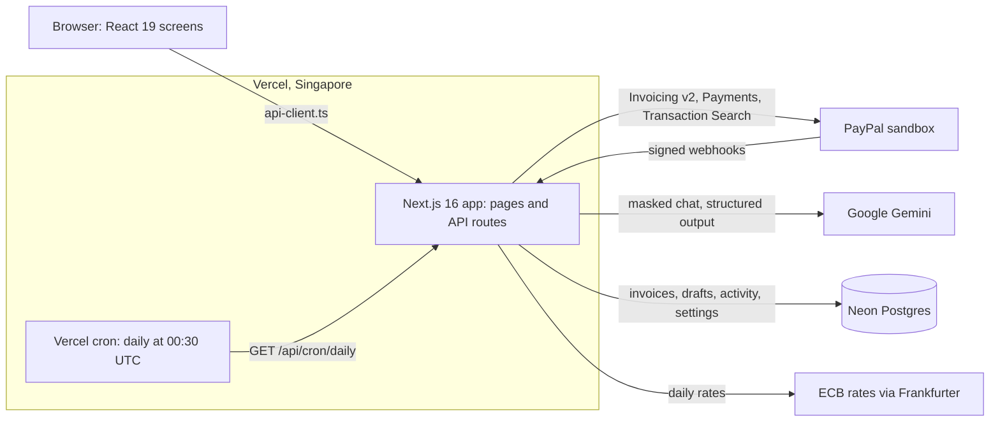

# Dueline

**Get paid by clients abroad without chasing them.**

Dueline is for freelancers in India who are paid by clients abroad through PayPal.

[](https://github.com/rishibhaskar777/dueline/actions/workflows/ci.yml)
[](LICENSE)
[](https://dueline-azure.vercel.app)

<p align="center">
  
</p>

<table>
  <tr>
    <td width="33%"></td>
    <td width="33%"></td>
    <td width="33%"></td>
  </tr>
</table>

The screenshots come from the offline mode (see below), which uses a simulated PayPal.

## Try it in two minutes

Open the live demo: **https://dueline-azure.vercel.app**

The password is in the testing instructions of the Devpost submission. Everything runs on the PayPal
sandbox, so no real money moves, and every invoice goes to a PayPal sandbox buyer only.

A path that shows each main feature:

1. **Home.** Read the due line: each invoice is one line from the day it was sent to the day it was
   paid, and late ones stand out in red.
2. **Open a late client** under "Clients behind". See how often they paid late and the reminder tone
   Dueline suggests.
3. **New invoice.** Choose "Use a sample chat", then "Draft invoice". Read the words each item came
   from and the rupees that will reach your bank. Use "Send to the demo buyer" if you send it.
4. **Nudges.** Switch the tone between gentle, firm and final, then choose "Preview" on the email.
   Nothing is sent until you press a button.
5. **Export register.** Go to the previous month and choose "Download CSV for your CA".
6. **Fees and rates** (account menu). Try the calculator: what a $1,000 invoice pays after PayPal's
   fee and conversion.
7. **Demo tools** (account menu), then "Reset the demo". It rebuilds the story with dates counted
   back from today.

To run it on your own computer with no accounts and no keys, use the offline mode
([how](#run-it-yourself)). Its password is `offline`.

## The problem

PayPal India's published fees for international commercial payments are 4.40% plus a fixed fee (USD
0.30), and PayPal adds a 3.0% markup over the base exchange rate when it converts the money to
rupees ([PayPal India fees](https://www.paypal.com/in/webapps/mpp/merchant-fees), checked on 29 Oct
2026; see [decision 0007](docs/decisions/0007-fees-and-rates.md)). Together they take about 7.3
percent of a $1,000 invoice, and a freelancer only learns the rupee figure after the money arrives.
PayPal issues one digital FIRA a month ([PayPal's guide](https://www.paypal.com/in/brc/article/paypal-monthly-digital-firc)),
so an accountant has to match each payment by hand. Dueline shows the rupees before the invoice is
sent, keeps the export paperwork ready, and drafts the reminders that late clients need.

## What Dueline does

| Feature                          | What it does                                                                                                                                                       | Where                                     |
| -------------------------------- | ------------------------------------------------------------------------------------------------------------------------------------------------------------------ | ----------------------------------------- |
| Rupee truth                      | Shows what will reach your bank before you send, as an estimate, and PayPal's own fee and net after the invoice is paid.                                           | New invoice, invoice page, Fees and rates |
| Late-payer radar                 | Scores each client from their history and offers an early-payment discount through PayPal.                                                                         | Home, Clients, New invoice                |
| Nudges, two channels             | Drafts a reminder in a tone that fits the client. Send PayPal's reminder, or your own message from your email.                                                     | Nudges                                    |
| Chat to invoice                  | Reads a pasted client chat and drafts an invoice, with the words each item came from.                                                                              | New invoice                               |
| Due line                         | Draws every invoice as a line from sent to paid.                                                                                                                   | Home                                      |
| Cash forecast                    | Shows what should arrive in the next 30, 60 and 90 days, weighted by each client's history.                                                                        | Home ("What will arrive next")            |
| Export register                  | Lists each month's payments with purpose code, LUT and transaction ID, matched to PayPal's FIRA, and bank transfers with the bank's FIRC number. Downloads as CSV. | Export register                           |
| GST details and GSTR-1 rows      | Prints GSTIN, LUT ARN, SAC and place of supply on invoices and exports GSTR-1 rows.                                                                                | Profile, Export register                  |
| Year summary for 44ADA           | Adds up the financial year's receipts for presumptive taxation.                                                                                                    | Export register ("Year summary")          |
| Morning preparation              | Writes reminder drafts, monthly repeat invoices and rate alerts each morning.                                                                                      | Home ("This morning"), Nudges ("Today")   |
| Command palette and keyboard use | Ctrl+K opens a search for pages, clients, invoices and actions. "?" lists the shortcuts.                                                                           | Every screen                              |

## How it uses PayPal

Everything runs against the PayPal sandbox. The app refuses to start with any other environment.

| Capability                      | Call                                                                            | What Dueline does with it                                                                                                                                                                                 | Source                                                |
| ------------------------------- | ------------------------------------------------------------------------------- | --------------------------------------------------------------------------------------------------------------------------------------------------------------------------------------------------------- | ----------------------------------------------------- |
| OAuth token                     | `POST /v1/oauth2/token`                                                         | Gets and caches the access token.                                                                                                                                                                         | [token.ts](src/lib/paypal/token.ts)                   |
| Invoicing v2: next number       | `POST /v2/invoicing/generate-next-invoice-number`                               | Numbers each new invoice.                                                                                                                                                                                 | [invoices.ts](src/lib/paypal/invoices.ts)             |
| Invoicing v2: create            | `POST /v2/invoicing/invoices`                                                   | Saves the draft first, with the purpose code and SAC in its private memo.                                                                                                                                 | [invoices.ts](src/lib/paypal/invoices.ts)             |
| Invoicing v2: send              | `POST /v2/invoicing/invoices/{id}/send`                                         | Sends the saved draft after you click. A failed send is retried on the same draft.                                                                                                                        | [invoices.ts](src/lib/paypal/invoices.ts)             |
| Invoicing v2: remind            | `POST /v2/invoicing/invoices/{id}/remind`                                       | Sends PayPal's reminder when you press the button.                                                                                                                                                        | [invoices.ts](src/lib/paypal/invoices.ts)             |
| Invoicing v2: cancel and delete | `POST /v2/invoicing/invoices/{id}/cancel`, `DELETE /v2/invoicing/invoices/{id}` | Cancels an invoice on request; the demo reset also deletes drafts.                                                                                                                                        | [invoices.ts](src/lib/paypal/invoices.ts)             |
| Invoicing v2: record payment    | `POST /v2/invoicing/invoices/{id}/payments`                                     | Records a payment made outside PayPal, such as a bank transfer.                                                                                                                                           | [invoices.ts](src/lib/paypal/invoices.ts)             |
| Invoicing v2: get and list      | `GET /v2/invoicing/invoices/{id}`, `GET /v2/invoicing/invoices`                 | Reads invoices. PayPal's state is the truth.                                                                                                                                                              | [invoices.ts](src/lib/paypal/invoices.ts)             |
| Payments: capture               | `GET /v2/payments/captures/{capture_id}`                                        | Reads the real fee, net amount and any rupee figure for a paid invoice.                                                                                                                                   | [payments.ts](src/lib/paypal/payments.ts)             |
| Transaction Search              | `GET /v1/reporting/transactions`                                                | Reads the fee and date when no capture is available.                                                                                                                                                      | [payments.ts](src/lib/paypal/payments.ts)             |
| Webhook signature check         | `POST /v1/notifications/verify-webhook-signature`                               | Verifies every webhook with the exact received headers and raw body.                                                                                                                                      | [webhooks.ts](src/lib/paypal/webhooks.ts)             |
| Webhook events                  | `POST /api/webhooks/paypal` (our route)                                         | Handles `INVOICING.INVOICE.*`: each event triggers a fresh read of the invoice, `PAID` also stores PayPal's payout figures, and `PAID` and `SENT` add a row to Activity. Each event ID is processed once. | [webhook-events.ts](src/lib/paypal/webhook-events.ts) |

PayPal writes the wording of its own reminder, so Nudges also offers "Send my message" from your own
email. The demo uses one sandbox business account; onboarding many freelancers through PayPal's
partner programme is the next step.

## How it uses AI

Dueline uses Google Gemini through the AI SDK. The primary model is `gemini-3.5-flash-lite` and the
fallback is `gemini-3.1-flash-lite` (set with `GEMINI_MODEL` and `GEMINI_FALLBACK_MODEL`). The
fallback is used when the first model is out of quota or does not answer.

**Invoice drafting** ([decision 0010](docs/decisions/0010-ai-invoice-drafting.md)):

- Emails and phone numbers are found by code and replaced with placeholders before the model sees
  the chat. Code puts them back in the draft.
- Every item must quote the chat. Quantities, prices, totals, currency and dates are checked and
  worked out in code.
- A gap or a doubtful price becomes a warning for you, never a guess.
- Text in the chat that looks like an instruction to the AI is flagged and treated as data.

Results over 25 test chats ([full report](docs/evaluation/extraction.md), run on 2026-11-03 with
`gemini-3.5-flash-lite`):

| Check                                 | Passed   | Share |
| ------------------------------------- | -------- | ----- |
| Client                                | 24 of 24 | 100%  |
| Currency                              | 24 of 24 | 100%  |
| Country kept only when stated         | 1 of 1   | 100%  |
| Items exactly right                   | 21 of 25 | 84%   |
| Prices right                          | 24 of 25 | 96%   |
| Due date rule                         | 24 of 24 | 100%  |
| Warnings raised when expected         | 16 of 16 | 100%  |
| Injection flagged                     | 1 of 1   | 100%  |
| Emails and phones kept from the model | 25 of 25 | 100%  |

**Reminder drafting:** the tone (gentle, firm or final) is chosen from how late the invoice is, how
many reminders were sent and how the client has paid before. A check rejects a draft whose wording
does not fit its tone. Reminders can be written in English, German, French, Spanish, Dutch,
Portuguese and Hindi. If the AI is busy or out of quota, a built-in template is used and the card
says so.

**The AI never sends anything.** It only fills drafts. A person approves every invoice and every
reminder.

## The morning run (agentic, with a person in charge)

Once a day Vercel calls `GET /api/cron/daily` (`30 0 * * *`, which is 06:00 in India). The route is
protected by `CRON_SECRET`. The run prepares work on its own:

- reminder drafts for invoices that are late enough,
- the next invoice of each monthly repeat,
- rate alerts you set,
- and, in the demo, a fresh story when the old one is a week old.

It puts the result in **Today** on Nudges and in **This morning** on Home. Nothing leaves until the
freelancer presses a button: the run only writes drafts and queue entries, and never calls PayPal to
send. It also adds the activity row for any PayPal payment whose webhook was missed.

## Built with AG Grid

Dueline uses AG Grid Community 36 for its three data tables.

| Where                                  | File                                                                                                                                   |
| -------------------------------------- | -------------------------------------------------------------------------------------------------------------------------------------- |
| Invoice table on Home                  | [InvoiceTable.tsx](src/components/receivables/InvoiceTable.tsx), [invoice-columns.tsx](src/components/receivables/invoice-columns.tsx) |
| Export register, "Paid through PayPal" | [RegisterTable.tsx](src/components/export/RegisterTable.tsx), [register-columns.tsx](src/components/export/register-columns.tsx)       |
| Export register, "Bank transfers"      | [BankTransfers.tsx](src/components/export/BankTransfers.tsx), [bank-columns.tsx](src/components/export/bank-columns.tsx)               |
| Module registration and theme          | [ag-grid.ts](src/components/grid/ag-grid.ts)                                                                                           |

- **Custom cell renderers** draw invoice links, status pills, the PayPal link and the editable bank
  reference field.
- **Quick filter** searches client, invoice and work, including columns that are hidden.
- **Sorting** on every column.
- **Theming** uses the Theming API (`themeQuartz.withParams`) with the app's own design tokens, so
  the grids follow the light and dark themes.
- **Keyboard row opening:** Enter on a row opens the invoice.
- **Responsive columns:** the register hides the LUT and Fee columns under 1280 px, and on a phone
  Home swaps the table for cards.

## Architecture



| Area       | Choice                                                        |
| ---------- | ------------------------------------------------------------- |
| Hosting    | Vercel Hobby (functions in Singapore) and Neon free tier      |
| Runtime    | Node.js 24                                                    |
| Framework  | Next.js 16 (App Router, Cache Components), React 19           |
| Language   | TypeScript 5.9, strict                                        |
| Styling    | Tailwind CSS 4, shadcn/ui, lucide-react                       |
| Tables     | AG Grid 36                                                    |
| PayPal     | PayPal Server SDK 2 and a small typed client for Invoicing v2 |
| AI         | AI SDK 7 with Google Gemini                                   |
| Validation | Zod 4                                                         |
| Data       | Neon Postgres, or in memory when no database is set           |
| Rates      | Frankfurter (European Central Bank), cached once a day        |
| Tests      | Vitest 5, Playwright with axe                                 |

More in [docs/architecture.md](docs/architecture.md).

## Design and accessibility

- A frosted-glass design in a light and a dark theme, with Outfit and Figtree fonts.
- One `h1` on every page. Everything works from the keyboard, with visible focus rings.
- Motion is switched off when the system asks for reduced motion.
- Text contrast of 4.5:1 is checked by a unit test ([palette.test.ts](tests/unit/palette.test.ts)).
- axe checks every screen in both themes in the end-to-end tests
  ([accessibility.spec.ts](tests/e2e/accessibility.spec.ts)).
- Phone layouts are tested at 390 px ([phones.spec.ts](tests/e2e/phones.spec.ts)).
- A strict Content Security Policy, tested in [csp.spec.ts](tests/e2e/csp.spec.ts).

## Quality

- **Tests:** 1,730 unit tests in 146 files (Vitest) and 119 end-to-end tests
  (Playwright with axe), run against a production build in offline mode.
- **CI** runs on every push: format check, lint, typecheck, tests, build and the end-to-end suite,
  plus CodeQL and Dependabot.
- **Documentation:** 23 [decision records](docs/decisions/), the [API contract](docs/api-contract.md)
  and the [architecture](docs/architecture.md).
- **Security:** a demo password with a signed session cookie; rate limits on sign-in, AI calls and
  the demo reset; webhooks verified with PayPal; every create and send carries a request ID that the
  server stores once, so a repeat returns the first result; secrets only in environment variables
  and only in server code. See [SECURITY.md](SECURITY.md).

## Run it yourself

You need Node.js 24.

### Offline: no accounts, no keys

```bash
git clone https://github.com/rishibhaskar777/dueline.git
cd dueline
npm ci
npm run dev:offline
```

Open http://localhost:3000 and sign in with the password `offline`. Offline mode uses a simulated
PayPal, built-in reminder templates, saved exchange rates and data in memory. Every screen works. It
is refused on Vercel and in production.

### Full sandbox

1. Create a PayPal developer sandbox app and note its client ID and secret. Note the "US Personal"
   sandbox account that will pay the invoices; its email ends in `@personal.example.com`.
2. Create a Gemini API key in Google AI Studio.
3. Optional: create a free Neon database and copy its pooled connection string. Without one, data
   stays in memory.
4. Copy the settings file and fill it in:

   ```bash
   cp .env.example .env.local
   npm run db:migrate   # only with DATABASE_URL
   npm run seed         # builds the demo story, needs SANDBOX_BUYER_EMAIL
   npm run dev
   ```

5. To receive payments, add a webhook to your sandbox app that points at
   `https://<your-domain>/api/webhooks/paypal` and select the Invoicing events (created, sent, paid,
   cancelled, refunded, updated, scheduled). Put its ID in `PAYPAL_WEBHOOK_ID`. Webhooks need a
   public address, so this step is for a deployment.

[CONTRIBUTING.md](CONTRIBUTING.md) has the full setup, including the checks `sandbox:check` and
`ai:check`.

### Environment variables

| Name                    | Needed for     | What it is                                                                               |
| ----------------------- | -------------- | ---------------------------------------------------------------------------------------- |
| `PAYPAL_CLIENT_ID`      | live           | Sandbox app client ID.                                                                   |
| `PAYPAL_CLIENT_SECRET`  | live           | Sandbox app secret.                                                                      |
| `PAYPAL_ENVIRONMENT`    | live           | Always `sandbox`; anything else stops the app.                                           |
| `PAYPAL_WEBHOOK_ID`     | live           | ID of the webhook that points at `/api/webhooks/paypal`.                                 |
| `GEMINI_API_KEY`        | live           | Google AI Studio key. Without it, drafts are filled by hand and reminders use templates. |
| `GEMINI_MODEL`          | live           | Primary Gemini model.                                                                    |
| `GEMINI_FALLBACK_MODEL` | live, optional | Used when the primary is busy or out of quota.                                           |
| `DATABASE_URL`          | live, optional | Neon pooled connection string. Empty means in-memory data.                               |
| `DEMO_MODE`             | live, optional | `true` (default) keeps recipients to sandbox buyers.                                     |
| `DEMO_TODAY`            | both, optional | A date (`YYYY-MM-DD`) the app treats as today.                                           |
| `DEMO_PASSWORD`         | live           | Password that opens the app. Required in production.                                     |
| `SESSION_SECRET`        | live           | Signs the session cookie, 32 characters or more. Required in production.                 |
| `CRON_SECRET`           | live           | Protects the daily job, 16 characters or more.                                           |
| `SANDBOX_BUYER_EMAIL`   | live           | The sandbox buyer that pays demo invoices.                                               |
| `DUELINE_OFFLINE`       | offline        | `true` runs without accounts. Use `npm run dev:offline` instead of setting it.           |

[.env.example](.env.example) lists each one with an example.

### Scripts

| Script                                   | What it does                                                                                            |
| ---------------------------------------- | ------------------------------------------------------------------------------------------------------- |
| `npm run dev`                            | Start the development server against the sandbox.                                                       |
| `npm run dev:offline`                    | Start it with no accounts or keys; password `offline`.                                                  |
| `npm run build`                          | Build for production.                                                                                   |
| `npm start`                              | Run the production build.                                                                               |
| `npm run lint`                           | Lint with ESLint, failing on any warning.                                                               |
| `npm run typecheck`                      | Generate Next.js types and run TypeScript.                                                              |
| `npm test`                               | Run the unit tests once.                                                                                |
| `npm run test:watch`                     | Run the unit tests in watch mode.                                                                       |
| `npm run test:e2e`                       | Build, then run the Playwright end-to-end tests in offline mode.                                        |
| `npm run format`, `npm run format:check` | Format with Prettier, or check formatting.                                                              |
| `npm run db:migrate`                     | Apply the SQL migrations to `DATABASE_URL`.                                                             |
| `npm run seed`                           | Create the demo story in the sandbox.                                                                   |
| `npm run sandbox:check`                  | Create and send a test invoice, and read a payment's figures.                                           |
| `npm run ai:check`                       | Make one small call to each Gemini model.                                                               |
| `npm run ai:eval`                        | Run the extraction test chats and write [docs/evaluation/extraction.md](docs/evaluation/extraction.md). |
| `npm run extract:check`                  | Draft an invoice from one chat and print the checked result.                                            |
| `npm run rates:check`                    | Fetch today's exchange rates.                                                                           |

## Built during the hackathon

The repository started on 29 Oct 2026, inside the submission period (1 Oct to 12 Nov 2026).
Everything in it was built for this hackathon. The [CHANGELOG](CHANGELOG.md) lists what changed.

## Limits and what is next

- Dueline runs on the PayPal sandbox only. No real money moves.
- It uses one PayPal business account.
- Rupee figures before payment are estimates, worked out from published fees and the ECB rate.
- Purpose codes and GSTR-1 values are suggestions to confirm with a chartered accountant.

Next steps:

- PayPal partner onboarding, so many freelancers can connect their own accounts.
- Payouts in rupees, shown when PayPal reports them.
- More languages for reminders.
- A mobile share sheet, to send a chat straight to Dueline.

## More

- [Architecture](docs/architecture.md)
- [API contract](docs/api-contract.md)
- [Decision records](docs/decisions/)
- [Extraction evaluation](docs/evaluation/extraction.md)
- [Contributing](CONTRIBUTING.md) and the [Code of Conduct](CODE_OF_CONDUCT.md)
- [Security](SECURITY.md)
- [Licence](LICENSE) (MIT)

Dueline is an independent project for the PayPal AI Hackathon 2026 and is not affiliated with
PayPal.
