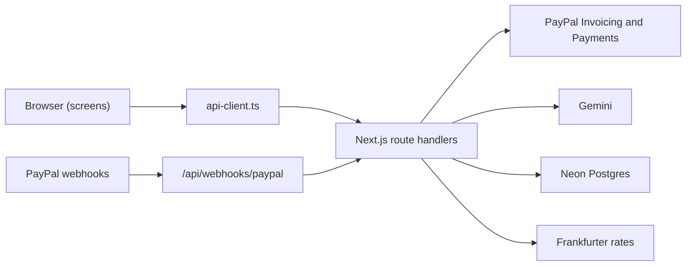
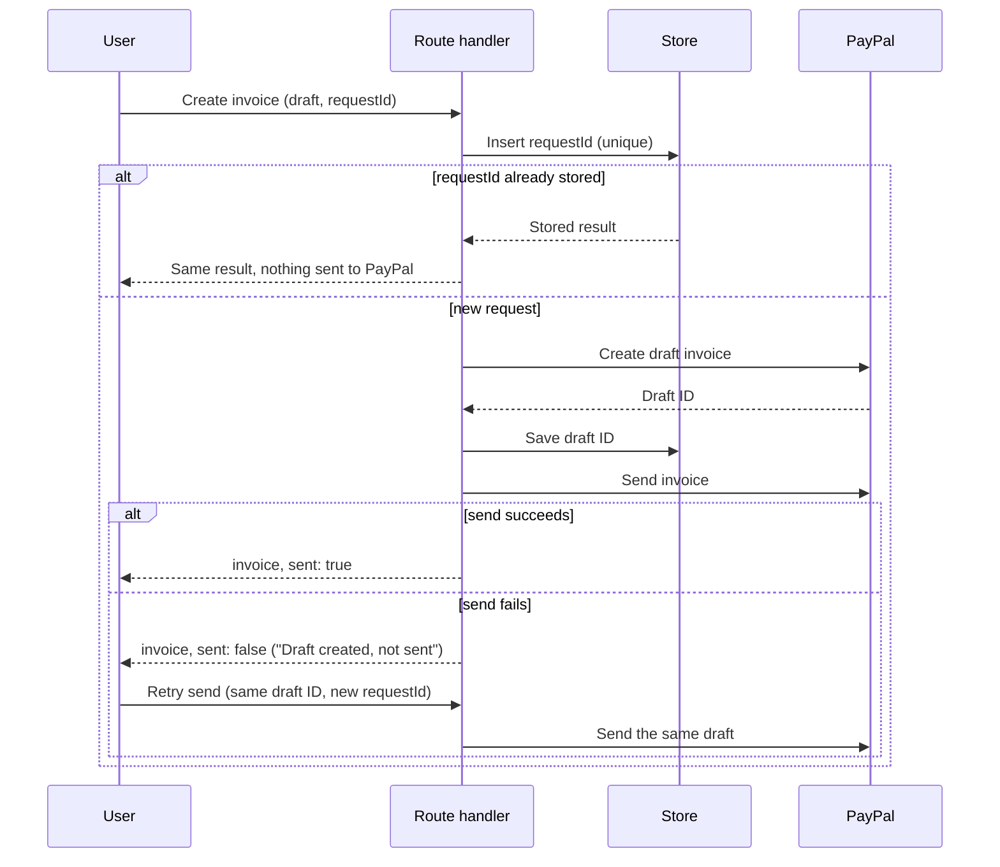

# Architecture

Dueline is a Next.js app. Screens are client components that call typed functions in
`src/lib/api-client.ts`. Those functions call route handlers under `src/app/api`, and the route
handlers talk to PayPal, Gemini, Postgres and the exchange-rate service.

`GET /api/health`, `GET /api/invoices`, `GET` and `PUT /api/settings` and `POST /api/payout-estimate`
are built. Every other route handler still returns sample data and the header `x-dueline-stub: true`. Parts
that are not built yet are marked **planned**.

## Modules in `src/lib`

**`api-client.ts`** has one typed function per endpoint. It is the only way screens reach the
server, and it turns error responses into `ApiClientError`. Built.

**`env.ts`** validates environment variables on the server and refuses to start unless
`PAYPAL_ENVIRONMENT=sandbox`. `getEnv()` is called inside functions, never at the top of a module,
so the production build works without secrets. Built.

**`clock.ts`** returns today's date in Asia/Kolkata, or `DEMO_TODAY` when it is set, and does day
arithmetic on plain `YYYY-MM-DD` strings. Every due-state and risk calculation uses it. Built.

**`paypal/`** holds the OAuth token, a small typed REST client for Invoicing v2, the Server SDK
wrappers for payments and transaction search, the actual-payout lookup and the mapping to our
types. Built. Webhook verification is planned.

**`ai/`** holds prompts and Gemini calls for extracting a draft from a chat, drafting reminders and
writing short explanations. Output is validated by code. Planned.

**`money/`** is pure decimal arithmetic in integer minor units, plus the payout estimate, the
rupees expected for an invoice, number formatting and totals. Built. `estimatePayout` takes the
gross amount, the settings and a market rate, and works in integer minor units, basis points and
ten-thousandths, rounding halves up.

**`rates/`** fetches the ECB's daily rates through Frankfurter (`ecb.ts`) and decides which rates are
in use (`rates.ts`). With the source "ecb" it uses the rates fetched today, otherwise fetches once
(callers that arrive together share one request) and stores them with the day fetched and the ECB's
own date. If the fetch fails it uses the latest stored rates, then the rates saved in settings. With
the source "manual" it makes no request. Built. See [decision 0007](decisions/0007-fees-and-rates.md).

**`settings.ts`** merges the saved settings over the defaults, so a row from an older version still
loads, and puts the rates in use into `marketRates` when the source is "ecb". Built.

**`risk/`** scores late payers from payment history and suggests an early-payment discount. Pure
functions. Planned.

**`export/`** holds the fixed RBI purpose-code list (built), validation of AI suggestions and the
monthly export register (planned).

**`privacy/`** masks emails and phone numbers before any AI call and restores them afterwards.
Planned.

**`store/`** defines a `Store` interface with Postgres and in-memory implementations and the SQL
migrations. Built. See [decision 0006](decisions/0006-storage.md).

## Reading invoices

`GET /api/invoices` lists the invoices in PayPal, drops drafts and cancelled invoices, reads each
one in full (PayPal's list leaves out items and the payer link), adds PayPal's own payout figures
for paid ones and maps each to an `InvoiceSummary`. The route then fills `payoutInr` from the
settings and the rates in use: PayPal's rupees when reported, PayPal's net converted at the
estimated rate for a paid invoice, and the estimate for the amount still due for an unpaid one. It
sorts newest first and totals the rupees. PayPal is the source of truth; the store only caches
payout figures.

Two caches keep the receivables page, which polls every 10 seconds, from calling PayPal each time.
Both are per process:

- Full invoices are kept by ID for 10 minutes and reused while the listed status is unchanged. They
  are read at most 4 at a time.
- The finished list is kept for 20 seconds, and callers that arrive while it loads share one load.
  Rupee figures are not part of it, so a change to the settings shows on the next poll.

`clearInvoiceCaches()` resets both.

## PayPal token flow

`getAccessToken()` asks `POST /v1/oauth2/token` with the client credentials and keeps the token in
memory. It asks again five minutes before the token expires, and callers that arrive while a request
is running share it. If PayPal answers 401 to an API call, the REST client clears the cached token
and retries once.

## Actual payout lookup

For an invoice that is paid, marked as paid or partly paid, `getActualPayout` takes the latest
payment's ID and tries, in this order:

1. The Payments API capture. Its seller receivable breakdown gives the fee, the net amount and, when
   PayPal converted the money, the exchange rate and the rupees received. Source `paypal_capture`.
2. Transaction Search for that transaction, within 15 days either side of the payment date. It gives
   the fee, and the net amount is worked out from it. Source `invoice_payment`. Sandbox data can
   take up to three hours to appear.
3. Nothing. The invoice shows no actual payout until a later request finds one.

Figures that are found are stored. A lookup that finds nothing is not repeated for five minutes,
because the receivables page polls every 10 seconds.

## Fees and rates screen

`/settings` renders `SettingsForm`, which loads and saves settings through `api-client.ts` and
shows `PayoutCalculator` beside it. The calculator calls `POST /api/payout-estimate` 300 ms after
typing stops and shows the fee, the market rate and the date it is from, PayPal's rate, what
reaches the bank and what is lost to fees and conversion. Built.

## Create and send an invoice

Planned. Creating and sending are separate steps, and the request ID is ours.

A repeated `requestId` returns the stored result, so a double click never creates a second invoice.
If sending fails, the draft ID is already saved, and the retry sends that draft instead of creating
a new one.

## Webhooks

Planned. The webhook route verifies the signature with PayPal using the exact received headers and
raw body, and processes each event ID once. It does not trust the event body. It triggers a fresh
read of the invoice from PayPal, and PayPal's current state is the truth.
