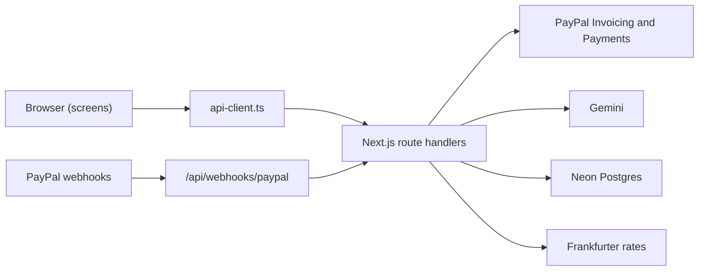
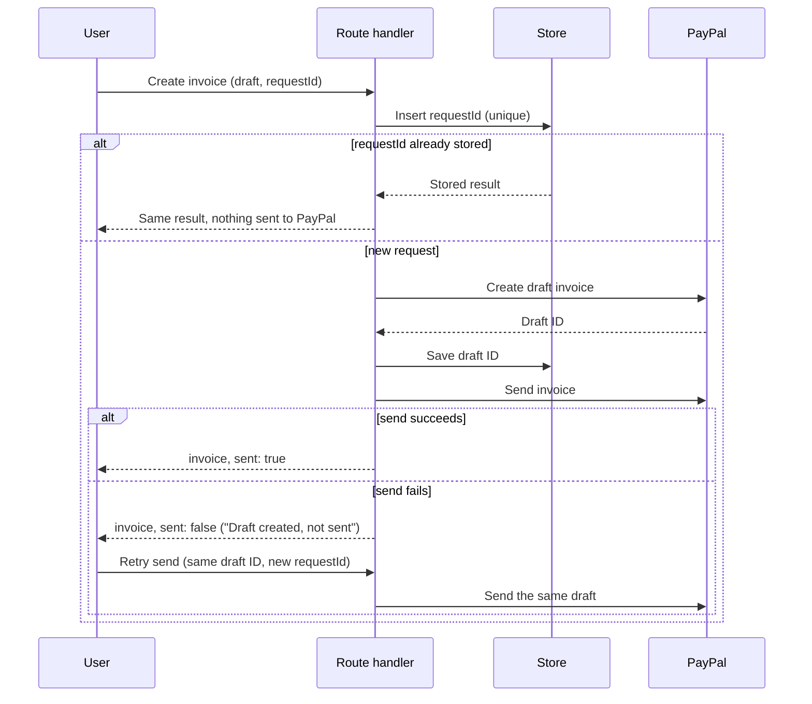

# Architecture

Dueline is a Next.js app. Screens are client components that call typed functions in
`src/lib/api-client.ts`. Those functions call route handlers under `src/app/api`, and the route
handlers talk to PayPal, Gemini, Postgres and the exchange-rate service.

`GET /api/health`, `GET /api/invoices`, `GET` and `PUT /api/settings`, `POST /api/payout-estimate`,
`GET /api/activity`, `POST /api/invoices/extract`, `POST /api/webhooks/paypal` and the demo sign-in
routes are built. Every other
route handler still returns sample data and the header `x-dueline-stub: true`. Parts that are not
built yet are marked **planned**.

## Modules in `src/lib`

**`api-client.ts`** has one typed function per endpoint. It is the only way screens reach the
server, and it turns error responses into `ApiClientError`. Built.

**`env.ts`** validates environment variables on the server and refuses to start unless
`PAYPAL_ENVIRONMENT=sandbox`. `getEnv()` is called inside functions, never at the top of a module,
so the production build works without secrets. Built.

**`clock.ts`** returns today's date in Asia/Kolkata, or `DEMO_TODAY` when it is set, and does day
arithmetic on plain `YYYY-MM-DD` strings. Every due-state and risk calculation uses it. Built.

**`paypal/`** holds the OAuth token, a small typed REST client for Invoicing v2, the Server SDK
wrappers for payments and transaction search, the actual-payout lookup and the mapping to our
types. Built. `webhooks.ts` verifies webhook signatures and `webhook-events.ts` processes verified
events (see Webhooks below).

**`demo-access/`** holds the signed session token, the password comparison, the cookie settings, the
safe `next` path and the rule that decides whether access is open, required or misconfigured. It
uses only Web Crypto, so `src/proxy.ts` can use it. Built. See
[decision 0008](decisions/0008-demo-access-and-deployment.md).

**`ai/`** holds the Gemini calls. `model.ts` builds the primary and fallback models from the
environment and runs a task on the fallback when the primary hits a quota, server, timeout or network
failure. `extract-invoice.ts` builds the prompt, reads or fills the cache and calls the model, and
`check-draft.ts` turns the model's loose answer into an `InvoiceDraft` with warnings. `quota.ts`
counts the hourly and daily limits. Reminder drafting and short explanations are planned. Output is
always validated by code. See [decision 0010](decisions/0010-ai-invoice-drafting.md).

**`money/`** is pure decimal arithmetic in integer minor units, plus the payout estimate, the
rupees expected for an invoice, number formatting and totals. Built. `estimatePayout` takes the
gross amount, the settings and a market rate, and works in integer minor units, basis points and
ten-thousandths, rounding halves up.

**`rates/`** fetches the ECB's daily rates through Frankfurter (`ecb.ts`) and decides which rates are
in use (`rates.ts`). With the source "ecb" it uses the rates fetched today, otherwise fetches once
(callers that arrive together share one request) and stores them with the day fetched and the ECB's
own date. If the fetch fails it uses the latest stored rates, then the rates saved in settings. With
the source "manual" it makes no request. Built. See [decision 0007](decisions/0007-fees-and-rates.md).

**`settings.ts`** merges the saved settings over the defaults, so a row from an older version still
loads, and puts the rates in use into `marketRates` when the source is "ecb". Built.

**`risk/`** scores late payers from payment history and suggests an early-payment discount. Pure
functions. Planned.

**`export/`** holds the fixed RBI purpose-code list (built, checked against the RBI's list on 30 Oct
2026), and the monthly export register (planned). `isPurposeCode` rejects any AI suggestion that is
not on the list.

**`privacy/`** masks emails and phone numbers as `[EMAIL_n]` and `[PHONE_n]` before any AI call and
restores them afterwards. Pure functions. Built.

**`store/`** defines a `Store` interface with Postgres and in-memory implementations and the SQL
migrations. Besides requests, events, settings, rates and payouts, it keeps rate-limit counters and a
small cache of JSON values with an expiry. Built. See [decision 0006](decisions/0006-storage.md).

## Reading invoices

`GET /api/invoices` lists the invoices in PayPal, drops drafts and cancelled invoices, reads each
one in full (PayPal's list leaves out items and the payer link), adds PayPal's own payout figures
for paid ones and maps each to an `InvoiceSummary`. The route then fills `payoutInr` from the
settings and the rates in use: PayPal's rupees when reported, PayPal's net converted at the
estimated rate for a paid invoice, and the estimate for the amount still due for an unpaid one. It
sorts newest first and totals the rupees. PayPal is the source of truth; the store only caches
payout figures.

Two caches keep the receivables page, which polls every 10 seconds, from calling PayPal each time.
Both are per process:

- Full invoices are kept by ID for 10 minutes and reused while the listed status is unchanged. They
  are read at most 4 at a time.
- The finished list is kept for 20 seconds, and callers that arrive while it loads share one load.
  Rupee figures are not part of it, so a change to the settings shows on the next poll.

`clearInvoiceCaches()` resets both.

## PayPal token flow

`getAccessToken()` asks `POST /v1/oauth2/token` with the client credentials and keeps the token in
memory. It asks again five minutes before the token expires, and callers that arrive while a request
is running share it. If PayPal answers 401 to an API call, the REST client clears the cached token
and retries once.

## Actual payout lookup

For an invoice that is paid, marked as paid or partly paid, `getActualPayout` takes the latest
payment's ID and tries, in this order:

1. The Payments API capture. Its seller receivable breakdown gives the fee, the net amount and, when
   PayPal converted the money, the exchange rate and the rupees received. Source `paypal_capture`.
2. Transaction Search for that transaction, within 15 days either side of the payment date. It gives
   the fee, and the net amount is worked out from it. Source `invoice_payment`. Sandbox data can
   take up to three hours to appear.
3. Nothing. The invoice shows no actual payout until a later request finds one.

Figures that are found are stored. A lookup that finds nothing is not repeated for five minutes,
because the receivables page polls every 10 seconds.

## Fees and rates screen

`/settings` renders `SettingsForm`, which loads and saves settings through `api-client.ts` and
shows `PayoutCalculator` beside it. The calculator calls `POST /api/payout-estimate` 300 ms after
typing stops and shows the fee, the market rate and the date it is from, PayPal's rate, what
reaches the bank and what is lost to fees and conversion. Built.

## Drafting an invoice from a chat

`POST /api/invoices/extract` takes a pasted chat of up to 6,000 characters and returns a draft. The
AI only fills it; nothing is created or sent.

1. `maskContacts` replaces emails and phone numbers with placeholders.
2. The SHA-256 of the masked text and today's date is the cache key. A stored model answer for it is
   used without a model call and counts towards no limit.
3. Otherwise the route reserves a call: 10 an hour for the address (first `x-forwarded-for` entry),
   then 400 a day for the app under a key that includes today's date. Over the first is 429
   `rate_limited`, over the second 503 `ai_unavailable`.
4. `runWithFallback` asks `GEMINI_MODEL` for a structured answer from the masked chat, in `<chat>`
   tags, with a 20 second timeout. A 429, a 5xx, a timeout or a network failure moves to
   `GEMINI_FALLBACK_MODEL` once; both failing is 503 `ai_unavailable`.
5. `checkModelDraft` checks every field against the original chat and today's date, restores the
   placeholders, and collects warnings. An item whose price does not appear as a number in its own
   quote is kept with a warning, and a chat with phrases such as "ignore previous instructions" gets
   one warning to check every item. No usable item is 422 `extraction_failed`.
6. The model's answer is stored for 24 hours and the draft is returned with `risk: null` and the
   count of masked emails and phone numbers.

## Create and send an invoice

Planned. Creating and sending are separate steps, and the request ID is ours.

A repeated `requestId` returns the stored result, so a double click never creates a second invoice.
If sending fails, the draft ID is already saved, and the retry sends that draft instead of creating
a new one.

## Demo access

`src/proxy.ts` runs before every route in its matcher (the API and the five app screens). The
landing page, the sign-in page and static files are not in the matcher. It lets `GET /api/health`,
`POST /api/webhooks/paypal` and `/api/demo/session` through, and otherwise checks the
`dueline_demo` cookie against `SESSION_SECRET`. It makes no database or PayPal call. Without a valid
cookie an API route gets 401 `unauthorized` and a screen is redirected to `/demo?next=<path>`.

Access is on when `DEMO_PASSWORD` is set. In production `DEMO_PASSWORD` and `SESSION_SECRET` are
both required; if one is missing, API routes answer 500 `config_error` and screens are rewritten to
`/not-configured`. In development an unset `DEMO_PASSWORD` leaves access open.

`/demo` renders `DemoSignIn`, which calls `signIn` in `api-client.ts` and then opens the `next`
path, checked by `safeNextPath`. `api-client.ts` sends the browser to `/demo` when any other call
answers 401. The sidebar's "Lock demo" button calls `signOut`.

## Webhooks

`POST /api/webhooks/paypal` is public, because PayPal calls it, and protects itself instead:

1. It reads the raw body (at most 100 KB) and sends it to PayPal's verify-webhook-signature API with
   the five `paypal-*` headers and `PAYPAL_WEBHOOK_ID`. The body is embedded as the received text,
   never parsed and written out again. Anything but `SUCCESS` (including simulator events) is
   answered with 400 `invalid_webhook`.
2. A verified event whose ID was already processed is answered with 204 and nothing else happens.
3. For `INVOICING.INVOICE.*` events it reads the invoice from PayPal with `getInvoice` and clears
   the invoice caches. The event body is not used for anything else. PayPal's state is the truth.
   PayPal's real `INVOICING.INVOICE.*` events carry the invoice at `resource.invoice` (the `resource`
   is not the invoice itself); the documented flat `resource.id` is accepted too. A verified invoice
   event with no invoice ID is logged as `missing_invoice_id`, marked processed and answered 204.
4. For `PAID` it also looks up PayPal's actual payout and stores it. For `PAID` and `SENT` it records
   an activity event whose ID is the PayPal event ID.
5. It marks the event ID as processed and answers 204. Other event types are only marked.

If a step after verification fails, the route logs PayPal's `debug_id` and answers 500, so PayPal
retries. `GET /api/activity` returns the latest 20 stored events.

## Deployment

Dueline runs on Vercel's Hobby plan. `vercel.json` pins functions to `sin1` (Singapore), next to the
Neon database, and Vercel detects the Next.js build itself. Secrets are set for the Production
environment only, and preview deployments are protected by Vercel Authentication, so a preview has
no PayPal or database access. Functions do not sleep. Migrations are run from a developer's
computer with `npm run db:migrate` against the same Neon database. See
[decision 0009](decisions/0009-hosting-on-vercel.md),
[decision 0008](decisions/0008-demo-access-and-deployment.md) and the "Deploying" section of
CONTRIBUTING.md.
