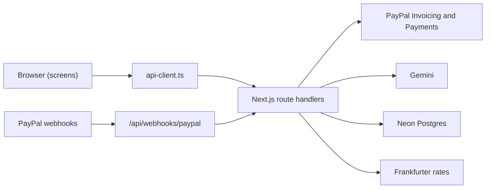
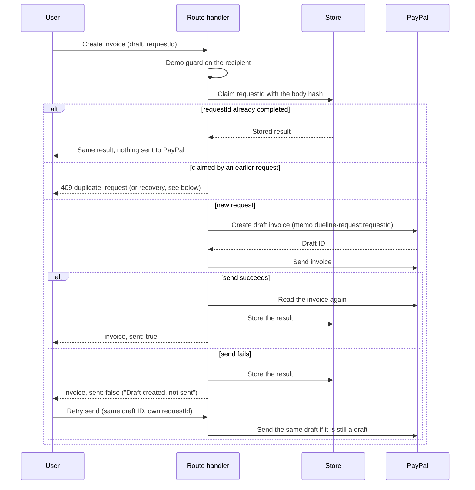
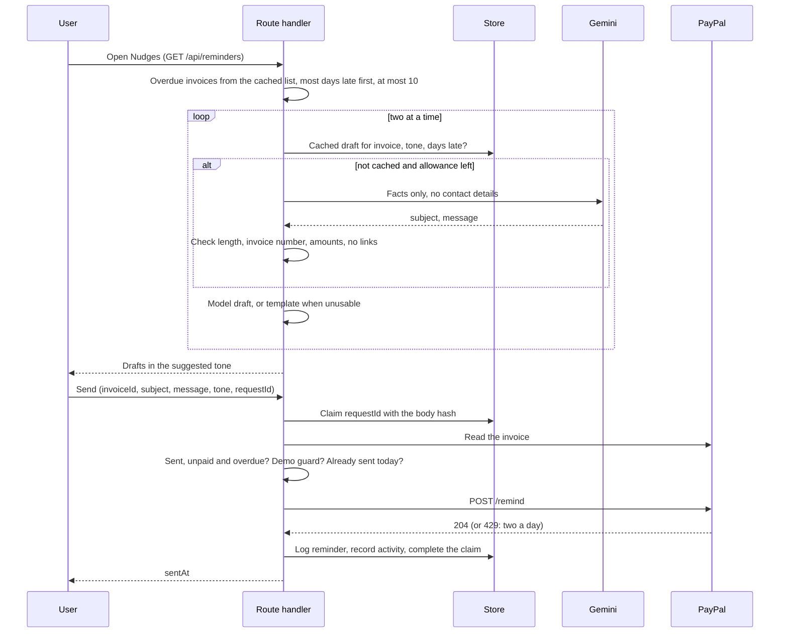

# Architecture

Dueline is a Next.js app. Screens are client components that call typed functions in
`src/lib/api-client.ts`. Those functions call route handlers under `src/app/api`, and the route
handlers talk to PayPal, Gemini, Postgres and the exchange-rate service.

`GET /api/health`, `GET /api/invoices`, `POST /api/invoices`, `POST /api/invoices/{id}/send`,
`GET /api/export-register`, `GET /api/exports/gstr1`, `GET /api/exports/annual`,
`GET /api/profile`, `PUT /api/profile`, `GET /api/settings`, `PUT /api/settings`, `POST /api/payout-estimate`, `GET /api/activity`,
`POST /api/invoices/extract`, `GET /api/purpose-codes`, `GET /api/demo/recipient`,
`GET /api/clients/risk`, `GET /api/dashboard`, `GET /api/clients`, `GET /api/clients/by-key/{key}`,
`PUT /api/clients/by-key/{key}/notes`, `GET /api/invoices/{id}`, `POST /api/invoices/{id}/cancel`,
`POST /api/invoices/{id}/record-payment`, `GET /api/reminders`, `POST /api/reminders/draft`,
`POST /api/reminders/send`, `POST /api/demo/reset`, `POST /api/webhooks/paypal` and the demo sign-in
routes are built. No route answers from sample data.

## Modules in `src/lib`

**`api-client.ts`** has one typed function per endpoint. It is the only way screens reach the
server, and it turns error responses into `ApiClientError`. Built.

**`env.ts`** validates environment variables on the server and refuses to start unless
`PAYPAL_ENVIRONMENT=sandbox`. `getEnv()` is called inside functions, never at the top of a module,
so the production build works without secrets. Built.

**`clock.ts`** returns today's date in Asia/Kolkata, or `DEMO_TODAY` when it is set. Every
due-state and risk calculation uses it. It is server only. Built.

**`date-math.ts`** does day arithmetic on plain `YYYY-MM-DD` strings (`addDays`, `daysBetween`) and
reads the Asia/Kolkata date. It has no server dependencies, so screens can use it; `clock.ts`
re-exports it. Built.

**`paypal/`** holds the OAuth token, a small typed REST client for Invoicing v2, the Server SDK
wrappers for payments and transaction search, the actual-payout lookup and the mapping to our
types. Built. `invoice-body.ts` is the one place that turns a draft into PayPal's create body.
`webhooks.ts` verifies webhook signatures and `webhook-events.ts` processes verified events (see
Webhooks below).

**`invoices/`** holds `createAndSendInvoice` and `sendExistingDraft` and the errors the routes map.
Built. See "Create and send an
invoice" below and [decision 0011](decisions/0011-creating-and-sending-invoices.md).

**`requests/`** holds what invoices and reminders share to make a request safe to repeat: the
request hash, `claimRequest` (the claim and recovery logic, which takes over a request that was cut
off) and `DuplicateRequestError`. **`demo-guard.ts`** holds the demo-mode check that a recipient is a
PayPal sandbox buyer. **`in-batches.ts`** runs work a few items at a time, keeping the order.

**`demo-access/`** holds the signed session token, the password comparison, the cookie settings, the
safe `next` path and the rule that decides whether access is open, required or misconfigured. It
uses only Web Crypto, so `src/proxy.ts` can use it. Built. See
[decision 0008](decisions/0008-demo-access-and-deployment.md).

**`ai/`** holds the Gemini calls. `model.ts` builds the primary and fallback models from the
environment and runs a task on the fallback when the primary hits a quota, server, timeout or network
failure. `extract-invoice.ts` builds the prompt, reads or fills the cache and calls the model, and
`check-draft.ts` turns the model's loose answer into an `InvoiceDraft` with warnings. `quota.ts`
counts the hourly and daily limits. Reminder drafting and short explanations are planned. Output is
always validated by code. See [decision 0010](decisions/0010-ai-invoice-drafting.md).

**`money/`** is pure decimal arithmetic in integer minor units, plus the payout estimate, the
rupees expected for an invoice, number formatting and totals. Built. `estimatePayout` takes the
gross amount, the settings and a market rate, and works in integer minor units, basis points and
ten-thousandths, rounding halves up.

**`rates/`** fetches the ECB's daily rates through Frankfurter (`ecb.ts`) and decides which rates are
in use (`rates.ts`). With the source "ecb" it uses the rates fetched today, otherwise fetches once
(callers that arrive together share one request) and stores them with the day fetched and the ECB's
own date. If the fetch fails it uses the latest stored rates, then the rates saved in settings. With
the source "manual" it makes no request. `getRatesOn(date)` gives the ECB's rates for a past date: it
reads them from the store's cache, fetches them once with Frankfurter's `date` parameter when they are
not there, and falls back to the rates in use. `getRatesWidget` compares today's rates with the average of the last 30 days (`fetchEcbSeries` and the pure
`rate-trend.ts`), once a day, kept in the store's cache. Built. See
[decision 0007](decisions/0007-fees-and-rates.md) and [decision 0013](decisions/0013-export-register.md).

**`settings.ts`** merges the saved settings over the defaults, so a row from an older version still
loads, and puts the rates in use into `marketRates` when the source is "ecb". Built.

**`risk/`** scores late payers from payment history and suggests an early-payment discount.
`score.ts` and `client-key.ts` are pure; `client-risk.ts` reads the cached invoice list and answers
for one client (`getClientRisk`) or for every client at once (`riskByClient`, which fills each
`InvoiceSummary.riskLevel`). Built. See [decision 0014](decisions/0014-late-payer-radar-and-nudges.md).

**`reminders/`** drafts and sends payment reminders. `tone.ts` suggests a tone, `check-reminder.ts`
holds the text rules (length, invoice number, amounts, no links or email addresses) used both on the
model's draft and on the text the freelancer sends (the client's business name and the work
description are taken out before links are looked for, so a client called "Acme.io" is not a link), `templates.ts` is the fallback, `draft-reminder.ts`
asks Gemini and caches the answer, `reminder-drafts.ts` builds the drafts for the Nudges screen and
`send-reminder.ts` sends one through PayPal. Built. See
[decision 0014](decisions/0014-late-payer-radar-and-nudges.md).

**`export/`** holds the fixed RBI purpose-code list (checked against the RBI's list on 30 Oct 2026;
`isPurposeCode` rejects any AI suggestion that is not on it), `register.ts`, which builds the monthly
export register, and `csv.ts`, which writes it as a CSV. `gstr1.ts` and `annual.ts` build the GSTR-1
rows and the year summary, with `gstr1-csv.ts` and `annual-csv.ts` writing them; `csv-text.ts` holds
the cell quoting and formula protection all three CSV writers share. Built. See
[decision 0013](decisions/0013-export-register.md) and
[decision 0016](decisions/0016-business-profile-and-gst.md).

**`insights/`** turns the invoice list into the dashboard widgets. `forecast.ts`, `fees-lost.ts` and
`upcoming.ts` (upcoming due and late clients) are pure; `dashboard.ts` gathers the inputs for
`GET /api/dashboard`. See [decision 0017](decisions/0017-money-views.md).

**`clients/`** groups invoices into clients by the radar's rule (`group-clients.ts`), summarises a
client (`summarise-client.ts`) and serves the client list, a client's page and their notes
(`clients.ts`). Built.

**`invoices/`** also holds the invoice page's side: `invoice-detail.ts` reads one invoice from PayPal and
builds its history with `timeline.ts`, `invoice-actions.ts` says which actions a status allows, and
`cancel-invoice.ts` and `record-payment.ts` run those two writes, and `reminders/send-reminder.ts` its
send, through `requests/run-claimed.ts` (claim, run once, store the result, release on failure; an
optional `afterRun` does the bookkeeping that must not release the claim). `payouts/load-summaries.ts` gives every
screen the same summaries with rupees and risk levels. Built.

**`profile.ts`** merges the saved business profile over the empty one, like `settings.ts`, so a row
from an older version still reads. Invoice creation, the demo seed, reminder drafts and the draft
extraction read it; nothing sends it to the AI. Built.

**`privacy/`** masks emails and phone numbers as `[EMAIL_n]` and `[PHONE_n]` before any AI call and
restores them afterwards. Pure functions. Built.

**`store/`** defines a `Store` interface with Postgres and in-memory implementations and the SQL
migrations. Besides requests, events, settings, rates and payouts, it keeps rate-limit counters and a
small cache of JSON values with an expiry, and private notes about each client. Built. See [decision 0006](decisions/0006-storage.md).

## Reading invoices

`GET /api/invoices` lists the invoices in PayPal, drops drafts and cancelled invoices, reads each
one in full (PayPal's list leaves out items and the payer link), adds PayPal's own payout figures
for paid ones and maps each to an `InvoiceSummary`. The route then fills `payoutInr`,
`payoutSource` and `rateDate` through `resolvePayouts` (`payouts/resolve-payouts.ts`), which the
export register calls as well, so one payment has one rupee figure. `payoutFor` in
`money/invoice-payout.ts` holds the rule: a paid invoice is PayPal's `netInr` when reported, else
PayPal's net (or the estimate when PayPal gave no figures) converted at the ECB rate of the payment
date less the markup; an invoice marked as paid outside PayPal is its amount at the ECB rate of the
payment date with no fee and no markup; an unpaid invoice is the estimate for the amount still due
at today's rate. Rates for past dates come from `getRatesOn`, one request per distinct date. The
route sorts newest first and totals the rupees, keeping what was paid outside PayPal apart from
what PayPal paid. PayPal is the source of truth; the store only caches payout figures. See
[decision 0013](decisions/0013-export-register.md).

The purpose code is kept in the invoice's private memo, next to the marker that finds the invoice
again (`dueline-request:<id> purpose:P1007`, `paypal/memo.ts`), so the client does not see it as
"Reference no.". `toInvoiceSummary` reads the memo first and falls back to the reference field of
older invoices.

Two caches keep the receivables page, which polls every 10 seconds, from calling PayPal each time.
Both are per process:

- Full invoices are kept by ID for 10 minutes and reused while the listed status is unchanged. They
  are read at most 4 at a time.
- The finished list is kept for 20 seconds, and callers that arrive while it loads share one load.
  Rupee figures are not part of it, so a change to the settings shows on the next poll.

`clearInvoiceCaches()` resets both.

## PayPal token flow

`getAccessToken()` asks `POST /v1/oauth2/token` with the client credentials and keeps the token in
memory. It asks again five minutes before the token expires, and callers that arrive while a request
is running share it. If PayPal answers 401 to an API call, the REST client clears the cached token
and retries once.

## Actual payout lookup

For an invoice that is paid, marked as paid or partly paid, `getActualPayout` takes the latest
payment's ID and tries, in this order:

1. The Payments API capture. Its seller receivable breakdown gives the fee, the net amount and, when
   PayPal converted the money, the exchange rate and the rupees received. Source `paypal_capture`.
2. Transaction Search for that transaction, within 15 days either side of the payment date. It gives
   the fee, and the net amount is worked out from it. Source `invoice_payment`. Sandbox data can
   take up to three hours to appear.
3. Nothing. The invoice shows no actual payout until a later request finds one.

Both also record `paidAt`, the payment's own timestamp (the capture's `create_time` or the
transaction's initiation date), and `transactionId`, the payment ID. A paid invoice's `paidOn` is the
Asia/Kolkata date of `paidAt`, because PayPal's `payment_date` is a plain date in PayPal's time zone.

Figures that are found are stored. A lookup that finds nothing is not repeated for five minutes,
because the receivables page polls every 10 seconds. A stored payout with no `paidAt` key (written
before paid times were recorded) is read from PayPal once more, and the old one is kept if that
fails.

## Export register

`GET /api/export-register?month=YYYY-MM` rejects a month after the current one (400), then
`buildExportRegister` takes the loaded invoices (the same cached list as receivables) and keeps those
that are paid or marked as paid and whose `paidOn`, the India date, is in the month. A partly paid
invoice is left out. An invoice marked as paid outside PayPal is not a row and not in any total; its
number goes into `recordedOutsidePayPal`, which the screen shows under the table and the CSV adds
after the rows. Each becomes a row: the foreign amount, PayPal's fee, net and transaction ID when
PayPal's figures were found, and the rupees, which come from `resolvePayouts` like the receivables
screen's (PayPal's `netInr` rounded to whole rupees, else the rate of the paid date less the
markup; the row carries the rate and its date). Rows are sorted by
paid date then invoice number, and the totals (rupees, PayPal's share, the estimated share, foreign
totals per currency, rows without a purpose code) are summed in integer units. `underLut` is true
when `mentionsLut` from `invoice-body.ts` finds the LUT declaration (or the shorter line older
invoices carry) in the invoice note. `sac` is the first item's SAC from the private memo.

With `format=csv`, `toCsv` writes the same register as an RFC 4180 CSV with a UTF-8 byte order mark,
CRLF line ends and a leading quote on any text cell that starts with `=`, `+`, `-`, `@`, a tab or a
carriage return. See [decision 0013](decisions/0013-export-register.md).

`/export` renders a server component with the header and one client component,
`ExportRegisterView`. `use-export-register.ts` reads today's date from `GET /api/health` to pick the
current month, then loads the register for the chosen month. The month picker has previous and next
buttons (next is disabled for the current month) and a month input. The screen shows summary tiles
(invoices paid, rupees with PayPal's and the estimated share, foreign totals, and a warning tile when
purpose codes are missing; a part of the rupee split that is zero is not named), an AG Grid table
in the receivables theme (the theme lives in `components/grid/ag-grid.ts`, and `SourceTag` in
`components/shared/` marks "PayPal" or "est." rupees) with the CA's columns first (paid on, invoice,
client, amount, rupees, purpose code, LUT, transaction ID) and the fee and net after them, a
"Download CSV for your CA" link, and an explainer that cites PayPal's monthly digital FIRA with a
"Learn more" link. A loading skeleton, an empty-month panel and an error panel
with PayPal's debug ID stand in for the content.

## Business profile and GST exports

The profile is one row (migration 004). `toPayPalInvoice` takes it with the draft: the `invoicer`
block (business name, name split at the last space, GSTIN as `tax_id`, website), `SAC <code>` as an
item description, and, when the LUT box is ticked, the declaration, `LUT ARN:` and the place of
supply in the note. The memo carries `sac:<code>` for the first item. `PUT /api/profile` checks the
formats with the one `profileSchema`, which the profile form runs too for its inline errors.

`GET /api/exports/gstr1` loads the invoices, keeps those whose `issuedOn` is in the month, and
converts each at the ECB rate of its invoice date to the paisa (`convertToPaise`), one rate request
per date. `GET /api/exports/annual` takes the invoices paid in the financial year, runs them through
`resolvePayouts` (which now also returns the rates behind each payout) and splits what did not
reach the bank into PayPal's fee and the conversion loss. Both are estimates and say so; see
[decision 0016](decisions/0016-business-profile-and-gst.md).

`/profile` loads the profile through `useProfile` and renders `ProfileForm` (validation shown once a
field is left, or after a save attempt) and a preview of the invoice header. The new invoice review
step reads the profile through the same hook to default each item's SAC, warn about a missing or ended LUT, and say when the name
and business name are empty. The export screen adds a GSTR-1 download and a year-summary dialog for
the financial year of the month shown.

## Fees and rates screen

`/settings` renders `SettingsForm`, which loads and saves settings through `api-client.ts` and
shows `PayoutCalculator` beside it. The calculator calls `POST /api/payout-estimate` 300 ms after
typing stops and shows the fee, the market rate and the date it is from, PayPal's rate, what
reaches the bank and what is lost to fees and conversion. Built.

## Drafting an invoice from a chat

`POST /api/invoices/extract` takes a pasted chat of up to 6,000 characters and returns a draft. The
AI only fills it; nothing is created or sent.

1. `maskContacts` replaces emails and phone numbers with placeholders.
2. The SHA-256 of the system prompt (which holds today's date) and the masked text is the cache key.
   A stored model answer for it is used without a model call and counts towards no limit, and a
   change to the prompt makes older answers unusable.
3. Otherwise the route reserves a call: 10 an hour for the address (first `x-forwarded-for` entry),
   then 400 a day for the app under a key that includes today's date. Over the first is 429
   `rate_limited`, over the second 503 `ai_unavailable`.
4. `runWithFallback` asks `GEMINI_MODEL` for a structured answer from the masked chat, in `<chat>`
   tags, with a 20 second timeout. A 429, a 5xx, a timeout or a network failure moves to
   `GEMINI_FALLBACK_MODEL` once; both failing is 503 `ai_unavailable`.
5. `checkModelDraft` checks every field against the original chat and today's date, restores the
   placeholders, and collects warnings. An item whose price does not appear as a number in its own
   quote is kept with a warning, and a chat with phrases such as "ignore previous instructions" gets
   one warning to check every item. No usable item is 422 `extraction_failed`.
6. The model's answer is stored for 24 hours. The draft is returned with the count of masked emails
   and phone numbers and `risk`, the late-payer radar's reading for the draft's client (name and
   email) from the cached invoice list. It is `null` when the draft has no email or the invoices
   cannot be read, which never fails the extraction.

## Create and send an invoice

Creating and sending are separate steps, and the request ID is ours. See
[decision 0011](decisions/0011-creating-and-sending-invoices.md).

1. `POST /api/invoices` checks the body with zod, then the due date against `today()` from
   `clock.ts`, and calls `createAndSendInvoice`.
2. The claim is keyed on the request ID and carries the SHA-256 of the body with sorted keys. The
   same ID with another body, or an ID still in progress, is 409 `duplicate_request`.
3. In demo mode the recipient must end in `@personal.example.com`, otherwise 403
   `recipient_not_allowed`, before any claim is made. `POST /api/invoices/{id}/send` applies the same
   check to the draft's recipients before it sends.
4. `toPayPalInvoice` builds the create body: the note with the optional LUT line and discount
   line, the memo `dueline-request:<requestId>` with the purpose code after it, and PayPal's invoice
   discount with the earlier due date when a discount is chosen.
5. A PayPal 4xx on create releases the claim and is 502 `paypal_error`. A timeout keeps the claim and
   is 504 `paypal_timeout`. A PayPal 5xx also keeps it.
6. A failed send (a PayPal error or a timeout) returns the draft with `sent: false` and stores that
   result. A successful send is followed by a fresh read of the invoice, the invoice caches are
   cleared and the result is stored.
7. A claim in progress for more than two minutes is taken over by one caller: it finds the invoice
   by its memo and finishes with it (no second send for an invoice that is already sent), or creates
   one when there is none.

`POST /api/invoices/{id}/send` claims its own request ID (hashed with the invoice ID), reads the
invoice, sends it only if it is still a draft, reads it again and stores the result. Any failure
releases the claim, so the retry starts from PayPal's current state. An unknown ID is 404
`not_found`.

PayPal has no per-invoice switch for automatic reminders, so they are turned off in the sandbox
business account's invoicing settings.

## New invoice screen

`/invoices/new` renders `NewInvoice`, which shows the paste step and then the review step. The paste
step calls `POST /api/invoices/extract`, or opens a blank form. The review step holds the form as
text fields (`invoice-form.ts` turns them into a request with the same zod schema the server uses),
loads the purpose codes, today's date and the demo buyer's address, shows the totals and a payout
estimate 300 ms after typing stops, and sends the request with one request ID for the form's whole
life. If the server holds a request (`duplicate_request`, `paypal_timeout`) and the user then edits
the form, a `duplicate_request` answer is replaced by "These details changed after the invoice was
submitted…" with a "Create another" button that starts over with a new request ID. The result panel offers "Retry sending" with its own request ID for a draft that was not sent.

## Receivables screen

`/receivables` renders a server component with the header and a "New invoice" link, and one client
component, `Receivables`. It shows, top to bottom: the totals strip, the due line, and the invoice
table beside the activity feed (stacked below 1536 px, so the table has the full width at laptop sizes). A loading skeleton of the same size,
an empty panel with "Create your first invoice" and an error panel with "Try again" stand in for
them. When data is already on screen and a refresh fails, the old data stays with a "Couldn't
refresh" note.

**Polling.** `use-receivables.ts` loads invoices, activity and health together. Health (today's
date and `demoClock`) is re-read every 5 minutes, so the date stays right if the tab is left open
past midnight. `poll-scheduler.ts` refreshes invoices and activity every
10 seconds while the tab is visible, refreshes at once when the tab becomes visible again, and
never starts a refresh while one is still running. `receivables-state.ts` holds the last good
data, keeps it when a refresh fails (the error and PayPal's `debugId` are kept apart from it), and
finds events that arrived since the previous refresh. Those are highlighted in the feed and
announced in an `aria-live` region.

**The due line.** `DueLineChart` draws one row per invoice, newest issued first, as hand-built SVG
(see [decision 0012](decisions/0012-hand-built-due-line.md)). The default view shows the last 60
days and up to 21 days ahead; a paid invoice that ended before that is behind "Show older", and an
unpaid invoice is always shown. `due-line-layout.ts` holds the maths and no React: the axis runs
from the earliest date shown (not before the window) to the latest of the due, paid and today dates
plus 3 days (not beyond 21 days ahead), with a tick every 7 days, and every position is a fraction
of the axis. A week label within 24 px of the "Today" label is left out, the status text starts
after whichever is further right, the line's end or its due tick, and a paid-late line says "Paid N
days late" in the late colour. A row whose client name appears twice shows the invoice number
under it. Chart text is at least 12 px. A paid invoice is a line from issued to paid in the paid colour, with
the part after the due date in the late colour when it was paid late. An unpaid invoice runs to
today: blue up to the due date and late after it, or the due-soon colour when it is due within 3
days. A tick marks the due date; a filled dot ends a paid line and an open dot marks today. Every
row says its state in words, is focusable, and opens the invoice panel on Enter or click.

**Shared pieces.** `components/shared/` holds what both data screens use: `LoadFailure` and
`toLoadError` (the error panel and the error shape), `SkeletonBlock`, `StatTile` and `SourceTag`.
`components/grid/` holds only the AG Grid theme. A rupee figure is tagged by its `payoutSource`:
"PayPal" when PayPal reported the rupees, "est." when they were worked out at an ECB rate, and
"outside PayPal" for a payment recorded elsewhere. `RiskReason` adds "Based on N invoices." to a
risk reason when N is below 4.

**The table.** `InvoiceTable` is an AG Grid (modules registered once in `components/grid/ag-grid.ts`, themed with
the Theming API). `invoice-table-model.ts` holds the status filters and counts and the default order
(overdue by most days late, then due soon, then other unpaid by due date, then paid, latest first). The search box is AG Grid's quick filter, which also reads the hidden work, issue date and purpose code columns. At 1366 px and wider the visible columns (invoice, client, amount, to your bank, due, status, days late, the open link) fit without scrolling; below that the grid scrolls with the invoice column pinned.

**The invoice panel.** A row opens a dialog with the work, the dates and the purpose code. An unpaid
invoice shows the estimate in rupees and the payer link. An invoice paid outside PayPal shows its
rupees at the ECB rate of the payment date and says no PayPal fee or markup applies. A paid invoice with PayPal's figures calls `POST /api/payout-estimate` for the invoice
amount and sets the estimate (published fees) beside PayPal's actual fee, amount after fee and
rupees, with the difference in words. When PayPal reported no exchange rate, the panel says the
conversion is reported at withdrawal and the rupees use the ECB rate of the payment date (shown as
"ECB rate of 30 Oct 2026", from `rateDate`) less PayPal's markup.

## Money views

**Receivables widgets.** The Receivables screen is a list of widgets: totals, forecast, due line, upcoming
due, late clients, fees lost, rates, the invoice table and activity. `components/dashboard/` holds
`dashboard-layout.ts` (the widget list and the pure helpers that validate, move, show, hide and reset a
layout), `use-layout.ts` (the layout in `localStorage` under `dueline.layout.v1`, read and written in
`try/catch`, the default layout whenever storage is unavailable) and `CustomisePanel`. The five new
widgets read `GET /api/dashboard` through `use-dashboard.ts` and share `DashboardWidget`, which gives each
one its loading, error and empty states. Nothing about the layout is on the server.

**Clients.** `/clients` is an AG Grid of `ClientSummary` rows with a search box; a row opens
`/clients/by-key/[key]`, which shows the risk badge and reason, three tiles, the client's invoices, a notes form
and "New invoice for this client" (`/invoices/new?client=<name>`, checked on the page).

**Invoice page.** `/invoices/[id]` shows the header (client link, number, status, amount, rupees with
their source and rate date, the payer link with a copy button), the history, the details and the
actions. Actions show only when the status allows them, and Record payment and Cancel open an inline
panel with their own request ID. Duplicate opens `/invoices/new?duplicate=<id>`, which loads the invoice
and fills the form. Receivables rows and the invoice panel link to the page.

## Late-payer radar

`GET /api/clients/risk?email=&name=` filters the cached invoice list (`loadInvoices`) to the client
(`isSameClient`: the business name, compared after trimming, collapsing spaces and ignoring case, or
outside demo mode the email as well; in demo mode the shared sandbox email is ignored) and calls
`scoreClient`. Only paid and overdue invoices are considered. `GET /api/invoices` also tags each
invoice with `riskLevel` from `riskLevelsById`, which has no entry for a client with nothing to judge.
See [decision 0014](decisions/0014-late-payer-radar-and-nudges.md). The
reason sentence is built by code from the numbers.

On the review screen `RiskRadar` shows the reading above the discount section: for a client on watch
or a late payer, the reason and a button "Offer N% if paid within D days" that ticks the discount and
fills its fields; for a reliable client, a short line. It uses the reading that came with the
extraction, and asks again (400 ms after typing stops) when the client name or email is edited. The
receivables table tags a client on watch or a late payer next to the name, and the invoice panel
shows the reason.

## Reminders

0. Whoever wrote the body, code ends every draft with the profile's sign-off and name (`withSignOff`),
   leaving room for it in the 900 characters; the model is told to write no sign-off.
1. `GET /api/reminders` takes the invoices with PayPal status SENT, UNPAID or PARTIALLY_PAID that
   are overdue, most days late first (at most 10), and drafts each in its suggested tone
   (`suggestTone` from the days late and the reminders already sent, one step firmer for a client
   who is a late payer), two model calls at a time. The response also carries `remindersLeftToday`
   (`reminders/daily-limit.ts`): PayPal's two a day less the reminders in the store's log since
   India midnight, and 0 for the rest of that day once PayPal has answered 429 (the answer is
   remembered in the store's cache). The send route applies the same count before calling PayPal.
2. `draftReminderText` first looks in the store's cache (24 hours, keyed by invoice, tone, days late
   and the prompt version). Otherwise it reserves a call (the app's 400 a day; for
   `POST /api/reminders/draft` also 20 an hour per address) and asks `runWithFallback` for a
   structured `{ subject, message }`. The model sees the client's business name, invoice number,
   amount, dates, days late and the work, never an email address or phone number.
3. `checkReminderText` accepts the draft only if the subject is 5 to 120 characters and the message
   20 to 900, the message names the invoice, every amount equals the invoice's (and is in its
   currency), and nothing is a link or an email address (not counting the client's business name or
   the work description, which are removed before the check). Otherwise, with no model, no allowance or
   no valid answer, `templateReminder` supplies the text and `source` is `"template"`. The daily
   allowance running out is not an error here; a per-address limit is `429 rate_limited`.
4. `POST /api/reminders/send` validates the lengths with zod, claims the request ID (hash of
   invoice, subject, message and tone), reads the invoice from PayPal, and refuses text with a link
   or an email address (`400`: "The message must not contain links or email addresses.", checked
   here because the client's name must be known). It also refuses an invoice that
   is paid ("This invoice is already paid."), not sent and unpaid, or not overdue ("This invoice is
   not overdue."). In demo mode a recipient that is not a sandbox buyer is `403` before PayPal is
   asked to send the reminder. A reminder already logged for the invoice on the current India day (real clock) is
   `429`. It then posts to the invoice's `/remind` endpoint with the freelancer's subject and
   message. Any failure before PayPal accepts it releases the claim; a PayPal 429 becomes "PayPal
   allows two reminders a day for this account. Try again tomorrow."
5. On success the reminder is logged with its tone, a `reminder_sent` activity event
   (`reminder:<requestId>`) is recorded, the invoice caches are cleared and the claim is completed
   with `sentAt`. A repeat of the request returns the stored `sentAt`.

**Nudges screen.** `/nudges` renders `Nudges`, which loads the drafts and the invoices. Each card
(`NudgeCard`) shows the client with a risk badge and reason, the invoice, the amount, the due date,
the days late and the reminders already sent; a tone switch with the suggested tone marked; the
editable subject and message with a note saying whether the AI or a template wrote it; and "Send
reminder through PayPal" (disabled with a calm banner when no PayPal reminders are left today; drafting still works).
When a late payer's record made the suggestion firmer, the card says "Suggested firm because Okafor & Reyes is a late payer." Switching tone calls `POST /api/reminders/draft`; when the subject or message was edited, the card
first asks "Replace your edits with a Firm draft?" with "Replace" and "Keep editing", and nothing is
drafted until the user chooses. Each draft gets its own request ID, so a retry never sends twice. After a send the card is closed for the day. Without
overdue invoices the screen reads "No late invoices. Nothing to chase today." The sidebar shows no
count on Nudges: it sits in the layout and shares no state with the screens, so a count would need
its own request for the invoice list.

## Demo story and reset

`src/lib/demo/story.ts` is pure data and a builder, and owns the story's client names, work, amounts and purpose codes
(`engagements`), which the sample data in `src/mocks` imports so nothing under `src/lib` or `src/app`
depends on it; `buildDemoStory(today)` turns day offsets into
the dates of eight invoices, each with a key and the memo `dueline-demo:<key>`. `seed.ts` (`seedDemo`)
reads every invoice in full, creates and sends the keys PayPal lacks through `invoice-body.ts`, and
records the history ones as paid with `recordExternalPayment`. It returns one row per invoice
(`created`, `repaired`, `skipped` or `failed`). `npm run seed` prints that table. An invoice paid
outside PayPal has no actual payout (`getActualPayout` skips it), so its rupees are estimated.

`POST /api/demo/reset` calls `resetDemo` in `reset.ts`: in demo mode only, it claims the single
ten-minute slot in the store, cancels the sent or unpaid invoices that are not in the story, deletes
drafts, runs `seedDemo`, clears the invoice caches and returns the counts. An invoice created in
the last 30 minutes (PayPal's `create_time`) (or one whose creation time PayPal did not report) is never cancelled or deleted and is counted in `kept`,
so a judge in the middle of an invoice does not lose it to another judge's reset. The "Demo" card
(`DemoCard`) lives on its own page, `/demo-tools`, which the sidebar links to only when `GET
/api/demo/recipient` succeeds (`useDemoMode`); it asks for confirmation inline and shows the result
line.

The story invoices' webhook events are dated by the story: a "sent" event at the invoice date and a
"paid" event at the payment date (09:00 India time, never after the time PayPal reported), so the
activity feed does not show eight months of history as having happened at the moment of seeding.
The feed shows a date instead of "N days ago" for anything a week old or more. See [decision 0015](decisions/0015-demo-story-and-reset.md).

## Demo access

`src/proxy.ts` runs before every route in its matcher (the API and the six app screens). The
landing page, the sign-in page and static files are not in the matcher. It lets `GET /api/health`,
`POST /api/webhooks/paypal` and `/api/demo/session` through, and otherwise checks the
`dueline_demo` cookie against `SESSION_SECRET`. It makes no database or PayPal call. Without a valid
cookie an API route gets 401 `unauthorized` and a screen is redirected to `/demo?next=<path>`.

Access is on when `DEMO_PASSWORD` is set. In production `DEMO_PASSWORD` and `SESSION_SECRET` are
both required; if one is missing, API routes answer 500 `config_error` and screens are rewritten to
`/not-configured`. In development an unset `DEMO_PASSWORD` leaves access open.

`/demo` renders `DemoSignIn`, which calls `signIn` in `api-client.ts` and then opens the `next`
path, checked by `safeNextPath`. `api-client.ts` sends the browser to `/demo` when any other call
answers 401. The sidebar's "Lock demo" button calls `signOut`.

## Webhooks

`POST /api/webhooks/paypal` is public, because PayPal calls it, and protects itself instead:

1. It reads the raw body (at most 100 KB) and sends it to PayPal's verify-webhook-signature API with
   the five `paypal-*` headers and `PAYPAL_WEBHOOK_ID`. The body is embedded as the received text,
   never parsed and written out again. Anything but `SUCCESS` (including simulator events) is
   answered with 400 `invalid_webhook`.
2. A verified event whose ID was already processed is answered with 204 and nothing else happens.
3. For `INVOICING.INVOICE.*` events it reads the invoice from PayPal with `getInvoice` and clears
   the invoice caches. The event body is not used for anything else. PayPal's state is the truth.
   PayPal's real `INVOICING.INVOICE.*` events carry the invoice at `resource.invoice` (the `resource`
   is not the invoice itself); the documented flat `resource.id` is accepted too. A verified invoice
   event with no invoice ID is logged as `missing_invoice_id`, marked processed and answered 204.
4. For `PAID` it also looks up PayPal's actual payout and stores it. For `PAID` and `SENT` it records
   an activity event whose ID is the PayPal event ID.
5. It marks the event ID as processed and answers 204. Other event types are only marked.

If a step after verification fails, the route logs PayPal's `debug_id` and answers 500, so PayPal
retries. `GET /api/activity` returns the latest 20 stored events.

## Deployment

Dueline runs on Vercel's Hobby plan. `vercel.json` pins functions to `sin1` (Singapore), next to the
Neon database, and Vercel detects the Next.js build itself. Secrets are set for the Production
environment only, and preview deployments are protected by Vercel Authentication, so a preview has
no PayPal or database access. Functions do not sleep. Migrations are run from a developer's
computer with `npm run db:migrate` against the same Neon database. See
[decision 0009](decisions/0009-hosting-on-vercel.md),
[decision 0008](decisions/0008-demo-access-and-deployment.md) and the "Deploying" section of
CONTRIBUTING.md.
