# Dueline Architecture

Dueline is a cross-border receivables app for freelancers in India who are paid by clients abroad
through PayPal. It shows what will reach the bank in rupees before an invoice is sent and after it is
paid, drafts a PayPal invoice from a pasted client chat, scores late payers and drafts polite
reminders, and keeps the export paperwork ready for a chartered accountant. It runs on the PayPal
sandbox, so no real money moves.

> **Read This First**
>
> - **What it is:** an invoicing and receivables app for freelancers in India paid through PayPal.
> - **The three ideas:** PayPal does the money, the model only proposes and code decides, and every figure can be traced.
> - **Where to start:** [section 1](#1-system-context), then [section 4.3](#43-a-payment-reaches-dueline).
> - **What can wait:** [section 12](#12-serving-many-freelancers) and the [appendix](#appendix) can be skipped.

Three ideas shape the design.

1. **PayPal does the money.** Invoices, payments, fees and payment state live in PayPal. Dueline
   reads them, caches a snapshot and never treats its own copy as the truth.
2. **The model only proposes and code decides.** Gemini fills a draft. Code checks every field and
   recalculates every figure, and nothing is created, sent or changed without a click.
3. **Every figure the freelancer sees can be traced.** A rupee amount comes from PayPal's own
   report, or from the European Central Bank's rate of a named date, and the screen says which.

## At a Glance

|                      |                                                                                                                                                                   |
| -------------------- | ----------------------------------------------------------------------------------------------------------------------------------------------------------------- |
| **Stack**            | Next.js 16 (App Router, Cache Components), React 19, TypeScript 5.9 (strict), Tailwind CSS 4, AG Grid, zod 4                                                      |
| **Runtime**          | Node.js 24 on Vercel's Hobby plan. Functions do not sleep ([decision 0009](decisions/0009-hosting-on-vercel.md))                                                  |
| **Data store**       | Postgres on Neon through `postgres`, or an in-memory store when no database is set. 21 tables in 11 migrations                                                    |
| **PayPal APIs**      | 14 calls: the OAuth token, 10 Invoicing v2 calls, one Payments call, Transaction Search and webhook signature verification ([section 1](#1-system-context))       |
| **AI**               | Gemini through the AI SDK, a primary and a fallback model. Used in two places: drafting an invoice from a chat and drafting reminders ([section 6](#6-ai-safety)) |
| **Scheduled jobs**   | One: the morning run at 06:00 India time ([section 4.6](#46-the-morning-run))                                                                                     |
| **Tests**            | 2,234 unit tests in 185 files (Vitest). 210 end-to-end tests in 23 files, plus one sign-in setup step (Playwright, with axe)                                      |
| **Decision records** | 25 ([section 13](#13-decision-records))                                                                                                                           |
| **API**              | 54 endpoints in 46 route files, described in the [API contract](api-contract.md)                                                                                  |
| **Live demo**        | [dueline-azure.vercel.app](https://dueline-azure.vercel.app)                                                                                                      |

Counted on 5 Nov 2026 from `tests/`, `docs/decisions/`, `src/app/api` and `src/lib/paypal`.

## Contents

- [1. System Context](#1-system-context)
- [2. Inside the App](#2-inside-the-app)
- [3. Design Principles](#3-design-principles)
- [4. Key Flows](#4-key-flows)
  - [4.1 Drafting an Invoice from a Chat](#41-drafting-an-invoice-from-a-chat)
  - [4.2 Creating and Sending, Exactly Once](#42-creating-and-sending-exactly-once)
  - [4.3 A Payment Reaches Dueline](#43-a-payment-reaches-dueline)
  - [4.4 Deposit and Balance Invoices](#44-deposit-and-balance-invoices)
  - [4.5 Reminders, Heads-Ups and Promises](#45-reminders-heads-ups-and-promises)
  - [4.6 The Morning Run](#46-the-morning-run)
- [5. Data and Storage](#5-data-and-storage)
- [6. AI Safety](#6-ai-safety)
- [7. Security and Reliability](#7-security-and-reliability)
- [8. Money, Rates and Export Rules](#8-money-rates-and-export-rules)
- [9. Performance](#9-performance)
- [10. Testing and Quality](#10-testing-and-quality)
- [11. Deployment and Operations](#11-deployment-and-operations)
- [12. Serving Many Freelancers](#12-serving-many-freelancers)
- [13. Decision Records](#13-decision-records)
- [Glossary](#glossary)
- [Appendix](#appendix)

Every diagram is an animated SVG. It plays one story in numbered steps, and the same numbers appear
on the diagram and in the list under it. If your browser asks for reduced motion, the animation
stops and the whole diagram stays on screen.

## 1. System Context

One freelancer uses Dueline in a browser. Dueline talks to PayPal for everything that involves
money, to Gemini for drafts, to the European Central Bank for exchange rates and to Postgres for its
own small records. The client never touches Dueline: they pay on PayPal's own page.

1. The freelancer pastes a chat and approves a draft. Browser and server talk JSON over HTTPS.
2. Dueline sends the chat to Gemini with emails and phone numbers masked, and gets a draft back.
3. Dueline creates and sends the invoice through PayPal Invoicing v2.
4. The client opens the invoice on PayPal's page and pays there. Dueline never sees a card or bank
   number.
5. PayPal sends a signed webhook. Dueline has PayPal verify it before it acts.
6. Dueline reads PayPal's real fee and net amount from Payments and Transaction Search.
7. Dueline reads the ECB rate to show the rupees when PayPal reports none.
8. Dueline stores the invoice snapshot and the payout figures in Postgres.
9. Every morning the scheduler starts the morning run.
10. The freelancer sends the CSV files to their chartered accountant.

| System                  | Used for                                            | What Dueline sends                                              | What it never sends                         |
| ----------------------- | --------------------------------------------------- | --------------------------------------------------------------- | ------------------------------------------- |
| PayPal (sandbox)        | Invoices, reminders, payments, fees, webhooks       | Invoice bodies, the received webhook body for verification      | Card or bank details, which it never holds  |
| Gemini                  | Drafting an invoice from a chat, drafting reminders | A masked chat; reminder facts such as amounts and dates         | Emails, phone numbers, the business profile |
| ECB through Frankfurter | Daily reference rates                               | A currency and a date                                           | Anything about the freelancer               |
| Postgres on Neon        | Request IDs, activity, settings, caches, notes      | Parameters only; every query is a tagged template               | Secrets, tokens, pasted chat text           |
| Vercel cron             | Starting the morning run                            | Nothing. The scheduler calls Dueline with a secret bearer token | Anything. The run takes no input            |

The 14 PayPal calls are listed in the [README](../README.md#paypal). The code is in
[`src/lib/paypal`](../src/lib/paypal).

## 2. Inside the App

Screens are client components. They reach the server only through
[`src/lib/api-client.ts`](../src/lib/api-client.ts). Every request passes the proxy, a route handler
and a module in `src/lib`, and the answer climbs back the same way.

1. A screen calls a typed function in `api-client`.
2. The call goes to the server as JSON over HTTPS.
3. The proxy checks the signed demo cookie and lets the request through.
4. The route handler validates the body with zod and hands the work to a module.
5. The module asks PayPal, Gemini or the rate service.
6. It reads or writes the store, which is Postgres or memory.
7. The answer climbs back, checked in code, as `{ ok }` or `{ error }`.
8. `api-client` turns it into data or an `ApiClientError`, and the screen draws it.

| Layer          | What it does                                                                                          | Where                                                                      |
| -------------- | ----------------------------------------------------------------------------------------------------- | -------------------------------------------------------------------------- |
| Screens        | Draw data. Never import PayPal, AI, store, rate or privacy modules                                    | [`src/app/(app)`](../src/app), [`src/components`](../src/components)       |
| `api-client`   | One typed function per endpoint. Turns error responses into `ApiClientError`. Shares reads in flight  | [`src/lib/api-client.ts`](../src/lib/api-client.ts)                        |
| Proxy          | Checks the signed demo cookie with Web Crypto only. No database or PayPal call                        | [`src/proxy.ts`](../src/proxy.ts)                                          |
| Route handlers | `parseBody` and `parseQuery` for zod, `ok` and `fail` for one answer shape                            | [`src/app/api`](../src/app/api), [`src/app/api/_lib`](../src/app/api/_lib) |
| Modules        | The work: PayPal calls, checks, maths, drafting. Pure logic is kept apart from code that reads stores | [`src/lib`](../src/lib)                                                    |
| Store          | One `Store` interface with Postgres and in-memory implementations                                     | [`src/lib/store`](../src/lib/store)                                        |

The modules in `src/lib` are grouped by job. The [module catalogue](#appendix) lists each one.

| Job             | Modules                                                                                            |
| --------------- | -------------------------------------------------------------------------------------------------- |
| Money and rates | `money/`, `rates/`, `payouts/`                                                                     |
| PayPal          | `paypal/`, `invoices/`, `requests/`                                                                |
| AI and privacy  | `ai/`, `privacy/`, `reminders/`                                                                    |
| Risk and export | `risk/`, `export/`, `insights/`, `clients/`                                                        |
| Automation      | `automation/`, `promises/`, `demo/`, `checklist/`                                                  |
| Foundations     | `env.ts`, `clock.ts`, `date-math.ts`, `settings.ts`, `profile.ts`, `demo-guard.ts`, `demo-access/` |

**Offline mode.** One switch, read once when the environment is validated, replaces PayPal, Gemini,
the rate service and Postgres with code inside the app. The checks and the routes do not change, so
every screen works with no account and no key. `npm run dev:offline` starts it, and the end-to-end
tests run the production build this way. [Decision 0020](decisions/0020-proof-and-hardening.md)
explains what it can and cannot prove, and the seams are listed in the
[appendix](#appendix).

## 3. Design Principles

1. **The model proposes, code decides.** The AI only fills a draft. Quantities, prices, totals,
   currency, dates and purpose codes are validated or recalculated in code, and text in a chat is
   data, never instructions. See [decision 0010](decisions/0010-ai-invoice-drafting.md).
2. **Writes are idempotent and in two steps.** Every create or send carries a client-generated
   request ID that is claimed in the store before PayPal is called. Creating and sending are separate
   calls, so a failed send leaves a saved draft, never a second invoice. See
   [decision 0001](decisions/0001-own-idempotency.md) and
   [decision 0011](decisions/0011-creating-and-sending-invoices.md).
3. **Verify before trusting.** A webhook is verified by PayPal on the exact bytes it sent, each event
   is processed once, and the event only triggers a fresh read of the invoice. See
   [decision 0008](decisions/0008-demo-access-and-deployment.md).
4. **One source of truth for money.** After payment the figures are PayPal's own. Before payment the
   rupee amount is an estimate and says so, with the ECB rate and its date. See
   [decision 0007](decisions/0007-fees-and-rates.md) and
   [decision 0013](decisions/0013-export-register.md).
5. **Fast reads from a snapshot.** PayPal's invoices are served from a stored snapshot and refreshed
   in the background, so a screen never waits for PayPal after the first read. See
   [decision 0024](decisions/0024-invoice-snapshot.md).
6. **Nothing is sent without a click.** Automation only prepares drafts and queue items. A person
   presses the button that creates, sends or reminds. See
   [decision 0018](decisions/0018-automation-and-comfort.md).
7. **Contacts stay out of the model.** Emails and phone numbers are masked by code before any AI
   call and restored by code afterwards. See
   [decision 0010](decisions/0010-ai-invoice-drafting.md).

## 4. Key Flows

Six flows carry most of the design. Each has an animated diagram, numbered steps that match it, what
always holds, and what the user sees when something fails.

### 4.1 Drafting an Invoice from a Chat

`POST /api/invoices/extract` takes a pasted chat of up to 6,000 characters and returns a draft. The
AI only fills it. Nothing is created or sent.

1. The freelancer pastes a chat. The body is validated with zod, and the chat is capped at 6,000
   characters.
2. [`maskContacts`](../src/lib/privacy/mask.ts) replaces emails and phone numbers with `[EMAIL_n]`
   and `[PHONE_n]`. WhatsApp date prefixes are stripped from each line, so a line only gets shorter
   and every quote can still be found in the chat as pasted.
3. The masked chat goes to Gemini. A stored answer for the same prompt and masked text (kept 24
   hours) is used with no model call. Otherwise the route reserves a call, asks the primary model
   for a structured answer with a 20 second timeout, and moves to the fallback model once on a
   quota error, a server error, a timeout or a network failure.
4. [`checkModelDraft`](../src/lib/ai/check-draft.ts) checks every field against the original chat and
   today's date. Quotes must be in the chat. Prices must appear as numbers in their own quote.
   Quantities are whole numbers from 1 to 999. The currency must be supported, the due date real
   and not past, the purpose code on the fixed list, and the payment terms quoted. A chat with
   phrases such as "ignore previous instructions" gets one warning to check every item.
5. A price the chat does not support is not trusted and not silently fixed. The item stays with a
   warning naming it. Items that fail harder are dropped with a warning.
6. Code restores the placeholders and returns the draft with the count of masked contacts and the
   late-payer reading for that client. The review form shows warnings as pills. Totals are
   recalculated there, and the freelancer decides what happens next.

**Guarantees**

- No model output reaches PayPal without a click. Totals are never taken from the model.
- Emails and phone numbers never reach the model. An address the model returns that is not in the
  chat is ignored.
- A draft's SAC is the profile's default, set by code. The model never sees the profile.
- A purpose code is kept only if it is on the list of 12 codes in
  [`purpose-codes.ts`](../src/lib/export/purpose-codes.ts).
- The model's answer is cached with placeholders, so no contact detail is stored.

**When things fail**

| What goes wrong                                      | What the user sees                                                                   |
| ---------------------------------------------------- | ------------------------------------------------------------------------------------ |
| More than 10 extractions in an hour from one address | `429 rate_limited` with the time to retry                                            |
| The app's 400 model calls for the day are used up    | `503 ai_unavailable`, with a message that the invoice can still be filled in by hand |
| Both models fail                                     | The same `503`. The blank form stays available                                       |
| The chat has nothing usable                          | `422 extraction_failed`, again with the hand-filled form                             |
| The model's answer does not match the schema         | The request fails. It is not retried on the fallback, which would fail the same way  |

### 4.2 Creating and Sending, Exactly Once

One click on "Create and send invoice" must never produce two invoices, even after a double click, a
timeout or a crash between PayPal's answer and our database. The request ID is ours, because PayPal
does not document one for Invoicing.

1. `POST /api/invoices` validates the body with zod and the due date against `today()`. The form
   sends one request ID for its whole life.
2. In demo mode the recipient must be a PayPal sandbox buyer. Anything else is answered with
   `403 recipient_not_allowed` before anything is claimed.
3. The route claims the request ID in the store, with the SHA-256 of the body (keys sorted), under a
   unique constraint. This happens before PayPal is called.
4. It creates a draft invoice at PayPal. The memo holds `dueline-request:<id>`, and the draft ID is
   saved first.
5. It sends the draft in a separate call. PayPal's own automatic reminders are switched off in the
   account, so the client hears from one voice.
6. It reads the invoice back from PayPal and refreshes the invoice snapshot.
7. It stores the result under the request ID.
8. The user sees the invoice, sent.
9. A double click or a retry sends the same request ID again.
10. The store already holds the finished result for that ID.
11. The route returns that result. PayPal is not called a second time.

**Guarantees**

- One request ID gives one invoice. The same ID with another body is refused as `duplicate_request`.
- The draft ID is saved before sending is tried, so a failure after it never creates a second draft.
- A claim stuck for more than two minutes is taken over by one caller, who finds the invoice by its
  memo and finishes with it. No second send happens for an invoice that is already sent.
- `POST /api/invoices/{id}/send` reads the invoice first and sends it only if it is still a draft.

**When things fail**

| What goes wrong                                  | What the user sees                                                                                            |
| ------------------------------------------------ | ------------------------------------------------------------------------------------------------------------- |
| PayPal rejects the create call (a 4xx)           | `502 paypal_error` with PayPal's debug ID. The claim is released, so the same request works after a fix       |
| PayPal does not answer in time, or answers a 5xx | `504 paypal_timeout`: "PayPal did not answer in time. Check Receivables before trying again." The claim stays |
| The draft exists but sending fails               | "Draft created, not sent", and "Retry sending" with its own request ID sends the same draft                   |
| The same request is still in progress            | `409 duplicate_request`: "This invoice is still being created. Check Receivables before trying again."        |
| The recipient is not a sandbox buyer             | `403 recipient_not_allowed`, before any claim or PayPal call                                                  |

### 4.3 A Payment Reaches Dueline

The client pays on PayPal's page. PayPal tells Dueline, and Dueline reads PayPal's own figures. The
webhook is a nudge, not a source of data.

1. The client pays on PayPal's own page, by card or PayPal balance. The invoice becomes `PAID`.
2. PayPal posts a signed event to `POST /api/webhooks/paypal`. The route is public, because PayPal
   calls it, and protects itself.
3. The route reads the raw body (at most 100 KB) and sends it with the five `paypal-*` headers to
   PayPal's verify-webhook-signature API. The body is embedded as the received text, never parsed
   and written out again. Only `SUCCESS` goes on. An event ID that was already processed is
   answered `204` and nothing else happens. See
   [`webhooks.ts`](../src/lib/paypal/webhooks.ts).
4. For invoice events the route reads the invoice from PayPal and clears the invoice caches. PayPal's
   real events carry the invoice at `resource.invoice`, and the documented flat shape is accepted
   too.
5. For `PAID` it looks up the payout: first the Payments capture, then Transaction Search within 15
   days either side of the payment date. The capture gives the fee, the net amount and, when PayPal
   converted the money, the rate and the rupees.
6. It stores the payout, records an activity row whose ID is the PayPal event ID, refreshes the
   snapshot for that invoice and marks the event processed.
7. Home draws the paid invoice on its next refresh, which is every 10 seconds while the tab is
   visible. The rupees are PayPal's when PayPal reported them, and otherwise PayPal's net converted
   at the ECB rate of the payment date. The screen tags which one it is.

**Guarantees**

- A webhook never changes anything by its contents. PayPal's current invoice is what Dueline
  believes.
- Each event ID is processed once, and the activity row uses the event ID as its key, so a repeat
  cannot add a second row.
- A paid invoice's date is the India date of the payment's own timestamp, so a month boundary falls
  at midnight in Asia/Kolkata.

**When things fail**

| What goes wrong                                                           | What the user sees                                                                                                              |
| ------------------------------------------------------------------------- | ------------------------------------------------------------------------------------------------------------------------------- |
| The signature is not verified                                             | `400 invalid_webhook`. Nothing changes                                                                                          |
| A step after verification fails                                           | `500`, with PayPal's debug ID logged, so PayPal retries                                                                         |
| The webhook never arrives                                                 | The invoice still reads as paid on the next refresh. The morning run adds the missing paid row for payments of the last 14 days |
| PayPal has no payout figures yet (the sandbox can take up to three hours) | The rupees are shown as an estimate, tagged "est.", until a later read finds the figures                                        |

### 4.4 Deposit and Balance Invoices

A chat often says "50% now, the rest on delivery". PayPal Invoicing v2's partial payment is not
available for invoices in India, so Dueline makes two ordinary invoices
([decision 0025](decisions/0025-deposit-invoices-and-promises.md)).

1. The chat asks for part upfront, so the form offers a deposit.
2. [`splitTotal`](../src/lib/money/split.ts) splits the total in integer minor units. The deposit is
   the percentage rounded to the cent, and the balance is the rest.
3. The deposit invoice is created and sent now through `createAndSendInvoice`, as in
   [section 4.2](#42-creating-and-sending-exactly-once).
4. The balance is saved as an unsent PayPal draft through `createDraftOnly`, under its own request
   ID. Both memos carry `split:<role>.<id>`.
5. The draft waits in Ready to send on Home. Drafts are never counted as money owed, so only a
   balance draft is shown.
6. On delivery the freelancer clicks Send balance. [`redatedForSending`](../src/lib/paypal/redate.ts)
   moves the invoice date to today in India time and keeps the days to pay, and a full `PUT` updates
   the draft.
7. PayPal sends it. Deposit plus balance equals the job total.

**Guarantees**

- The two amounts always add up. Each is a complete invoice for its own value, with one line, the
  SAC, the purpose code and the LUT line, so the export register and GSTR-1 count each once.
- The balance is sent only by an explicit click, through the same send route as any draft.
- The deposit's request ID names the pair and the balance has its own, so a failed balance can be
  retried alone without a second deposit.

**When things fail**

| What goes wrong                                        | What the user sees                                                                                   |
| ------------------------------------------------------ | ---------------------------------------------------------------------------------------------------- |
| The deposit is created but not sent                    | The answer carries that deposit and no balance. Nothing more is created                              |
| The balance cannot be saved after the deposit went out | The deposit is shown with the balance missing. Sending the same request again makes only the balance |
| The re-dating update fails                             | The send stops, and the draft stays a draft                                                          |

### 4.5 Reminders, Heads-Ups and Promises

A reminder is one pipeline. The tone is chosen by code from facts, the model writes the body, code
checks it, and the freelancer sends it.

1. An invoice due today or within the profile's heads-up days, with no late days, gets the heads-up
   tone. It never speaks of lateness.
2. A late invoice gets a tone from [`suggestTone`](../src/lib/reminders/tone.ts): gentle under 8
   days late with no reminder sent, firm from 8 days, after one reminder, for a late payer or after
   a broken promise, and final beyond 30 days or after two reminders. The reason is written from
   the numbers.
3. A promised date pauses drafting until that date. A missed date makes the next reminder firm.
4. Gemini writes a subject and a message from facts only: the client's business name, invoice
   number, amount, dates, days late and the work. It sees no email address or phone number.
5. [`checkReminderText`](../src/lib/reminders/check-reminder.ts) accepts the draft only if the length
   is right, the message names the invoice, every amount matches, nothing is a link or an email
   address and no word contradicts the tone. Otherwise a template in the client's language is used.
6. The draft opens for review. The sign-off is added by code, and the freelancer may edit.
7. The freelancer sends PayPal's own reminder, or their own message by email with the pay link added.
8. The send is logged once, an activity row is recorded and the card closes for the day.

**Guarantees**

- The tone and the reason come from code. The model writes the body only, and never the sign-off.
- Nothing is sent without a click. A reminder is logged for an invoice once per India day, and PayPal
  allows two a day for the account.
- A promise pauses drafting, so Dueline never nags a client who named a date.
- A paid invoice, one not overdue (outside heads-ups), or a recipient that is not a sandbox buyer in
  demo mode is refused before PayPal is called.

**When things fail**

| What goes wrong                                        | What the user sees                                                                             |
| ------------------------------------------------------ | ---------------------------------------------------------------------------------------------- |
| The model is down, over its allowance or fails a check | A template draft, marked as a template. This is never an error                                 |
| PayPal has already sent two reminders today            | "PayPal allows two reminders a day for this account. Try again tomorrow." Drafting still works |
| PayPal refuses a heads-up before the invoice is due    | `409 invalid_state`. Nothing is logged, and the card offers only "Send my message"             |
| The send fails before PayPal accepts it                | The claim is released, so a retry starts from PayPal's current state                           |

### 4.6 The Morning Run

Every day at 06:00 India time the scheduler calls `GET /api/cron/daily`. The run prepares reminder
drafts, queue items, repeats and a digest. It never creates, sends or reminds anything.

1. At 06:00 India time the scheduler calls the daily route. Vercel may start the job at any minute of
   the hour, so nothing depends on the exact minute.
2. The route compares the secret bearer token in constant time, after hashing both sides. Anything
   else is `401`, and nothing is accepted when no secret is set.
3. It claims `daily-run:<India day>` with the same helper that guards invoice creation. The day is
   the real India day, not the demo clock.
4. It reloads the invoices from PayPal and rebuilds the snapshot.
5. It drafts reminders for late and due-soon invoices, up to 10 of each, within the daily model
   allowance. An invoice with an active promise is skipped.
6. It replaces the reminder items in the queue as a set, turns due monthly repeats into drafts, and
   adds the paid row for any payment of the last 14 days that a missed webhook dropped.
7. It rebuilds the snapshot again, warms the payout rates and returns the digest. Nothing is sent.
8. A second call the same day gets the stored result with `ran: false`. PayPal and the model are not
   called.

**Guarantees**

- The run is once per India day, however many times it is asked for, by the scheduler, a retry or
  the Demo tools button.
- Every piece is safe to stop and repeat: reminder items are replaced as a set, a repeat's queue item is
  added only if absent, and a repeat's date moves on only after its item exists.
- No function that sends, creates or reminds is reachable from the run, and a test checks the PayPal
  send functions are never called.

**When things fail**

| What goes wrong                            | What the user sees                                                                                         |
| ------------------------------------------ | ---------------------------------------------------------------------------------------------------------- |
| The scheduler's secret is wrong or missing | `401`. Nothing runs                                                                                        |
| The run is still going when called again   | "Today's preparation is still running. Try again in a minute."                                             |
| The run fails part way                     | The claim is released, so the next call finishes the day. Re-seeding and reconciling log and go on         |
| The run never happens                      | Nothing breaks. Due and late states are worked out on every read, so Home is right the next morning anyway |

## 5. Data and Storage

PayPal holds the invoices, so Dueline keeps little of its own: request IDs, event IDs, a short
activity feed, reminder history, settings, caches and private notes about clients. The store is one
interface with a Postgres and an in-memory implementation, so everything behaves the same with or
without a database ([decision 0006](decisions/0006-storage.md)).

1. Home asks for the invoices.
2. The route reads the stored snapshot.
3. It answers at once, with due states worked out for today's India date.
4. A snapshot older than 60 seconds starts one refresh behind the response. The refresh makes one
   list call to PayPal.
5. Only new invoices and those whose list entry changed are read in full, and the refreshed snapshot
   is saved.
6. A write (create, send, cancel, record payment, reminder, webhook, demo reset, the morning run)
   refreshes the invoices it touched before it answers. If that refresh fails, the snapshot is
   dropped so no read shows what is known to be old.

| Table                  | What it holds                                                                         | Written by                                 | How long it lives                                               |
| ---------------------- | ------------------------------------------------------------------------------------- | ------------------------------------------ | --------------------------------------------------------------- |
| `idempotency_requests` | Request ID, body hash, status and the stored result                                   | Create, send, cancel, reminders, daily run | Kept. A failed or cut-off claim is released                     |
| `webhook_events`       | IDs of processed PayPal events                                                        | The webhook route                          | Kept                                                            |
| `activity_events`      | The activity feed: sent, paid, reminder, heads-up                                     | Webhook, reminders, seeding, reconcile     | Kept. The feed reads the latest events                          |
| `reminder_log`         | Each reminder sent, with its tone                                                     | Reminder send                              | Kept                                                            |
| `rate_limits`          | Counters per key and window                                                           | Sign-in, extraction, reminder drafts       | One window                                                      |
| `cache_entries`        | The invoice snapshot, full invoices, model answers, rate series and day-keyed markers | Many                                       | By `expires_at`. Expired rows are removed on the next write     |
| `actual_payouts`       | PayPal's fee, net and rupee figures for a paid invoice                                | Webhook, payout lookups                    | Kept. A lookup that finds nothing is not repeated for 5 minutes |
| `exchange_rates`       | ECB rates with the day fetched and the ECB's own date                                 | Rates module                               | Kept                                                            |
| `bank_receipts`        | FIRC or e-BRC reference for a payment made outside PayPal                             | Export register                            | Until removed                                                   |
| `settings`             | Fees, rates source, reminder and automation switches                                  | Settings screen                            | One row, kept                                                   |
| `profile`              | Name, business name, GSTIN, LUT, SAC, sign-off                                        | Profile screen                             | One row, kept                                                   |
| `client_notes`         | Private notes and reminder language per client                                        | Client page, Nudges                        | Kept                                                            |
| `client_aliases`       | A client merged into another                                                          | Client page                                | Until unmerged                                                  |
| `payment_promises`     | One promised date per invoice, with a note                                            | Nudges, invoice page                       | Cleared when the invoice settles, and by a demo reset           |
| `queue_items`          | Today's queue: reminder items and monthly repeat items                                | Morning run                                | Until dismissed. Reminder items are replaced each run           |
| `repeat_schedules`     | Monthly repeat invoices                                                               | Client page                                | Until deleted                                                   |
| `library_items`        | Saved line items                                                                      | Item library                               | Until deleted                                                   |
| `demo_generation`      | The current demo story and the day it was seeded                                      | Demo reset, weekly re-seed                 | One row                                                         |
| `demo_hidden_invoices` | Invoices the owner hid from the demo                                                  | Demo tools                                 | Until shown again                                               |
| `app_flags`            | "Export downloaded" and "checklist dismissed"                                         | Export, checklist                          | Kept                                                            |
| `schema_migrations`    | The migrations that have run                                                          | `npm run db:migrate`                       | Kept                                                            |

**Never stored:** secrets or tokens, the pasted chat text, and any card or bank detail. The cached
model answer holds placeholders, not contacts.

**The invoice snapshot.** The last good set of PayPal invoices, each with the payout figures found
for it, lives in `cache_entries` under one versioned key ([`invoice-cache.ts`](../src/lib/paypal/invoice-cache.ts),
[`summaries.ts`](../src/lib/paypal/summaries.ts)). A value that does not parse reads as no snapshot,
and the key changes with the shape of the value. It holds the invoices and client emails, as the
database already does, expires after seven days and is never logged. Due state, days late and amount
due are worked out on every read with that read's India date, so a snapshot built yesterday is
right today. An instance trusts its own copy for 5 seconds, a failed refresh is not retried for 30
seconds, and a full invoice is trusted for 6 hours while its change mark holds. See
[decision 0024](decisions/0024-invoice-snapshot.md).

## 6. AI Safety

The AI is untrusted input. It drafts, and code decides. Six layers keep a wrong guess from reaching
PayPal.

| Layer                | How it works                                                                                                                                                                                         | Where                                                                                                                          |
| -------------------- | ---------------------------------------------------------------------------------------------------------------------------------------------------------------------------------------------------- | ------------------------------------------------------------------------------------------------------------------------------ |
| Masking              | Emails and phone numbers become placeholders before the prompt is built, and code puts them back. Money, dates and times are not read as phones                                                      | [`privacy/mask.ts`](../src/lib/privacy/mask.ts)                                                                                |
| Quoting              | Each item must carry the words it came from. A quote not found in the chat (ignoring case and spacing) is flagged. A price not inside its own quote is flagged too                                   | [`ai/check-draft.ts`](../src/lib/ai/check-draft.ts)                                                                            |
| Checks in code       | Currency, quantity (1 to 999), price (positive, two decimals), due date, purpose code, payment terms (a share from 1 to 99) and client details are re-checked. Totals are never taken from the model | [`ai/check-draft.ts`](../src/lib/ai/check-draft.ts)                                                                            |
| Injection handling   | The system prompt says the chat is data. The chat sits inside `<chat>` tags with any tag inside it removed. A chat with orders to an AI gets a warning to check every item                           | [`ai/extract-invoice.ts`](../src/lib/ai/extract-invoice.ts)                                                                    |
| Reminder checks      | Length, invoice number, amounts, no links or addresses, and a tone check that sends a contradicting draft back to the template                                                                       | [`reminders/check-reminder.ts`](../src/lib/reminders/check-reminder.ts), [`check-tone.ts`](../src/lib/reminders/check-tone.ts) |
| Fallbacks and limits | A second model on quota, server, timeout or network failure. Templates when the model fails. 10 extractions an hour per address, 400 model calls a day                                               | [`ai/model.ts`](../src/lib/ai/model.ts), [`ai/quota.ts`](../src/lib/ai/quota.ts)                                               |

**What the model never does:** see an email or phone, see the business profile, pick a SAC, choose a
tone, score a client, compute a total or send anything. The late-payer score and its reason are a
pure function of the invoice history.

**Evaluation.** `npm run ai:eval` runs the real extraction (the model, then the checks in code) over
the 27 chats in `tests/fixtures/chats` and compares the result with each chat's expected answer. It is
run by hand, never by a test or CI. The latest run is from 3 Nov 2026 with `gemini-3.5-flash-lite`, over the 25 chats there were then.
It never writes to the database named in `DATABASE_URL`: its usage counters are kept in memory, and
it only replaces the report when run with `--write`.
The full report is [docs/evaluation/extraction.md](evaluation/extraction.md).

| Check                                 | Passed   | Share |
| ------------------------------------- | -------- | ----- |
| Client                                | 24 of 24 | 100%  |
| Currency                              | 24 of 24 | 100%  |
| Country kept only when stated         | 1 of 1   | 100%  |
| Items exactly right                   | 21 of 25 | 84%   |
| Prices right                          | 24 of 25 | 96%   |
| Due date rule                         | 24 of 24 | 100%  |
| Warnings raised when expected         | 16 of 16 | 100%  |
| Injection flagged                     | 1 of 1   | 100%  |
| Emails and phones kept from the model | 25 of 25 | 100%  |

Three of the four chats with items not exactly right differ in wording only (for example "hour"
against a description). In the fourth, a chat with no email, the model split 700.00 into three lines
of 233.33, and the checks flagged both prices as not in the chat. The report lists each.

## 7. Security and Reliability

| Control                 | How it works                                                                                                                                                                                                                                                  | Where                                                                                                      |
| ----------------------- | ------------------------------------------------------------------------------------------------------------------------------------------------------------------------------------------------------------------------------------------------------------- | ---------------------------------------------------------------------------------------------------------- |
| Demo access             | One shared password gives a signed cookie (HMAC-SHA256 with an expiry, HttpOnly, SameSite Lax, 7 days). The proxy checks it with Web Crypto and no database call. In production a missing setting makes protected routes fail with `config_error`, never open | [`src/proxy.ts`](../src/proxy.ts), [`demo-access/`](../src/lib/demo-access)                                |
| Sign-in limits          | 10 attempts per browser and 60 per address in 15 minutes. The browser is told apart by a random cookie, so dropping it does not help                                                                                                                          | [`attempt-keys.ts`](../src/lib/demo-access/attempt-keys.ts)                                                |
| Webhook verification    | PayPal verifies the signature on the exact raw body and headers. Anything but `SUCCESS` is refused. Each event ID is processed once, and the event only triggers a fresh read                                                                                 | [`webhooks.ts`](../src/lib/paypal/webhooks.ts), [`webhook-events.ts`](../src/lib/paypal/webhook-events.ts) |
| Idempotency keys        | A client-generated request ID is claimed under a unique constraint before PayPal is called, with a hash of the body to catch reuse                                                                                                                            | [`requests/`](../src/lib/requests)                                                                         |
| Demo guard              | While demo mode is on, invoice and reminder recipients must be PayPal sandbox buyers. Anything else is `403 recipient_not_allowed`, before any claim                                                                                                          | [`demo-guard.ts`](../src/lib/demo-guard.ts)                                                                |
| Validation              | Every request body and query is validated with zod. The pasted chat is capped at 6,000 characters, a webhook body at 100 KB                                                                                                                                   | [`src/app/api/_lib`](../src/app/api/_lib)                                                                  |
| Rate limits             | See the table below                                                                                                                                                                                                                                           | [`ai/quota.ts`](../src/lib/ai/quota.ts)                                                                    |
| Content Security Policy | Everything from this origin, `data:` images, inline styles and scripts, no framing, no plugins, forms post only here. Plus `nosniff`, a strict referrer policy, HSTS and a denied camera, microphone and location                                             | [`next.config.ts`](../next.config.ts)                                                                      |
| Secrets                 | Read only in server code that imports `server-only`. Never logged, never sent to the browser, never committed. Set for the production environment only. Preview deployments have no PayPal or database access                                                 | [`env.ts`](../src/lib/env.ts)                                                                              |
| Sandbox only            | The app refuses to start unless it is configured for the PayPal sandbox                                                                                                                                                                                       | [`env.ts`](../src/lib/env.ts)                                                                              |

The policy allows inline scripts because the prerendered pages cannot carry a per-request nonce.
[Decision 0020](decisions/0020-proof-and-hardening.md) records what was tried and why. A unit test
checks every directive, and an end-to-end test visits each screen and fails on any browser message
about the policy.

| Limit                     | Count     | Window     | Counted by              | Over the limit                      |
| ------------------------- | --------- | ---------- | ----------------------- | ----------------------------------- |
| Demo sign-in              | 10 and 60 | 15 minutes | Browser cookie, address | `429 rate_limited`                  |
| Chat extractions          | 10        | 1 hour     | Address                 | `429 rate_limited`                  |
| Reminder drafts           | 20        | 1 hour     | Address                 | `429 rate_limited`                  |
| Model calls               | 400       | India day  | The whole app           | `503 ai_unavailable`, or a template |
| PayPal reminders          | 2         | India day  | The PayPal account      | A message, and drafting still works |
| Reminders for one invoice | 1         | India day  | Invoice                 | `429`                               |
| Demo reset                | 1         | 10 minutes | The app                 | `429 rate_limited`                  |

The address is the first entry of `x-forwarded-for`. Vercel overwrites that header with the client's
real address, so a client cannot choose it ([decision 0009](decisions/0009-hosting-on-vercel.md)).

**What is logged.** Route errors log a status, an error name and PayPal's `debug_id`. Operational
warnings log a reason such as `verification_failed`, never a payload. **What is never logged:**
emails, chat text, full invoices, tokens or secrets.

## 8. Money, Rates and Export Rules

**Fees and rates** ([decision 0007](decisions/0007-fees-and-rates.md)).

- The default fees are the ones PayPal India publishes for international commercial payments,
  checked on 29 Oct 2026: 4.40% plus a fixed fee by currency (USD 0.30, EUR 0.35, GBP 0.20, CAD
  0.30, AUD 0.30), and a 3.0% markup over the base rate when money is converted. They are stored in
  settings so the freelancer can change them. On a $1,000 invoice the two come to about 7.3%.
- The market rate is the ECB's daily reference rate through Frankfurter. It is free, needs no key
  and is not PayPal. Rates are fetched once a day and stored with the day fetched and the ECB's own
  date. If the service is down the latest stored rates are used, then the rates saved in settings.
  The freelancer can also choose their own rates.
- Sums use integer minor units, basis points for percentages and ten-thousandths for rates, with
  halves rounded up. No floating-point number touches an amount ([`src/lib/money`](../src/lib/money)).
- **Estimate and truth.** Before payment the rupee figure is an estimate and is labelled one. After
  payment it is PayPal's `netInr` when reported, or PayPal's net converted at the ECB rate of the
  payment date less the markup, tagged "PayPal fee · est. rate". The sandbox business account keeps
  US dollars, so it reports a fee and a net but no rupees.
- A payment recorded outside PayPal is its amount at the ECB rate of the payment date with no fee
  and no markup, tagged "outside PayPal".

**Export paperwork** ([decision 0013](decisions/0013-export-register.md),
[decision 0016](decisions/0016-business-profile-and-gst.md)).

| Item              | What Dueline does                                                                                                                                                                         |
| ----------------- | ----------------------------------------------------------------------------------------------------------------------------------------------------------------------------------------- |
| FIRA              | PayPal emails a monthly digital FIRA. The export register is the freelancer's own record to match it line by line: foreign amount, fee, net, rupees, purpose code, LUT and transaction ID |
| FIRC and e-BRC    | A payment recorded outside PayPal is a bank transfer. Its FIRC or e-BRC reference is saved against the invoice and shown in the register and the CSV                                      |
| Purpose codes     | Only from the fixed list of 12 RBI codes for services, checked on 30 Oct 2026. The AI may suggest one, code rejects anything else, and the UI says "Suggestion, confirm with your CA"     |
| LUT               | With the LUT box ticked the invoice note carries the declaration, the LUT ARN and the place of supply. The register flags each invoice under LUT                                          |
| GSTR-1            | A CSV of export invoices issued in a month, each converted at the ECB rate of its invoice date, to the paisa. An estimate, and it says so                                                 |
| 44ADA             | A year summary of receipts in the financial year, with PayPal's fee and the conversion loss split out, against the presumptive limit of ₹75 lakh                                          |
| Printable invoice | An A4 tax invoice with GSTIN, SAC, place of supply and the export endorsement, which the browser saves as a PDF. An invoice not under LUT prints a warning in place of the endorsement    |
| Months            | Months are India months. A payment's month comes from its own timestamp, not PayPal's plain `payment_date`                                                                                |

The sources for the invoice wording are in [export-invoice.md](export-invoice.md). All paperwork
values are suggestions for a chartered accountant to confirm.

## 9. Performance

Judges open the demo after it has been idle, so the first read matters most.

- **The snapshot.** Before it existed, the first Nudges visit after idle took 6.9 s for the invoices
  and 9.0 s in all, measured from India, because a cold function listed the invoices in PayPal and
  read each in full at about a second each. Warm, the same endpoints answered in 145 to 195 ms. With
  the snapshot the first request needs no PayPal call, and Home and Nudges fill in about a second
  after the demo has been idle ([decision 0024](decisions/0024-invoice-snapshot.md)).
- **A refresh makes one list call** plus one read per changed invoice, instead of one per invoice.
- **Summaries on read.** Building the demo's summaries from the stored invoices takes under a
  millisecond, so the due state is exact on every read.
- **The browser asks once.** Reads of the same address that are still on their way share one
  request. A page asks for the profile, invoices and demo buyer once and draws each part as it
  arrives. A screen opened again shows its last answer while the new one loads, and any write,
  sign-in or sign-out forgets every remembered answer.
- **A cold function that fails its first read** is read once more after 700 ms.
- **Cached on purpose.** Model answers for 24 hours, payout lookups that found nothing for 5
  minutes, ECB rates once a day, the rate trend once a day and the PayPal token until 5 minutes
  before it expires.
- **Polling.** Home refreshes invoices and activity every 10 seconds while the tab is visible, never
  starts a refresh while one is running, and refreshes at once when the tab becomes visible.

## 10. Testing and Quality

| Layer         | Where                                                     | What it covers                                                                                          |
| ------------- | --------------------------------------------------------- | ------------------------------------------------------------------------------------------------------- |
| Unit          | `tests/unit`                                              | 2,234 tests in 185 files: logic, route handlers and the models behind components                        |
| End to end    | `tests/e2e`                                               | 210 tests in 23 files on the production build in offline mode, in Chromium, plus one sign-in setup step |
| Accessibility | `tests/e2e/accessibility.spec.ts`                         | An axe check of 16 screens and 4 later states, each in light and dark                                   |
| Contrast      | `tests/unit/theme-contrast.test.ts`                       | Checks the 4.5:1 text pairs in both themes from the stylesheet's tokens                                 |
| Policy        | `tests/unit/next-config.test.ts`, `tests/e2e/csp.spec.ts` | Every Content Security Policy directive, and no browser message about it on any screen                  |
| AI evaluation | `scripts/ai-eval.ts`                                      | Real Gemini over 27 chats. Run by hand, never by a test or CI ([section 6](#6-ai-safety))               |

- **No network in unit tests.** A setup file replaces `fetch` with a function that fails at once, so a
  test that forgets to mock PayPal or Gemini fails instead of reaching them
  ([`tests/support/no-network.ts`](../tests/support/no-network.ts)).
- **One fake PayPal.** The unit tests and offline mode share the same stand-in for Invoicing v2
  ([`fake-paypal.ts`](../src/lib/paypal/offline/fake-paypal.ts)), so both are checked against the
  same behaviour.
- **Rules kept by tests.** Every `GET` starts with `await connection()` except the prerendered purpose
  codes, no route answers from sample data, and the PayPal send functions are never reachable from
  the morning run.
- **CI** ([`ci.yml`](../.github/workflows/ci.yml)) runs format check, lint, type check, unit tests and
  the production build on every pull request and every push to `main`, then the end-to-end tests.
  **CodeQL** scans JavaScript and TypeScript on push, pull request and weekly. **Dependabot** opens
  weekly npm updates and monthly GitHub Actions updates, and holds back major versions of
  TypeScript, ESLint and `@types/node` on purpose ([decision 0005](decisions/0005-toolchain.md)).

## 11. Deployment and Operations

**Hosting.** Dueline runs on Vercel's Hobby plan, with functions pinned in `vercel.json` to the one
region next to the database. A test keeps that setting from being edited away. Functions do not
sleep. Secrets are set for the production environment only, and preview deployments are protected by
Vercel Authentication, so a preview has no PayPal or database access. Usage caps on the plan are
hard: if the demo goes over them, Vercel stops serving instead of charging
([decision 0009](decisions/0009-hosting-on-vercel.md)).

**Migrations** are plain SQL files applied in name order from a developer's computer with
`npm run db:migrate` against the same database. The "Deploying" section of
[CONTRIBUTING.md](../CONTRIBUTING.md) has the steps.

**The daily job.** One cron entry in `vercel.json` (`30 0 * * *`, which is 06:00 India time) calls the
morning run ([section 4.6](#46-the-morning-run)). The plan allows one run a day, and delivery is best
effort and can repeat, which is why the run is idempotent.

**Offline mode.** `npm run dev:offline` runs the whole app with no accounts. `GET /api/health`
reports it and the account menu shows an "Offline demo" badge. It refuses to run on Vercel or in
production outside CI.

**Demo reset.** The Demo tools page calls `POST /api/demo/reset`, in demo mode only. It claims a single
ten-minute slot, cancels the open story invoices and other unpaid ones, deletes drafts and seeds a
new story generation dated from today. An invoice created in the last 30 minutes is never cancelled,
so one judge's reset does not take another's work. The morning run starts a new generation by itself
once the current one is 7 days old.

**When something breaks**

| Symptom                                            | What it means                                                                                   | What an operator does                                                                      |
| -------------------------------------------------- | ----------------------------------------------------------------------------------------------- | ------------------------------------------------------------------------------------------ |
| Home shows "Updating from PayPal…" for a long time | The snapshot is older than five minutes and refreshes keep failing. The last good one is served | Check PayPal's status. The next read retries after 30 seconds                              |
| A paid invoice has no "paid" row in Activity       | The webhook was missed                                                                          | Nothing. The morning run adds it for payments of the last 14 days                          |
| Extraction answers `503 ai_unavailable`            | The app's 400 model calls for the day are used up, or both models are down                      | Wait for the next India day, or fill the invoice by hand. Reminders fall back to templates |
| The PayPal reminder button is disabled             | PayPal has sent two reminders today                                                             | Use "Send my message", or try tomorrow                                                     |
| An estimate names an older rate date               | The rate service is down, or manual rates are chosen                                            | Nothing. Stored ECB rates, then the rates saved in settings, are used                      |
| Every protected route answers `config_error`       | A demo access setting is missing in production                                                  | Set it in the production environment and redeploy                                          |
| The first request after a pause is slow            | The free database was suspended                                                                 | Nothing. Sign-in counters are read with one retry                                          |
| The demo looks stale                               | The story is dated from its last seed                                                           | Demo tools, "Reset the demo"                                                               |
| The demo stops serving                             | A hard usage cap on the plan was reached                                                        | Wait for the cap to reset                                                                  |

## 12. Serving Many Freelancers

> **Design, not built.** Dueline serves one freelancer through one PayPal sandbox account today.
> Nothing on this diagram exists in the code. [Decision 0019](decisions/0019-many-freelancers.md)
> writes it down so the step from one freelancer to many is planned and today's choices do not make it
> harder. What it says about PayPal is how PayPal's offer is understood today and must be confirmed
> before building.

1. Each freelancer connects their own PayPal business account once, with Log in with PayPal and an
   invoicing permission. Dueline never holds a password.
2. Their tokens are kept encrypted in a token vault, with the key held outside the database.
3. A signed session cookie carries the tenant ID. The proxy resolves it before a route runs, and the
   tenant never comes from the request body or the URL.
4. Routes call PayPal with that tenant's own token.
5. `storeFor(tenant)` reaches Postgres with a `tenant_id` on every private row. Row-level security
   is the second defence, so a missed filter cannot leak a row.
6. One webhook endpoint serves every freelancer. The signature check is unchanged, and an
   `invoice_index` finds whose event it is. The event still only triggers a fresh read.
7. A frequent cron claims each tenant's morning run with `daily-run:<tenant>:<day>`, the same
   idempotent claim used today.
8. Model calls are counted per tenant under the app-wide ceiling, because the free Gemini quota is
   one pool.

| Step in the plan      | What ships                                                                                                  |
| --------------------- | ----------------------------------------------------------------------------------------------------------- |
| 1. Name the tenant    | A `tenants` table with one row, and a nullable `tenant_id` on every private table, filled and then required |
| 2. Bind the store     | `storeFor(tenant)` and a tenant context read from the session. Nothing observable changes                   |
| 3. Row-level security | A non-owner role with policies, first logging violations, then enforcing, with a two-tenant test            |
| 4. Connect            | Log in with PayPal, the credentials table, per-tenant tokens, connect and disconnect screens                |
| 5. Limits and jobs    | Per-tenant model limits, the fan-out daily run and a plan that allows commercial use                        |

The largest unknown is outside the code: whether PayPal offers third-party invoicing to Dueline on
the terms assumed. The Hobby plan is for personal, non-commercial projects, so the plan changes
before any limit is reached. Taking real money needs its own decision record.

## 13. Decision Records

Each record has a status, a context, a decision and consequences. An accepted record is not
rewritten. If a decision changes, a new record supersedes it. The index is
[decisions/README.md](decisions/README.md).

| No.  | Title                                                                                                             | The decision in one line                                                                                                                                      |
| ---- | ----------------------------------------------------------------------------------------------------------------- | ------------------------------------------------------------------------------------------------------------------------------------------------------------- |
| 0001 | [Our own idempotency for create and send](decisions/0001-own-idempotency.md)                                      | Every create or send carries a client request ID, claimed in our store before PayPal is called                                                                |
| 0002 | [A demo clock](decisions/0002-demo-clock.md)                                                                      | A demo date replaces today in every due-state calculation, PayPal data stays real, and the UI says so                                                         |
| 0003 | [Free-tier hosting](decisions/0003-free-tier-hosting.md)                                                          | A free web host and free Postgres. Superseded by 0009                                                                                                         |
| 0004 | [How we integrate with PayPal](decisions/0004-paypal-integration.md)                                              | Server SDK for OAuth, Payments and Transaction Search, a small typed REST client for Invoicing, no agent toolkit                                              |
| 0005 | [Toolchain versions](decisions/0005-toolchain.md)                                                                 | Node 24, TypeScript 5.9, ESLint 9, Next.js 16 with Cache Components                                                                                           |
| 0006 | [Storage](decisions/0006-storage.md)                                                                              | Postgres on Neon's free plan, or memory, behind one Store interface. PayPal stays the source of truth. Amended: full invoices are kept in the snapshot (0024) |
| 0007 | [Fees and rates](decisions/0007-fees-and-rates.md)                                                                | Published PayPal India fees as editable defaults, ECB rates, and an estimate labelled until PayPal reports                                                    |
| 0008 | [Demo access and deployment](decisions/0008-demo-access-and-deployment.md)                                        | A shared password with a signed cookie. Webhooks verified by PayPal's API and used only to trigger a read                                                     |
| 0009 | [Hosting on Vercel](decisions/0009-hosting-on-vercel.md)                                                          | Vercel Hobby: functions do not sleep, a client cannot spoof its address, functions sit next to the database                                                   |
| 0010 | [AI invoice drafting](decisions/0010-ai-invoice-drafting.md)                                                      | The AI only drafts. Contacts are masked, every field is re-checked, quotes must match, two models with fallback                                               |
| 0011 | [Creating and sending invoices](decisions/0011-creating-and-sending-invoices.md)                                  | Claim before calling PayPal, mark the invoice with a memo, recover after two minutes, create and send apart                                                   |
| 0012 | [A hand-built due line](decisions/0012-hand-built-due-line.md)                                                    | The due line is drawn by hand as positioned HTML from a pure layout function, with no chart library                                                           |
| 0013 | [The export register](decisions/0013-export-register.md)                                                          | India months from the payment timestamp, PayPal's rupees when reported, otherwise the ECB rate of that date                                                   |
| 0014 | [The late-payer radar and nudges](decisions/0014-late-payer-radar-and-nudges.md)                                  | Score and reason come from code. Tone follows days late and reminders (final after 30 days or two reminders). AI drafts are checked, templates fall back      |
| 0015 | [The demo story and its reset](decisions/0015-demo-story-and-reset.md)                                            | A seeded story with real sandbox history, recorded as outside payments, seeded idempotently by memo markers                                                   |
| 0016 | [The business profile and GST exports](decisions/0016-business-profile-and-gst.md)                                | One profile row prints GSTIN, LUT and SAC on invoices. GSTR-1 and the year summary are estimates                                                              |
| 0017 | [The money views](decisions/0017-money-views.md)                                                                  | A forecast that says how it is made, fees lost counting PayPal payments only, and rates as context                                                            |
| 0018 | [Automation and comfort](decisions/0018-automation-and-comfort.md)                                                | The daily run only prepares, lives in the app, and is idempotent once per India day                                                                           |
| 0019 | [Serving many freelancers](decisions/0019-many-freelancers.md)                                                    | A design only: per-freelancer PayPal connection, a tenant ID on every row, row-level security, per-tenant limits                                              |
| 0020 | [Proof and hardening](decisions/0020-proof-and-hardening.md)                                                      | Offline mode, a measured extraction evaluation, a full Content Security Policy and end-to-end tests                                                           |
| 0021 | [Demo generations, and reminders that read like a person](decisions/0021-demo-generations-and-human-reminders.md) | Story generations, one visibility rule, and reminders whose words agree with their tone                                                                       |
| 0022 | [Screens that answer their question](decisions/0022-screens-that-answer.md)                                       | The invoice number is the link, one discount control, due-line labels that never collide, merges as aliases                                                   |
| 0023 | [A visual redesign](decisions/0023-visual-redesign.md)                                                            | Glass surfaces, one token set for light and dark, and new fonts served from the app                                                                           |
| 0024 | [A stored snapshot of the PayPal invoices](decisions/0024-invoice-snapshot.md)                                    | Serve the stored snapshot at once, refresh it in the background, and make it exact after a write                                                              |
| 0025 | [Deposit invoices, a printable invoice, a currency guard](decisions/0025-deposit-invoices-and-promises.md)        | Two ordinary invoices instead of partial payment, a browser-made PDF, and a guard that only asks                                                              |

## Glossary

| Term            | Meaning                                                                                                                              |
| --------------- | ------------------------------------------------------------------------------------------------------------------------------------ |
| FIRA            | Foreign Inward Remittance Advice. PayPal sends a monthly digital one for the money it paid to a freelancer's Indian bank             |
| FIRC            | Foreign Inward Remittance Certificate, issued by a bank for a foreign payment it received                                            |
| e-BRC           | Electronic Bank Realisation Certificate, proof that an export payment was received                                                   |
| LUT             | Letter of Undertaking. An exporter of services who holds one supplies without paying IGST, and the invoice carries a declaration     |
| ARN             | Application Reference Number of a LUT. Dueline checks it has 15 characters                                                           |
| SAC             | Services Accounting Code. A six-digit code for a service, starting with 99, printed on each invoice item                             |
| GSTIN           | The 15-character GST identification number of a business                                                                             |
| Purpose code    | The RBI code that says why a foreign payment was made. Dueline offers 12 codes for services and rejects any other                    |
| 44ADA           | The section of the Income-tax Act for presumptive taxation of professionals. Dueline's year summary compares receipts with its limit |
| GSTR-1          | The monthly GST return of outward supplies. Dueline writes the export invoice rows as a CSV                                          |
| Sandbox         | PayPal's test environment. Everything in Dueline runs there and no real money moves                                                  |
| Webhook         | A message PayPal posts to Dueline when something changes, such as an invoice being paid                                              |
| Idempotency key | A client-generated request ID. Repeating the same request with the same ID returns the stored result instead of doing the work again |

## Appendix

The sections below keep the detailed reference from earlier versions of this document. Open the one
you need.

<b>Module catalogue</b>

One line per module in [`src/lib`](../src/lib). A path ending in `/` is a folder.

| Module                                    | What it does                                                                                   |
| ----------------------------------------- | ---------------------------------------------------------------------------------------------- |
| `api-client.ts`                           | Typed fetch wrappers, one per endpoint. The only way screens reach the server                  |
| `env.ts`                                  | Validates the environment on the server. Refuses to start outside the PayPal sandbox           |
| `clock.ts`                                | Today's date in Asia/Kolkata, or the demo date. Server only                                    |
| `date-math.ts`                            | Day arithmetic on plain `YYYY-MM-DD` strings. No server dependencies                           |
| `format-date.ts`, `format-days.ts`        | How dates and day counts read on screen                                                        |
| `after-response.ts`                       | Runs work once the response has been sent                                                      |
| `in-batches.ts`                           | Runs work a few items at a time, keeping the order                                             |
| `remembered.ts`                           | The answers a screen last showed, kept for the life of the tab                                 |
| `search.ts`                               | Filters a list by the words typed, for the command palette and the item library                |
| `sentence.ts`, `utils.ts`, `countries.ts` | Small helpers: ending a sentence, class names, the countries a client can be in                |
| `repository.ts`                           | The repository address the website links to                                                    |
| `settings.ts`                             | Merges the saved settings over the defaults and puts the rates in use into `marketRates`       |
| `profile.ts`                              | Merges the saved business profile over the empty one                                           |
| `demo-guard.ts`, `sandbox-buyer.ts`       | The demo-mode check that a recipient is a sandbox buyer, and how such an address is shown      |
| `ai/`                                     | The Gemini calls: models with fallback, the extraction prompt, the checks, the allowances      |
| `automation/`                             | The morning run, the queue, repeats, the digest and rate alerts                                |
| `checklist/`                              | The first-run checklist, ticked from the profile, settings, invoices and flags                 |
| `clients/`                                | Grouping invoices into clients, client summaries and merged clients                            |
| `demo/`                                   | The demo story, seeding, reset, generations and what the demo shows                            |
| `demo-access/`                            | The signed session token, the password check, the cookie and the sign-in limits                |
| `export/`                                 | The purpose-code list, the export register, GSTR-1 and the year summary, and their CSV writers |
| `insights/`                               | The Home widgets: forecast, fees lost, upcoming and late clients                               |
| `invoices/`                               | Create and send, cancel, record payment, the invoice detail, its timeline and the split        |
| `money/`                                  | Decimal arithmetic in integer minor units, the payout estimate, formatting and totals          |
| `payouts/`                                | The rupee figure of each invoice, from PayPal's report or the ECB rate of the payment date     |
| `paypal/`                                 | OAuth token, the Invoicing client, the SDK wrappers, webhooks, the snapshot and the mapping    |
| `paypal/offline/`                         | The fake PayPal shared by the unit tests and offline mode                                      |
| `privacy/`                                | Masks emails and phone numbers before any AI call and restores them                            |
| `promises/`                               | Promised payment dates and the range they may take                                             |
| `rates/`                                  | Daily ECB rates through Frankfurter, with stored and manual fallbacks                          |
| `reminders/`                              | Tone, drafts, checks, templates, languages, the send and the daily limit                       |
| `requests/`                               | Claiming a request ID, running once, and the duplicate-request error                           |
| `risk/`                                   | The late-payer score and its reason, pure functions                                            |
| `store/`                                  | The `Store` interface, its Postgres and in-memory implementations and the migrations           |

<b>Every API route</b>

All 54 endpoints, read from `src/app/api`. Request bodies, answers and errors are in the [API contract](api-contract.md).

| Method   | Path                                      |
| -------- | ----------------------------------------- |
| `GET`    | `/api/activity`                           |
| `GET`    | `/api/checklist`                          |
| `POST`   | `/api/checklist/dismiss`                  |
| `GET`    | `/api/clients`                            |
| `GET`    | `/api/clients/by-key/{key}`               |
| `PUT`    | `/api/clients/by-key/{key}/language`      |
| `POST`   | `/api/clients/by-key/{key}/merge`         |
| `DELETE` | `/api/clients/by-key/{key}/merged/{from}` |
| `PUT`    | `/api/clients/by-key/{key}/notes`         |
| `GET`    | `/api/clients/risk`                       |
| `GET`    | `/api/cron/daily`                         |
| `GET`    | `/api/dashboard`                          |
| `POST`   | `/api/demo/hidden-invoices`               |
| `POST`   | `/api/demo/prepare`                       |
| `GET`    | `/api/demo/recipient`                     |
| `POST`   | `/api/demo/reset`                         |
| `DELETE` | `/api/demo/session`                       |
| `POST`   | `/api/demo/session`                       |
| `GET`    | `/api/digest`                             |
| `GET`    | `/api/export-register`                    |
| `PUT`    | `/api/export-register/bank-reference`     |
| `GET`    | `/api/exports/annual`                     |
| `GET`    | `/api/exports/gstr1`                      |
| `GET`    | `/api/health`                             |
| `GET`    | `/api/invoices`                           |
| `POST`   | `/api/invoices`                           |
| `GET`    | `/api/invoices/{id}`                      |
| `POST`   | `/api/invoices/{id}/cancel`               |
| `DELETE` | `/api/invoices/{id}/promise`              |
| `PUT`    | `/api/invoices/{id}/promise`              |
| `POST`   | `/api/invoices/{id}/record-payment`       |
| `POST`   | `/api/invoices/{id}/send`                 |
| `POST`   | `/api/invoices/extract`                   |
| `POST`   | `/api/invoices/split`                     |
| `GET`    | `/api/items`                              |
| `POST`   | `/api/items`                              |
| `DELETE` | `/api/items/{id}`                         |
| `POST`   | `/api/payout-estimate`                    |
| `GET`    | `/api/profile`                            |
| `PUT`    | `/api/profile`                            |
| `GET`    | `/api/purpose-codes`                      |
| `GET`    | `/api/queue`                              |
| `POST`   | `/api/queue/{id}/dismiss`                 |
| `GET`    | `/api/rate-alerts`                        |
| `GET`    | `/api/reminders`                          |
| `POST`   | `/api/reminders/draft`                    |
| `POST`   | `/api/reminders/send`                     |
| `GET`    | `/api/repeats`                            |
| `POST`   | `/api/repeats`                            |
| `DELETE` | `/api/repeats/{id}`                       |
| `PATCH`  | `/api/repeats/{id}`                       |
| `GET`    | `/api/settings`                           |
| `PUT`    | `/api/settings`                           |
| `POST`   | `/api/webhooks/paypal`                    |

<b>Offline mode seams</b>

Offline mode runs the app with no accounts. `npm run dev:offline` starts the development
server this way, and the end-to-end tests run the production build this way. See
[decision 0020](decisions/0020-proof-and-hardening.md) for why and for what it cannot prove.

| Seam              | Where                                      | Offline                                                        |
| ----------------- | ------------------------------------------ | -------------------------------------------------------------- |
| PayPal REST       | `paypal/rest.ts` (`paypalFetch`)           | `paypal/offline/transport.ts` maps the paths to the fake       |
| PayPal payouts    | `paypal/payments.ts` (`getActualPayout`)   | The fake's captures, written when the story is seeded          |
| Access token      | `paypal/token.ts`                          | A fixed token; the fake accepts any                            |
| Invoice drafting  | `ai/extract-invoice.ts`                    | `ai/offline-extraction.ts`, then the same `checkModelDraft`    |
| Reminder drafting | `reminders/draft-reminder.ts` (`askModel`) | No model, so the template is used                              |
| Exchange rates    | `rates/rates.ts`                           | The rates saved in settings, reported as manual; no network    |
| Storage           | `env.ts` drops the database setting        | The in-memory store                                            |
| Webhook secret    | `env.ts` sets the webhook's ID             | The fake accepts a body whose signature is `offline-signature` |

`paypal/offline/fake-paypal.ts` is the stand-in for PayPal's Invoicing API that the unit tests and
offline mode share. `world.ts` holds the one instance of a process. On its first use it seeds the
demo story through the same `seedDemo` the sandbox uses, then adds `paid-story.ts`: four invoices
paid through PayPal with PayPal's own fee and rupee figures, three in the previous month and one
recent, so the export register has rows. The seed's own PayPal calls skip the wait for the seed by
running inside an `AsyncLocalStorage` scope.

`GET /api/health` reports `offline: true` and the account menu shows an "Offline demo" badge.

<b>PayPal in detail: reading invoices, tokens, payouts and webhooks</b>

**Reading invoices**

`GET /api/invoices` lists the invoices in PayPal, drops drafts and cancelled invoices, reads each
one in full (PayPal's list leaves out items and the payer link), adds PayPal's own payout figures
for paid ones and maps each to an `InvoiceSummary`. The route then fills `payoutInr`,
`payoutSource` and `rateDate` through `resolvePayouts` (`payouts/resolve-payouts.ts`), which the
export register calls as well, so one payment has one rupee figure. `payoutFor` in
`money/invoice-payout.ts` holds the rule: a paid invoice is PayPal's `netInr` when reported, else
PayPal's net (or the estimate when PayPal gave no figures) converted at the ECB rate of the payment
date less the markup; an invoice marked as paid outside PayPal is its amount at the ECB rate of the
payment date with no fee and no markup; an unpaid invoice is the estimate for the amount still due
at today's rate. The sandbox never reports rupees, so a paid invoice usually has PayPal's fee and net
with rupees worked out at the ECB rate: the screens call that "PayPal fee · est. rate"
(`components/shared/payout-source.ts`), and keep "est." for a payment with no PayPal figures at all.
Rates for past dates come from `getRatesOn`, one request per distinct date. The
route sorts newest first and totals the rupees, keeping what was paid outside PayPal apart from
what PayPal paid. PayPal is the source of truth; the store only caches payout figures. See
[decision 0013](decisions/0013-export-register.md).

The purpose code is kept in the invoice's private memo, next to the marker that finds the invoice
again (`dueline-request:<id> purpose:P1007`, `paypal/memo.ts`), so the client does not see it as
"Reference no.". `toInvoiceSummary` reads the memo first and falls back to the reference field of
older invoices.

**The invoice snapshot**

PayPal's sandbox answers a full invoice read in about a second, and a function that has just woken
has nothing in memory. So PayPal's invoices, each with the payout figures found for it, are kept as
a snapshot in `cache_entries` under `invoices:snapshot:v2` (`paypal/invoice-cache.ts`,
`paypal/summaries.ts`). The key carries a version that changes with the shape of the value, and a
stored value that does not parse reads as no snapshot. The snapshot holds no token or credential. Everything that builds on the loaded
invoices (Receivables, the dashboard, clients, reminders, the export register, the checklist) reads
it through `loadInvoices()`. See [decision 0024](decisions/0024-invoice-snapshot.md).

- **Read.** The snapshot is served at once, however old. The loaded invoices (`LoadedInvoice[]`,
  before rupee figures) are worked out from it on every read with that read's India date, so due
  states and days late are right on the first read of a new day even if the daily run did not happen;
  building them for the demo's invoices takes under a millisecond. An instance trusts its own copy
  for 5 seconds, then looks at the stored one, so a write on another instance shows up quickly. With
  no snapshot at all the first request builds it.
- **Refresh.** A snapshot older than 60 seconds starts one refresh with `after()`, behind the
  response, one at a time per instance. A refresh lists the invoices (one PayPal call) and reads in
  full only those that are new or whose list entry changed: PayPal's list carries no update time, so
  the change mark is the status, the amounts, the dates, the memo, the note and the recipient. Every
  full invoice is kept in `cache_entries` by ID (`invoices:full:v1:<id>`) with its mark, and trusted
  for 6 hours while the mark holds. A refresh that fails leaves the snapshot as it was and is not
  retried for 30 seconds. Payouts keep their stored lookup. Invoices PayPal no longer lists (deleted
  by a demo reset) leave the snapshot and the stored full copies at the next refresh.
- **Writes and events.** Create, send, cancel, record payment, sending a reminder, the PayPal webhook
  handler, the demo reset and re-seed and the daily run call `refreshSnapshotNow(ids)`, which waits
  for a rebuild that reads the named invoices again. The next read is exact. If that rebuild fails,
  the snapshot is dropped so the next read builds from PayPal. The refresh runs even when the PayPal
  call itself fails, since the invoice may have changed before the failure. Hiding an invoice in the demo needs no
  refresh: the hidden list is applied after the snapshot.
- **Warm.** The daily run rebuilds the snapshot at its start and end. A successful demo sign-in
  starts `warmInvoiceSnapshot()` with `after()`, so the first screen finds it ready.
- **Screens.** `GET /api/invoices` also answers `today` and `loadedAt`. Home draws from the invoices
  alone; the activity and the connection status fill in when they answer. A snapshot older than five
  minutes shows "Updating from PayPal…" until a newer reading arrives.

`findInvoiceByMemo` and `listInvoicesInFull` skip the snapshot (an invoice made a moment ago must be
found, drafts and cancelled ones included) but use the same stored full invoices.

**PayPal token flow**

`getAccessToken()` asks `POST /v1/oauth2/token` with the client credentials and keeps the token in
memory. It asks again five minutes before the token expires, and callers that arrive while a request
is running share it. If PayPal answers 401 to an API call, the REST client clears the cached token
and retries once.

**Actual payout lookup**

For an invoice that is paid, marked as paid or partly paid, `getActualPayout` takes the latest
payment's ID and tries, in this order:

1. The Payments API capture. Its seller receivable breakdown gives the fee, the net amount and, when
   PayPal converted the money, the exchange rate and the rupees received. Source `paypal_capture`.
2. Transaction Search for that transaction, within 15 days either side of the payment date. It gives
   the fee, and the net amount is worked out from it. Source `invoice_payment`. Sandbox data can
   take up to three hours to appear.
3. Nothing. The invoice shows no actual payout until a later request finds one.

Both also record `paidAt`, the payment's own timestamp (the capture's `create_time` or the
transaction's initiation date), and `transactionId`, the payment ID. A paid invoice's `paidOn` is the
Asia/Kolkata date of `paidAt`, because PayPal's `payment_date` is a plain date in PayPal's time zone.

Figures that are found are stored. A lookup that finds nothing is not repeated for five minutes,
because the receivables page polls every 10 seconds. A stored payout with no `paidAt` key (written
before paid times were recorded) is read from PayPal once more, and the old one is kept if that
fails.

**Webhooks**

`POST /api/webhooks/paypal` is public, because PayPal calls it, and protects itself instead:

1. It reads the raw body (at most 100 KB) and sends it to PayPal's verify-webhook-signature API with
   the five `paypal-*` headers and the webhook's ID. The body is embedded as the received text,
   never parsed and written out again. Anything but `SUCCESS` (including simulator events) is
   answered with 400 `invalid_webhook`.
2. A verified event whose ID was already processed is answered with 204 and nothing else happens.
3. For `INVOICING.INVOICE.*` events it reads the invoice from PayPal with `getInvoice` and clears
   the invoice caches. The event body is not used for anything else. PayPal's state is the truth.
   PayPal's real `INVOICING.INVOICE.*` events carry the invoice at `resource.invoice` (the `resource`
   is not the invoice itself); the documented flat `resource.id` is accepted too. A verified invoice
   event with no invoice ID is logged as `missing_invoice_id`, marked processed and answered 204.
4. For `PAID` it also looks up PayPal's actual payout and stores it. For `PAID` and `SENT` it records
   an activity event whose ID is the PayPal event ID.
5. It marks the event ID as processed and answers 204. Other event types are only marked.

A missed webhook loses only the "paid" row of the activity feed, because the invoice and its payout
are always read from PayPal. At the end of its run the daily job calls `reconcilePaidInvoices`
(`src/lib/paypal/reconcile-paid.ts`), which adds that row, with a fixed ID per invoice, for an invoice
paid through PayPal in the last 14 days that has none.

If a step after verification fails, the route logs PayPal's `debug_id` and answers 500, so PayPal
retries. `GET /api/activity` returns the latest 20 stored events.

<b>Drafting and creating in detail</b>

**Drafting an invoice from a chat**

`POST /api/invoices/extract` takes a pasted chat of up to 6,000 characters and returns a draft. The
AI only fills it; nothing is created or sent.

1. `maskContacts` replaces emails and phone numbers with placeholders.
2. The SHA-256 of the system prompt (which holds today's date) and the masked text is the cache key.
   A stored model answer for it is used without a model call and counts towards no limit, and a
   change to the prompt makes older answers unusable.
3. Otherwise the route reserves a call: 10 an hour for the address (first `x-forwarded-for` entry),
   then 400 a day for the app under a key that includes today's date. Over the first is 429
   `rate_limited`, over the second 503 `ai_unavailable`.
4. `runWithFallback` asks the primary model for a structured answer from the masked chat, in `<chat>`
   tags (WhatsApp date prefixes are stripped from each line first, by `stripChatPrefixes`; a line only
   ever gets shorter, so every quote is still found in the chat as pasted), with a 20 second timeout. A 429, a 5xx, a timeout or a network failure moves to
   the fallback model once; both failing is 503 `ai_unavailable`.
5. `checkModelDraft` checks every field against the original chat and today's date, restores the
   placeholders, and collects warnings. An item whose price does not appear as a number in its own
   quote is kept with a warning, and a chat with phrases such as "ignore previous instructions" gets
   one warning to check every item. No usable item is 422 `extraction_failed`. The same step keeps the
   model's `paymentTerms` only when its quote is in the chat and its share is from 1 to 99, and keeps
   `clientContactName` only when the name is in the chat; both are notices or details, never prices.
6. The model's answer is stored for 24 hours. The draft is returned with the count of masked emails
   and phone numbers and `risk`, the late-payer radar's reading for the draft's client (name and
   email) from the cached invoice list. It is `null` when the draft has no email or the invoices
   cannot be read, which never fails the extraction.

**Create and send an invoice**

Creating and sending are separate steps, and the request ID is ours. See
[decision 0011](decisions/0011-creating-and-sending-invoices.md).

1. `POST /api/invoices` checks the body with zod, then the due date against `today()` from
   `clock.ts`, and calls `createAndSendInvoice`.
2. The claim is keyed on the request ID and carries the SHA-256 of the body with sorted keys. The
   same ID with another body, or an ID still in progress, is 409 `duplicate_request`.
3. In demo mode the recipient must be a PayPal sandbox buyer address, otherwise 403
   `recipient_not_allowed`, before any claim is made. `POST /api/invoices/{id}/send` applies the same
   check to the draft's recipients before it sends.
4. `toPayPalInvoice` builds the create body: the note with the optional LUT line and discount
   line, the memo `dueline-request:<requestId>` with the purpose code after it, and PayPal's invoice
   discount with the earlier due date when a discount is chosen.
5. A PayPal 4xx on create releases the claim and is 502 `paypal_error`. A timeout keeps the claim and
   is 504 `paypal_timeout`. A PayPal 5xx also keeps it.
6. A failed send (a PayPal error or a timeout) returns the draft with `sent: false` and stores that
   result. A successful send is followed by a fresh read of the invoice, the invoice caches are
   cleared and the result is stored.
7. A claim in progress for more than two minutes is taken over by one caller: it finds the invoice
   by its memo and finishes with it (no second send for an invoice that is already sent), or creates
   one when there is none.

`POST /api/invoices/{id}/send` claims its own request ID (hashed with the invoice ID), reads the
invoice, sends it only if it is still a draft, reads it again and stores the result. Any failure
releases the claim, so the retry starts from PayPal's current state. An unknown ID is 404
`not_found`.

PayPal has no per-invoice switch for automatic reminders, so they are turned off in the sandbox
business account's invoicing settings.

**Deposit and balance invoices**

`POST /api/invoices/split` runs `createDepositAndBalance` (`src/lib/invoices/create-split.ts`). It
splits the item total with `splitTotal` (`src/lib/money/split.ts`), builds a one-line deposit and a
one-line balance draft (`split-drafts.ts`), sends the deposit through `createAndSendInvoice`, then
saves the balance as an unsent draft through `createDraftOnly` under its own request ID. Both memos
carry `split:<role>.<id>` (`src/lib/paypal/memo.ts`). The invoice snapshot keeps balance drafts only:
`loadInvoices` drops every draft, `loadReadyInvoices` returns the balance drafts, and
`GET /api/invoices` lists them as `readyToSend`. Sending one uses `sendExistingDraft`, which first dates a balance draft with the sending day:
`redatedForSending` (`src/lib/paypal/redate.ts`) moves `invoice_date` to today in India time and keeps the
days to pay, and `updateDraftInvoice` sends it as a full `PUT /v2/invoicing/invoices/{id}`. A failed update
stops the send. Home's "Ready to send" is a dashboard widget, so Customise can hide it; it shows nothing
when there is no balance to send.

**Currency check**

`src/lib/invoices/chat-currency.ts` reads the money words in a chat and returns notices for a form's
currency. New invoice shows them with a button; `checkModelDraft` adds the same text to `warnings`.

**Printable invoice**

`src/components/print` builds a `PrintDocument` from the invoice detail and the profile
(`buildPrintDocument`) and draws it with print rules in the `(print)` route group, which has no app
bar. The browser makes the PDF. An invoice not under LUT prints a warning where the LUT endorsement
would be, and the screen shows the same warning above the print button. The sources for the wording are in [export-invoice.md](export-invoice.md).

<b>Reminders and the morning run in detail</b>

**Reminders**

0. Whoever wrote the body, code ends every draft with the profile's sign-off, name and business name
   (`withSignOff`), leaving room for it in the 900 characters; the model is told to write no sign-off.
   Every body also goes through `normaliseMessage` (greeting on its own line, paragraphs of one or two
   sentences) and, for a model's draft, through `contradictingPhrase` (`check-tone.ts`), which sends a
   draft whose words contradict its tone back to the template.
1. `GET /api/reminders` takes the invoices with PayPal status SENT, UNPAID or PARTIALLY_PAID that
   are overdue, most days late first (at most 10), and answers each in its suggested tone
   (`suggestTone` from the days late and the reminders already sent: final only after two reminders
   or beyond 30 days, and a late payer's gentle becomes firm) and the client's reminder language, without calling the model: the cached
   model draft (`cachedReminderText`) or the template with `pending: true`. The daily run fills the
   cache with `prepareReminderDrafts`, two model calls at a time. The response also carries `remindersLeftToday`
   (`reminders/daily-limit.ts`): PayPal's two a day less the reminders in the store's log since
   India midnight, and 0 for the rest of that day once PayPal has answered 429 (the answer is
   remembered in the store's cache). The send route applies the same count before calling PayPal.
2. `draftReminderText` first looks in the store's cache (24 hours, keyed by invoice, tone, language,
   days late, the reminders already sent and the prompt version). Otherwise it reserves a call (the app's 400 a day; for
   `POST /api/reminders/draft` also 20 an hour per address) and asks `runWithFallback` for a
   structured `{ subject, message }`. The model sees the client's business name, invoice number,
   amount, dates, days late and the work, never an email address or phone number. It also sees the
   first name of the invoice recipient's name, for the greeting. A firm or final draft that leaves out
   the due date or the days overdue gets one sentence with both after its greeting
   (`reminders/state-facts.ts`). A client's country can suggest a reminder language
   (`reminders/country-language.ts`): the draft carries it as `languageSuggestion` until saving any
   language sets `client_notes.language_chosen`, which the client page and the Nudges card do through
   `LanguageSuggestion`.
3. `checkReminderText` accepts the draft only if the subject is 5 to 120 characters and the message
   20 to 900, the message names the invoice, every amount equals the invoice's (and is in its
   currency), and nothing is a link or an email address (not counting the client's business name or
   the work description, which are removed before the check). Otherwise, with no model, no allowance or
   no valid answer, `templateReminder` supplies the text and `source` is `"template"`. The daily
   allowance running out is not an error here; a per-address limit is `429 rate_limited`.
4. `POST /api/reminders/send` validates the lengths with zod, claims the request ID (hash of
   invoice, subject, message and tone), reads the invoice from PayPal, and refuses text with a link
   or an email address (`400`: "The message must not contain links or email addresses.", checked
   here because the client's name must be known). It also refuses an invoice that
   is paid ("This invoice is already paid."), not sent and unpaid, or not overdue ("This invoice is
   not overdue."). In demo mode a recipient that is not a sandbox buyer is `403` before PayPal is
   asked to send the reminder. A reminder already logged for the invoice on the current India day (real clock) is
   `429`. It then posts to the invoice's `/remind` endpoint with the freelancer's subject and
   message. Any failure before PayPal accepts it releases the claim; a PayPal 429 becomes "PayPal
   allows two reminders a day for this account. Try again tomorrow."
5. On success the reminder is logged with its tone, a `reminder_sent` activity event
   (`reminder:<requestId>`) is recorded, the invoice caches are cleared and the claim is completed
   with `sentAt`. A repeat of the request returns the stored `sentAt`.

**Nudges screen.** `/nudges` renders `Nudges`: the Today list (`TodayQueue`, from `GET /api/queue`)
and `NudgeList`, which loads the drafts and the invoices. `NudgeList` owns a `DraftQueue` that lets
two `POST /api/reminders/draft` calls run at once; a card whose draft is pending joins it, shows
"Improving the draft…", and takes the answer only if `improvedOutcome` says the text is still
untouched and no send has started. Each card
(`NudgeCard`) shows the client with a risk badge and reason, the invoice, the amount, the due date,
the days late and the reminders already sent; a tone switch with the suggested tone marked; the
editable subject and message with a note saying whether the AI or a template wrote it; "Send
PayPal reminder" (disabled with a calm banner when no PayPal reminders are left today; drafting still
works), which has PayPal email its standard reminder and sends no words of ours, because PayPal
ignores them; and "Send my message" (`EmailMessageActions`), which builds a `mailto:` link, a Gmail
compose link and a copy of the message with the invoice's pay link added by `nudge-email.ts`. Opening
or copying records nothing; "I sent it" posts `channel: "email"`, which only logs the reminder.
The card shows `ReminderDraft.reason`, which names the facts behind the suggestion ("Suggested firm: 8 days late, and late on 3 of 3 invoices."); the Today queue item carries the same text. Switching tone calls `POST /api/reminders/draft`; when the subject or message was edited, the card
first asks "Replace your edits with a Firm draft?" with "Replace" and "Keep editing", and nothing is
drafted until the user chooses. Each draft gets its own request ID, so a retry never sends twice. After a send the card is closed for the day. Without
overdue invoices the screen reads "No late invoices. Nothing to chase today." The Nudges tab shows no
count on Nudges: it sits in the layout and shares no state with the screens, so a count would need
its own request for the invoice list.

**Heads-up before the due date**

A heads-up is a reminder in a fifth place of the same pipeline, not a second pipeline. `Tone` has a
`heads_up` member; `suggestTone` returns it for an invoice with no days late and never for a late one.
`isHeadsUpDue` (`src/lib/reminders/heads-up.ts`) picks the invoices: sent and unpaid, due today or within
the profile's `headsUpDays`, no `heads_up` row in `reminder_log`, and `sendHeadsUp` on.
`listHeadsUpDrafts` in `reminder-drafts.ts` writes their quick drafts for `GET /api/reminders` (the
`headsUps` list) and `prepareReminderDrafts` caches them each morning. The model prompt, the template of each
language (`HEADS_UPS` in `template-packs.ts`) and the tone check (`LATE_WORDS` in `check-tone.ts`, which
rejects a draft that speaks of lateness, in any language) are the only parts written for it;
`withStatedFacts` adds nothing to it. `sendReminder` accepts the `heads_up` tone for an invoice not yet due,
refuses a second heads-up and records a `heads_up_sent` activity row; reminders sent before it are not
counted by `suggestTone`. If PayPal refuses a heads-up reminder with a 4xx, `heads-up-refusal.ts` records the
refusal for the India day (a day-keyed cached value), `sendReminder` answers `409 invalid_state` without logging,
counting or recording anything, and `ReminderDraft.paypalRefused` hides the PayPal button on the card. On Nudges, `NudgeList` draws a "Due soon" section above the late cards from the
same `NudgeCard`, which hides the tone control and, once either channel has been used, shows "Heads-up
sent" and closes.

**Promised dates**

`payment_promises` holds at most one row per invoice (`StoredPromise` in `store.ts`, memory and Postgres
implementations). `loadWithDrafts` in `summaries.ts` reads them with the invoices and
`withPromises` (`src/lib/promises/attach-promises.ts`) puts each on its unpaid invoice's summary, so every
list that feeds a screen carries `InvoiceSummary.promise` and the stored snapshot is untouched.
`savePaymentPromise` and `removePaymentPromise` (`src/lib/promises/promises.ts`) are the two routes' work:
they check the invoice is late and unpaid and the date against `isPromiseDateAllowed`
(`promise-range.ts`, shared with the form), write an activity row and refresh the snapshot. The webhook,
`recordPayment`, `cancelInvoice` and the morning run's reconciliation clear the promise of a settled invoice,
and a demo reset clears them all. `prepareReminderDrafts` skips an invoice while `isPromiseActive` holds;
`suggestTone` and `toneReason` take a missed promise into account, and `scoreClient` adds its sentence to the
radar's reason. `PromiseControl` is the one inline form, used by the Nudges card and the invoice page; the
card shrinks to a line while the promise is active and only an open card asks for a draft.

**Daily preparation**

`runDailyPreparation` uses `runClaimed` with the request ID `daily-run:<India day>`, the same helper
that guards invoice creation, so the once-a-day rule is the one idempotency rule of the app. The day
is the real India day, not the demo clock's date. A failure releases the claim. Inside the run,
`replaceQueueItems("reminder", ...)` swaps the reminder items for the current list,
`addQueueItem` ignores an ID it has seen, and `prepareDueRepeats` adds a repeat's item before it
moves the repeat's date on. Queue items stay until they are dismissed; a retainer item therefore
survives later runs. The run calls only reads and the drafting code; no function that sends,
creates or reminds is reachable from it, and a test checks the PayPal send functions are never called.

`GET /api/digest` builds the digest from the shown invoices and the queue each time it is read; it is
not stored. `listQueue` checks every reminder item against the shown invoices and deletes the ones
whose invoice is not shown, is paid or is no longer overdue, and `seedNewGeneration` clears the
reminder items when a reset or the weekly re-seed starts a new generation. `GET /api/rate-alerts` evaluates
the alerts in Settings against the rates in use and drives the account button's dot and the badge beside Fees and rates in its menu, and the optional browser
notifications, which a client component polls once a minute while the app is open.

`vercel.json` holds the one cron entry. `src/proxy.ts` lets `GET /api/cron/daily` through without the
demo cookie, since Vercel Cron cannot send it or follow a redirect; the route checks the secret bearer token
itself. The Demo tools button calls `POST /api/demo/prepare`, which runs the same function.

<b>Money and paperwork in detail</b>

**Export register**

`GET /api/export-register?month=YYYY-MM` rejects a month after the current one (400), then
`buildExportRegister` takes the loaded invoices (the same cached list as receivables) and keeps those
that are paid or marked as paid and whose `paidOn`, the India date, is in the month. A partly paid
invoice is left out. An invoice marked as paid outside PayPal is a bank transfer: it becomes an
`outsideRows` entry with no PayPal fee, net or transaction ID and with the `bankReference` (the
bank's FIRC or e-BRC number) saved for it in the `bank_receipts` table through
`PUT /api/export-register/bank-reference`. The screen lists them under the table with an editable
reference, the totals report PayPal FIRA rupees, bank rupees and both together, and the CSV has both
kinds of row with a `Proof` column (`PayPal FIRA`, `Bank FIRC/e-BRC <reference>` or `Bank, reference
missing`). The invoices come from `loadVisibleInvoices`, so what the demo hides is not in it.
`latestMonthWithPayments` is the newest month, up to the current one, with a paid invoice. Each
PayPal payment becomes a row: the foreign amount, PayPal's fee, net and transaction ID when
PayPal's figures were found, and the rupees, which come from `resolvePayouts` like the receivables
screen's (PayPal's `netInr` rounded to whole rupees, else the rate of the paid date less the
markup; the row carries the rate and its date). The register's rupee note counts payments on PayPal's
figures (reported rupees, or its fee and net), estimates and bank transfers. Rows are sorted by
paid date then invoice number, and the totals (rupees, PayPal's share, the estimated share, foreign
totals per currency, rows without a purpose code) are summed in integer units. `underLut` is true
when `mentionsLut` from `invoice-body.ts` finds the LUT declaration (or the shorter line older
invoices carry) in the invoice note. `sac` is the first item's SAC from the private memo.

With `format=csv`, `toCsv` writes the same register as an RFC 4180 CSV with a UTF-8 byte order mark,
CRLF line ends and a leading quote on any text cell that starts with `=`, `+`, `-`, `@`, a tab or a
carriage return. See [decision 0013](decisions/0013-export-register.md).

`/export` renders a server component with the header and one client component,
`ExportRegisterView`. `use-export-register.ts` reads today's date from `GET /api/health` to pick the
current month, then loads the register for the chosen month. The month picker has previous and next
buttons (next is disabled for the current month) and a month input. The screen shows summary tiles
(invoices paid, rupees with PayPal's and the estimated share, foreign totals, and a warning tile when
purpose codes are missing; a part of the rupee split that is zero is not named), an AG Grid table
in the receivables theme (the theme lives in `components/grid/ag-grid.ts`, and `SourceTag` in
`components/shared/` marks "PayPal" or "est." rupees) with the CA's columns first (paid on, invoice,
client, amount, rupees, purpose code, LUT, transaction ID) and the fee and net after them, a
"Download CSV for your CA" link, and an explainer that cites PayPal's monthly digital FIRA with a
"Learn more" link. Each grid ends with a pinned totals row worked out from the rows it lists (`grid-totals.ts`, one
line for each currency), and has an "Export grid as CSV" button that uses AG Grid's CSV export for the
columns on screen, without the totals row (`grid-export.ts`; the CA's download above has more
columns). A loading skeleton, an empty-month panel and an error panel
with PayPal's debug ID stand in for the content.

**Business profile and GST exports**

The profile is one row (migration 004). `toPayPalInvoice` takes it with the draft: the `invoicer`
block (business name, name split at the last space, GSTIN as `tax_id`, website), `SAC <code>` as an
item description, and, when the LUT box is ticked, the declaration, `LUT ARN:` and the place of
supply in the note. The memo carries `sac:<code>` for the first item. `PUT /api/profile` checks the
formats with the one `profileSchema`, which the profile form runs too for its inline errors.

`GET /api/exports/gstr1` loads the invoices, keeps those whose `issuedOn` is in the month, and
converts each at the ECB rate of its invoice date to the paisa (`convertToPaise`), one rate request
per date. `GET /api/exports/annual` takes the invoices paid in the financial year, runs them through
`resolvePayouts` (which now also returns the rates behind each payout) and splits what did not
reach the bank into PayPal's fee and the conversion loss. Both are estimates and say so; see
[decision 0016](decisions/0016-business-profile-and-gst.md).

`/profile` loads the profile through `useProfile` and renders `ProfileForm` (validation shown once a
field is left, or after a save attempt) and a preview of the invoice header. The new invoice review
step reads the profile through the same hook to default each item's SAC, warn about a missing or ended LUT, and say when the name
and business name are empty. The export screen adds a GSTR-1 download and a year-summary dialog for
the financial year of the month shown.

**Fees and rates screen**

`/settings` renders `SettingsForm`, which loads and saves settings through `api-client.ts` and
shows `PayoutCalculator` beside it. The calculator calls `POST /api/payout-estimate` 300 ms after
typing stops and shows the fee, the market rate and the date it is from, PayPal's rate, what
reaches the bank and what is lost to fees and conversion.

**Money views**

**Receivables widgets.** The Receivables screen is a list of widgets: totals, forecast, due line, upcoming
due, late clients, fees lost, rates, the invoice table and activity. `components/dashboard/` holds
`dashboard-layout.ts` (the widget list and the pure helpers that validate, move, show, hide and reset a
layout), `use-layout.ts` (the layout in `localStorage` under `dueline.layout.v2`, read and written in
`try/catch`, the default layout whenever storage is unavailable) and `CustomisePanel`. Each widget's size on the six-column grid (`columns`, `rows`) and whether it is shown by default are in
`WIDGETS`; the grid packs with `grid-auto-flow: dense`, so hidden or reordered widgets leave no holes. The five new
widgets read `GET /api/dashboard` through `use-dashboard.ts` and share `DashboardWidget`, which gives each
one its loading, error and empty states. Nothing about the layout is on the server.

**Clients.** `/clients` is a grid of cards, one link per `ClientSummary` (`ClientCards`), most owed first
(`sortClients`) with a search pill over name, email and reason (`searchClients`); a card opens
`/clients/by-key/[key]`. That page shows an avatar tinted by the risk level (`risk-tone.ts`), the risk badge, a
reason strip with the offer the radar suggests, three `TotalCard`s (shared with Home), the client's invoices (status pills from `clientStatusLabel`, which adds how late a paid invoice was paid),
reminder language, repeats, a notes form, merged clients and the merge card, and "New invoice for this client"
(`/invoices/new?client=<name>`, checked on the page).

**Invoice page.** `/invoices/[id]` shows the header (back link to Home, number, status, client link and the
payer link, copy and reminder buttons chosen by `headerActions`), then the amount card with the blue payout
panel (`payoutPanel`: rupees, their source and rate date), the facts, the items, the actions, and the history
beside them (dot colours from `timelineDot`). Actions show only when the status allows them, and Record payment and Cancel open an inline
panel with their own request ID. Duplicate opens `/invoices/new?duplicate=<id>`, which loads the invoice
and fills the form. Receivables rows and the invoice panel link to the page.

**Late-payer radar**

`GET /api/clients/risk?email=&name=` filters the cached invoice list (`loadInvoices`) to the client
(`isSameClient`: the business name, compared after trimming, collapsing spaces and ignoring case, or
outside demo mode the email as well; in demo mode the shared sandbox email is ignored) and calls
`scoreClient`. Only paid and overdue invoices are considered. `GET /api/invoices` also tags each
invoice with `riskLevel` from `riskLevelsById`, which has no entry for a client with nothing to judge.
See [decision 0014](decisions/0014-late-payer-radar-and-nudges.md). The
reason sentence is built by code from the numbers.

On the review screen `RiskRadar` shows the reading above the discount section: for a client on watch
or a late payer, the reason and a button "Offer N% if paid within D days" that ticks the discount and
fills its fields; for a reliable or new client, a short line ("New client. Paid on time once."). It uses the reading that came with the
extraction, and asks again (400 ms after typing stops) when the client name or email is edited. The
receivables table tags a client on watch or a late payer next to the name, and the invoice panel
shows the reason.

<b>Screens in detail</b>

**New invoice screen**

`/invoices/new` renders `NewInvoice`, which shows the paste step and then the review step; each draws
`StepHeader` (the step pill, which shows progress and is not a control, and the page's one h1, from
`stepHeader`), and the sent result carries its own h1. The paste
step calls `POST /api/invoices/extract`, or opens a blank form. The review step holds the form as
text fields (`invoice-form.ts` turns them into a request with the same zod schema the server uses),
loads the purpose codes, today's date and the demo buyer's address, shows the totals and a payout
estimate 300 ms after typing stops, and sends the request with one request ID for the form's whole
life. If the server holds a request (`duplicate_request`, `paypal_timeout`) and the user then edits
the form, a `duplicate_request` answer is replaced by "These details changed after the invoice was
submitted…" with a "Create another" button that starts over with a new request ID. The result panel offers "Retry sending" with its own request ID for a draft that was not sent.

**Screens that answer.** `useDiscountOffer` links the radar to the one discount control, which now sits in the
Details card (`DiscountFields`). The radar renders under the Client card as a strip in the risk tone. What the
privacy filter hid and every warning are tinted pills above the form (`noticePills`). The summary card reads the same payout estimate as Fees and rates.

**Receivables screen**

`/receivables` renders one client component, `Receivables`: the header (`HomeHeader`: the greeting, the date
and connection line, Customise and "+ New invoice") and then the widgets on a six-column grid (from 1024 px;
one column below). The default order is This morning, Getting started, the totals, the due line beside the
forecast and Clients behind, the invoice table, What getting paid costs and Activity; upcoming due and the
rates are available in Customise and hidden by default. A loading skeleton of the same shapes, an empty panel
with "Create your first invoice" and an error panel with "Try again" stand in for them. When data is already on screen and a refresh fails, the old data stays with a "Couldn't
refresh" note.

**Polling.** `use-receivables.ts` loads invoices, activity and health together. Health (today's
date and `demoClock`) is re-read every 5 minutes, so the date stays right if the tab is left open
past midnight. `poll-scheduler.ts` refreshes invoices and activity every
10 seconds while the tab is visible, refreshes at once when the tab becomes visible again, and
never starts a refresh while one is still running. `receivables-state.ts` holds the last good
data, keeps it when a refresh fails (the error and PayPal's `debugId` are kept apart from it), and
finds events that arrived since the previous refresh. Those are highlighted in the feed and
announced in an `aria-live` region.

**The due line.** `DueLineChart` draws one row per invoice, newest issued first, from positioned HTML
(see [decision 0012](decisions/0012-hand-built-due-line.md)): a client column, the line and a label column.
The default view shows the last 60 days and up to 21 days ahead; a paid invoice that ended before that is
behind "Show older", and an unpaid invoice is always shown. `due-line-layout.ts` holds the maths and no
React: the axis runs from the earliest date shown (not before the window) to the latest of the due, paid
and today dates plus 3 days (not beyond 21 days ahead), with a tick every 7 days, and every position is a
fraction of the axis. A week label within 48 px of the "Today" label is left out, and on a narrow line
only every few weeks is labelled so neighbours keep 56 px apart. A row has one colour: paid (green), late
(red, also for an invoice paid late, which says "Paid N days late"), due soon (amber) or before due
(blue). The bar grows from the left the first time a row is shown (`.dl-bar`, not with reduced motion).
A tick marks the due date; a filled dot ends a paid line and an open dot marks today. The state is in
words in the label column, which drops under the line on a phone, so nothing can collide and the page
does not scroll sideways. Every row is focusable and opens the invoice panel on Enter or click.

**Shared pieces.** `components/shared/` holds what both data screens use: `LoadFailure` and
`toLoadError` (the error panel and the error shape), `SkeletonBlock`, `StatTile` and `SourceTag`.
`components/grid/` holds only the AG Grid theme. A rupee figure is tagged by its `payoutSource`:
"PayPal" when PayPal reported the rupees, "est." when they were worked out at an ECB rate, and
"outside PayPal" for a payment recorded elsewhere. `RiskReason` adds "Based on N invoices." to a
risk reason when N is below 4.

**The table.** `InvoiceTable` is an AG Grid (modules registered once in `components/grid/ag-grid.ts`, themed with
the Theming API). `invoice-table-model.ts` holds the status filters and counts and the default order
(overdue by most days late, then due soon, then other unpaid by due date, then paid, latest first). The search box is AG Grid's quick filter, which also reads the hidden work, issue date and purpose code columns. At 1366 px and wider the visible columns (invoice, client, amount, to your bank, due, status, days late, the open link) fit without scrolling; below that the grid scrolls with the invoice column pinned.

**The invoice panel.** A row opens a dialog with the work, the dates and the purpose code. An unpaid
invoice shows the estimate in rupees and the payer link. An invoice paid outside PayPal shows its
rupees at the ECB rate of the payment date and says no PayPal fee or markup applies. A paid invoice with PayPal's figures calls `POST /api/payout-estimate` for the invoice
amount and sets the estimate (published fees) beside PayPal's actual fee, amount after fee and
rupees, with the difference in words. When PayPal reported no exchange rate, the panel says the
conversion is reported at withdrawal and the rupees use the ECB rate of the payment date (shown as
"ECB rate of 30 Oct 2026", from `rateDate`) less PayPal's markup.

**Merged clients, the checklist and shared state**

A merge is a row in `client_aliases` (migration 009). `loadInvoices` applies the aliases after its cache
(`applyAliases`, pure, in `lib/clients/aliases.ts`), so every list built on it sees one client; the
radar also maps a typed name through them (`resolveClientName`). `checkMerge` refuses chains.
`app_flags` holds "export_downloaded" (set when the register's CSV is served) and "checklist_dismissed".
`GET /api/checklist` ticks the first-run items from the profile, settings, the invoices and those flags.
The Nudges tab's overdue count is a small store (`overdue-count.ts`) that the Receivables poll publishes to; `use-nudges-count.ts` also reads it every five minutes.

**Look and feel**

The colours are custom properties in `src/app/globals.css`, with a `.dark` block that redefines them.
A script in the page head sets the class from the saved choice, or from the device on a first visit, and `ThemeToggle` (and the command palette) switch it with `toggleTheme`, which changes the class at once: for one frame every CSS transition is switched off (a `theme-changing` class on `<html>`), so nothing fades between the colours. Components use the tokens
(`bg-card`, `text-foreground`, `text-late`), the AG Grid theme and the SVG charts read them, and
`tests/unit/theme-contrast.test.ts` checks the text pairs in both themes. Below 768 px the top bar has a second row for the tabs (`AppBar`, `MainTabs`), `useIsPhone` swaps the grids for card lists and the due line puts its labels under the line. The command palette (`CommandPalette`) builds its commands from the pages, the clients and
the invoices (`buildCommands`) and searches them with `filterByQuery`.

The design system is in `src/app/globals.css`: the colour and glass tokens for both themes, the
`surface`, `surface-strong`, `glass-track` and `glass-indicator` utilities (with a solid fallback
where `backdrop-filter` is missing) and the page background's classes. `Backdrop` draws that
background once from the root layout, and its colours switch with the `.dark` class. Fonts are Outfit
and Figtree through `next/font/google`. `useSlidingIndicator` and `pickIndicator` place the pill under
the hovered, focused, clicked or active item; `Segmented` and the main tabs (`MainTabs`, in the sticky `AppBar` with `AccountMenu`) use them
([decision 0023](decisions/0023-visual-redesign.md)). `SlidingPill` draws the pill inside a clip box as wide as
the items, so the spring's overshoot is cut at the track's edge instead of making the track scroll, and every
item keeps one font weight so choosing one never resizes the track. A `Segmented` option can carry a `count`,
drawn as a badge after its label; the button's name reads "Overdue, 2 invoices" and the badge is hidden from
assistive technology.

**The public website**

The pages outside the app sit in the `(marketing)` route group, whose layout (`src/app/(marketing)/layout.tsx`)
renders `SiteNav`, the page in `<main>` and `SiteFooter`. They are static: the landing page (`/`),
`/how-it-works`, `/features`, `/for-your-ca` and `/built-on-paypal` fetch nothing and prerender at build time.
`SiteNav` is the app bar's glass with the four site pages as sliding tabs (`SITE_LINKS`, `activeSiteLink`);
the landing page has no current tab. `SiteFooter` is the same glass with a brand block and a "Footer"
navigation of three columns (Product, Try it, Project) built from `SITE_LINKS`, `DEMO_HREF` and
`REPOSITORY_URL`. The landing page's black section is a small client component
(`ChoiceSection`) that shows one of three cards from `LANDING_CHOICES`. `/demo`, the password page, has no
site bar: it is a split page, a navy panel (`SignInPanel`) and the form. `src/app/sitemap.ts` lists the five
public pages (`SITEMAP_PATHS`) and `robots.ts` points to it.

<b>Demo and access in detail</b>

**Demo story and reset**

`src/lib/demo/story.ts` is pure data and a builder, and owns the story's client names, countries,
work, amounts and purpose codes (`engagements`), which the sample data in `src/mocks` imports so
nothing under `src/lib` or `src/app` depends on it; `buildDemoStory(today)` turns day offsets into
the dates of eleven invoices, each with a key, a country, an optional past reminder and the memo
`dueline-demo:<generation>:<key>`. `seed.ts` (`seedDemo(generation)`) reads every invoice in full,
creates and sends the keys PayPal lacks through `invoice-body.ts` (with the LUT line, the default SAC
and the client's billing country), records the history ones as paid with `recordExternalPayment`, and
writes the story's own history: a `sent` and a `paid` activity row with the ids
`demo:<generation>:<key>:sent` and `:paid` at 09:00 India time on the story's dates, and the one past
gentle reminder in the reminder log (Dueline's log only; nothing goes to PayPal). It returns one row
per invoice (`created`, `repaired`, `skipped` or `failed`). `seedNewGeneration` records the next
generation (`demo_generation`: id and the day it was seeded) and seeds it. `npm run seed` prints the
table. An invoice paid outside PayPal has no actual payout (`getActualPayout` skips it), so its
rupees are estimated.

`POST /api/demo/reset` calls `resetDemo` in `reset.ts`: in demo mode only, it claims the single
ten-minute slot in the store, cancels the open story invoices (all older than the generation about to
start), cancels the other sent or unpaid invoices, deletes drafts, runs `seedNewGeneration`, clears
the invoice caches and returns the counts. A non-story invoice created in the last 30 minutes (PayPal's
`create_time`) (or one whose creation time PayPal did not report) is never cancelled or deleted and is
counted in `kept`, so a judge in the middle of an invoice does not lose it to another judge's reset.
The daily run calls `reseedStaleDemo`: once the current generation is 7 days old it starts a new one,
cancelling only the open story invoices of older generations, behind the same ten-minute slot. The story
is built so that something is due soon on every day of its seven days (`RESEED_AFTER_DAYS` in `story.ts`:
Northpine Studio on days 0 to 3, Tandem Health on days 4 to 6), and `demo-freshness.test.ts` checks it. The
"Demo" card (`DemoCard`) lives on its own page, `/demo-tools`, which the account menu links to only when
`GET /api/demo/recipient` succeeds (`useDemoMode`); it asks for confirmation inline and shows the
result line.

**What the demo shows.** `visibility.ts` holds one pure function, `isShownInDemo(invoice, generation,
hiddenIds)`, and `visible-invoices.ts` (`loadVisibleInvoices`) applies it to the loaded invoices.
Receivables (`loadSummaries`), the dashboard, Clients, the radar, the export register, GSTR-1, the
year summary, the digest, the daily run and the reminder drafts all read through it, and
`activity-feed.ts` filters the feed the same way. The rule is in the contract. With no generation
stored the current one is 0, so the earlier story stays on show until the first reset. Invoices are
hidden by hand with `POST /api/demo/hidden-invoices` (`demo_hidden_invoices`); the invoice page still
opens for a hidden invoice and carries the button to show it again.

**Dates of the story's events.** `story-events.ts` owns `storyEventAt`, shared by the webhook path and
the Activity read path: a story invoice's `sent` event is at its issue date and a `paid` event of a
payment recorded outside PayPal at its paid date (09:00 India time, never after the time reported).
The webhook for a story invoice reuses the seed's row id, so it adds no second row, and
`GET /api/activity` moves rows stored with the real time onto the story's dates when it reads them, so
no data migration is needed. `buildTimeline` uses the same moments for a story invoice's `created`
and `sent`, and adds `due` and `overdue` milestones to every invoice. The feed shows a date instead of
"N days ago" for anything a week old or more. See [decision 0015](decisions/0015-demo-story-and-reset.md)
and [decision 0021](decisions/0021-demo-generations-and-human-reminders.md).

**Demo access**

`src/proxy.ts` runs before every route in its matcher (the API and the app screens (Receivables, invoices, clients, Nudges, Export, Profile, Settings and Demo tools)). The
landing page, the sign-in page and static files are not in the matcher. It lets `GET /api/health`,
`POST /api/webhooks/paypal`, `GET /api/cron/daily` and `/api/demo/session` through, and otherwise checks the
`dueline_demo` cookie against the session signing secret. It makes no database or PayPal call. Without a valid
cookie an API route gets 401 `unauthorized` and a screen is redirected to `/demo?next=<path>`.

Access is on when the demo password is set. In production the demo password and the session signing secret are
both required; if one is missing, API routes answer 500 `config_error` and screens are rewritten to
`/not-configured`. In development an unset demo password leaves access open.

`/demo` renders `DemoSignIn`, which calls `signIn` in `api-client.ts` and then opens the `next`
path, checked by `safeNextPath`. `api-client.ts` sends the browser to `/demo` when any other call
answers 401. The account menu's "Lock demo" item calls `signOut`.

`POST /api/demo/session` counts attempts in two ways over 15 minutes: 10 per browser, told apart by a
random id the route puts in the `dueline_browser` cookie on the first attempt, and 60 per address, which
holds someone who keeps dropping the cookie while leaving room for several people on one office
network. Either count over its limit answers 429 `rate_limited`. The counters are read with one retry,
so a database that was asleep does not fail the first sign-in (`retryOnce`).

<b>Module notes</b>

**`api-client.ts`** has one typed function per endpoint. It is the only way screens reach the
server, and it turns error responses into `ApiClientError`.

**`env.ts`** validates environment variables on the server and refuses to start outside the PayPal sandbox. `getEnv()` is called inside functions, never at the top of a module,
so the production build works without secrets. With offline mode on it asks for no PayPal
settings, ignores keys and the database URL, and refuses to run on Vercel or in production outside CI
(see "Offline mode seams" above). `isOffline()` is what the seams read.

**`clock.ts`** returns today's date in Asia/Kolkata, or the demo date when it is set. Every
due-state and risk calculation uses it. It is server only.

**`date-math.ts`** does day arithmetic on plain `YYYY-MM-DD` strings (`addDays`, `daysBetween`) and
reads the Asia/Kolkata date. It has no server dependencies, so screens can use it; `clock.ts`
re-exports it.

**`paypal/`** holds the OAuth token, a small typed REST client for Invoicing v2, the Server SDK
wrappers for payments and transaction search, the actual-payout lookup and the mapping to our
types. `invoice-body.ts` is the one place that turns a draft into PayPal's create body.
`webhooks.ts` verifies webhook signatures and `webhook-events.ts` processes verified events (see the webhook details in this appendix).

**`invoices/`** holds `createAndSendInvoice` and `sendExistingDraft` and the errors the routes map. See "Create and send an invoice" in this appendix and [decision 0011](decisions/0011-creating-and-sending-invoices.md).

**`requests/`** holds what invoices and reminders share to make a request safe to repeat: the
request hash, `claimRequest` (the claim and recovery logic, which takes over a request that was cut
off) and `DuplicateRequestError`. **`demo-guard.ts`** holds the demo-mode check that a recipient is a
PayPal sandbox buyer. **`in-batches.ts`** runs work a few items at a time, keeping the order.

**`automation/`** holds what the daily run prepares: `daily-run.ts` (the run), `queue.ts` and
`queue-items.ts`, `repeats.ts` with `repeat-dates.ts`, `library.ts`, `digest.ts` and `daily-digest.ts`,
`rate-alerts.ts` and `rate-alert-status.ts`, and `cron-auth.ts`. Everything pure (dates, alerts, digest,
the secret check) is separate from what reads the store, so it can be tested alone. See "Daily preparation" in this appendix and [decision 0018](decisions/0018-automation-and-comfort.md).

**`search.ts`** filters a list by the words typed, for the command palette and the item library.

**`demo-access/`** holds the signed session token, the password comparison, the cookie settings, the
safe `next` path and the rule that decides whether access is open, required or misconfigured. It
uses only Web Crypto, so `src/proxy.ts` can use it. See
[decision 0008](decisions/0008-demo-access-and-deployment.md).

**`ai/`** holds the Gemini calls. `model.ts` builds the primary and fallback models from the
environment and runs a task on the fallback when the primary hits a quota, server, timeout or network
failure. `extract-invoice.ts` builds the prompt, reads or fills the cache and calls the model, and
`check-draft.ts` turns the model's loose answer into an `InvoiceDraft` with warnings. `quota.ts`
counts the hourly and daily limits. Reminder drafting lives in `reminders/`. Output is
always validated by code. See [decision 0010](decisions/0010-ai-invoice-drafting.md).

**`money/`** is pure decimal arithmetic in integer minor units, plus the payout estimate, the
rupees expected for an invoice, number formatting and totals. `estimatePayout` takes the
gross amount, the settings and a market rate, and works in integer minor units, basis points and
ten-thousandths, rounding halves up. It also splits the loss: `feeInr` is the fee at the market rate
and `conversionLossInr` is what the markup took, and the two always add up to `lossInr`.

**`rates/`** fetches the ECB's daily rates through Frankfurter (`ecb.ts`) and decides which rates are
in use (`rates.ts`). With the source "ecb" it uses the rates fetched today, otherwise fetches once
(callers that arrive together share one request) and stores them with the day fetched and the ECB's
own date. If the fetch fails it uses the latest stored rates, then the rates saved in settings. With
the source "manual" it makes no request. `getRatesOn(date)` gives the ECB's rates for a past date: it
reads them from the store's cache, fetches them once with Frankfurter's `date` parameter when they are
not there, and falls back to the rates in use. `getRatesWidget` compares today's rates with the average of the last 30 days (`fetchEcbSeries` and the pure
`rate-trend.ts`), once a day, kept in the store's cache. See
[decision 0007](decisions/0007-fees-and-rates.md) and [decision 0013](decisions/0013-export-register.md).

**`settings.ts`** merges the saved settings over the defaults, so a row from an older version still
loads, and puts the rates in use into `marketRates` when the source is "ecb".

**`risk/`** scores late payers from payment history and suggests an early-payment discount.
`score.ts` and `client-key.ts` are pure; `client-risk.ts` reads the cached invoice list and answers
for one client (`getClientRisk`) or for every client at once (`riskByClient`, which fills each
`InvoiceSummary.riskLevel`). See [decision 0014](decisions/0014-late-payer-radar-and-nudges.md).

**`reminders/`** drafts and sends payment reminders. `tone.ts` suggests a tone, `check-reminder.ts`
holds the text rules (length, invoice number, amounts, no links or email addresses) used both on the
model's draft and on the text the freelancer sends (the client's business name and the work
description are taken out before links are looked for, so a client called "Acme.io" is not a link), `templates.ts` is the fallback, `draft-reminder.ts`
asks Gemini and caches the answer, `reminder-drafts.ts` builds the drafts for the Nudges screen and
`send-reminder.ts` sends one through PayPal. See
[decision 0014](decisions/0014-late-payer-radar-and-nudges.md).

**`export/`** holds the fixed RBI purpose-code list (checked against the RBI's list on 30 Oct 2026;
`isPurposeCode` rejects any AI suggestion that is not on it), `register.ts`, which builds the monthly
export register, and `csv.ts`, which writes it as a CSV. `gstr1.ts` and `annual.ts` build the GSTR-1
rows and the year summary, with `gstr1-csv.ts` and `annual-csv.ts` writing them; `csv-text.ts` holds
the cell quoting and formula protection all three CSV writers share. See
[decision 0013](decisions/0013-export-register.md) and
[decision 0016](decisions/0016-business-profile-and-gst.md).

**`insights/`** turns the invoice list into the dashboard widgets. `forecast.ts`, `fees-lost.ts` and
`upcoming.ts` (upcoming due and late clients) are pure; `dashboard.ts` gathers the inputs for
`GET /api/dashboard`. See [decision 0017](decisions/0017-money-views.md).

**`clients/`** groups invoices into clients by the radar's rule (`group-clients.ts`), summarises a
client (`summarise-client.ts`) and serves the client list, a client's page and their notes
(`clients.ts`).

**`invoices/`** also holds the invoice page's side: `invoice-detail.ts` reads one invoice from PayPal and
builds its history with `timeline.ts`, `invoice-actions.ts` says which actions a status allows, and
`cancel-invoice.ts` and `record-payment.ts` run those two writes, and `reminders/send-reminder.ts` its
send, through `requests/run-claimed.ts` (claim, run once, store the result, release on failure; an
optional `afterRun` does the bookkeeping that must not release the claim). `payouts/load-summaries.ts` gives every
screen the same summaries with rupees and risk levels.

**`profile.ts`** merges the saved business profile over the empty one, like `settings.ts`, so a row
from an older version still reads. Invoice creation, the demo seed, reminder drafts and the draft
extraction read it; nothing sends it to the AI.

**`privacy/`** masks emails and phone numbers as `[EMAIL_n]` and `[PHONE_n]` before any AI call and
restores them afterwards. Pure functions.

**`store/`** defines a `Store` interface with Postgres and in-memory implementations and the SQL
migrations. Besides requests, events, settings, rates and payouts, it keeps rate-limit counters and a
small cache of JSON values with an expiry, and private notes about each client. See [decision 0006](decisions/0006-storage.md).

<b>Rendering rules</b>

`GET /api/purpose-codes` is the one data route that is prerendered: it reads a fixed list. Every other
`GET` starts with `await connection()`, which `tests/unit/route-rendering.test.ts` enforces.

